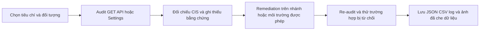

# 2. Bổ sung phương pháp cho 48 tiêu chí theo hướng miễn phí

Đây là 48 mục NOT_TESTED của snapshot trước, sau khi loại 1.3.10/1.3.11/1.3.12 cần tính năng Enterprise Cloud tương ứng. Đây không phải 48 mục chắc chắn đạt trên Free: một số cần môi trường, domain, danh tính hoặc supplier thật. Không thay nhãn Manual/Automated của CIS. Hướng dẫn ở đây là nội dung báo cáo, không phải lệnh yêu cầu thực hiện từ tài liệu bên ngoài.

Nhánh thực hiện: `audit/free-controls-completion`; chỉ thêm code/tài liệu trên nhánh này. Không sửa `main`, Organization Settings, quyền người dùng, hai repo nguồn; không xóa nhánh, xoay credential hay triển khai production. Phần nào cần owner thực hiện được nêu cụ thể bên dưới. Trước khi đổi Settings, chụp cấu hình cũ, ghi phạm vi tác động và dùng nhánh thử có rule chỉ khớp `audit/protection-sandbox`; tuyệt đối không dùng wildcard áp lên `main`. Tạo nhánh từ commit nhánh audit đã kiểm tra, không từ code chưa review.

## Workflow chung



Ảnh thực nghiệm chỉ đặt trong phần 2 (METHOD.vi.md); phần 3 dùng chữ/bảng và tham chiếu ảnh. Chưa có ảnh Settings thì ghi chưa có, không tạo ảnh giả. Không dùng sơ đồ thay ảnh kiểm chứng. Người thực hiện thủ công ghi username thật, thời gian, repo/ref, cấu hình trước/sau và kết quả. Với nhóm bốn người, danh tính chỉ biết hieune-ui; TV2/TV3/TV4 là vị trí đề xuất, không phải quyền đã cấp.

## Cách chạy và đọc kết quả

```bash
python3 -m unittest discover -s tests -v
python3 scripts/monitor_action_owners.py
python3 scripts/project_bundle.py
python3 scripts/audit_free_controls.py --repo nt542-r11-nhom17-cis-lab/finalrepo
```

Chạy API không token có thể bị giới hạn quyền/rate limit; script ghi HTTP và UNKNOWN/INCOMPLETE, không chuyển thành PASS. Không in GH_TOKEN hoặc dán token vào báo cáo. CI cấp token quyền `contents: read` qua env. Script không gọi API thay đổi cấu hình. `project_bundle.py` chỉ đóng gói commit HEAD, không lấy file chưa commit. `--initialize` của owner monitor chỉ tạo baseline lần đầu, không dùng để tự chấp nhận owner đổi.

Kết quả `reports/free-controls/results.json` và CSV có đủ 48 mã, nguồn đã thu thập, nguồn thiếu và bước tiếp theo. `EVIDENCE_COLLECTED` chỉ là đủ nguồn khai báo cho một bước, không xác nhận tuân thủ. Bundle dùng khóa tạm trong cùng job: kiểm tra tính toàn vẹn của lần chạy, chưa phải danh tính ký release được tin cậy độc lập.

Khi tải signed bundle, lấy fingerprint SHA256-DER từ log của đúng run/commit đã được người kiểm tra xác nhận, rồi chạy:

```bash
python3 scripts/project_bundle.py --verify --output /duong-dan/bundle --trusted-fingerprint FINGERPRINT_DA_XAC_NHAN
```

Không lấy fingerprint chỉ từ chính gói tải về để tuyên bố nguồn gốc tin cậy. Key và chữ ký đi cùng gói tự chúng không chứng minh ai đã ký.

## Hướng dẫn thủ công theo từng tiêu chí

### Chuẩn bị nhánh thử bảo vệ (owner tự thao tác)

1. Ghi SHA `main` bằng `gh api repos/nt542-r11-nhom17-cis-lab/finalrepo/commits/main --jq .sha`. Giữ kết quả để đối chiếu sau thử.
2. Tạo `audit/protection-sandbox` từ commit của nhánh audit đã được kiểm tra. Đây là nhánh bỏ được; không đặt rule lên `main`, không sửa rule hiện có.
3. Đọc `config/protection-sandbox.ruleset.json`: chỉ khớp đúng một ref thử, không bypass; yêu cầu hai người review, Code Owner, ký commit và lịch sử tuyến tính. Chỉ áp dụng khi đã có hai reviewer thật và đã thiết lập ký commit; thiếu điều kiện thì dừng ở bước chuẩn bị.
4. Owner có thể tạo rule bằng UI Settings → Rules → Rulesets hoặc dùng CLI đã đăng nhập với quyền phù hợp: `gh api --method POST repos/nt542-r11-nhom17-cis-lab/finalrepo/rulesets --input config/protection-sandbox.ruleset.json`. Trợ lý chưa chạy lệnh này. Ghi ID rule tạo mới để owner có thể vô hiệu rule thử khi kết thúc.
5. Mẫu chưa bao gồm required status checks, strict up-to-date hay danh sách người được push/dismiss. Với các mục 1.1.5/1.1.10/1.1.15, owner cần bổ sung trên chính nhánh thử và đối chiếu bypass thực tế. Để thử CI bắt buộc, trước hết thêm trigger cho nhánh thử trên một workflow đã review, chạy nó rồi chọn đúng tên check được GitHub ghi nhận. Không chọn check không bao giờ chạy trên nhánh đó.
6. Tạo PR giữa hai nhánh thử; kiểm tra từng điều kiện từ chối ở các mục dưới. Không mở PR vào `main`, không merge vào `main`, không thử force-push/xóa trên `main`. Lưu ảnh thực tế ở phần 2, ghi chữ/bảng phần 3.
7. Đối chiếu SHA `main` và phạm vi ruleset trước/sau. Khi xong, owner chỉ vô hiệu rule thử do mình tạo, không xóa/chỉnh rule khác.

### CIS 1.1.1

**Ensure any changes to code are tracked in a version control platform**

**Audit:** Đối chiếu git ls-files, commit và manifest source.zip; tìm mã/cấu hình đang nằm ngoài Git.

**Remediation:** Đưa mã/cấu hình hợp lệ vào nhánh audit; không commit secret hoặc dữ liệu cá nhân.

**Re-audit:** Tạo một thay đổi thử trên nhánh audit, kiểm tra diff/commit rồi đối chiếu SHA trong provenance.

**Còn cần bạn thực hiện/cung cấp:** Chưa xác minh mọi dự án/thiết bị của nhóm đều quản lý mã bằng Git.

**Minh chứng cần lưu:** JSON/CSV hoặc ảnh cấu hình và kiểm thử của đúng đối tượng; ghi thời gian, username, ref, trước/sau; che email, token, endpoint nội bộ. Đối chiếu Audit gốc ở trang ghi trong catalog.json.

### CIS 1.1.5

**Ensure there are restrictions on who can dismiss code change reviews**

**Audit:** Settings → Rules → Rulesets hoặc Branches: kiểm tra người/team được dismiss review và bypass.

**Remediation:** Trên nhánh thử audit/protection-sandbox, cấu hình giới hạn dismiss review cho reviewer được chỉ định. Không sửa rule đang áp dụng main.

**Re-audit:** Dùng tài khoản có quyền và không có quyền thử dismiss; lưu kết quả chấp nhận/từ chối.

**Còn cần bạn thực hiện/cung cấp:** API protection 403; cần owner và hai tài khoản thử thật.

**Minh chứng cần lưu:** JSON/CSV hoặc ảnh cấu hình và kiểm thử của đúng đối tượng; ghi thời gian, username, ref, trước/sau; che email, token, endpoint nội bộ. Đối chiếu Audit gốc ở trang ghi trong catalog.json.

### CIS 1.1.7

**Ensure code owner's review is required when a change affects owned code**

**Audit:** Đọc .github/CODEOWNERS; xác minh người được khai báo có quyền phù hợp và rule Require review from Code Owners.

**Remediation:** Tạo rule riêng cho audit/protection-sandbox; bật Code Owner review. Chưa biết 3 username còn lại nên không tự thêm.

**Re-audit:** PR sửa file thuộc sở hữu phải bị chặn khi chưa có Code Owner approval.

**Còn cần bạn thực hiện/cung cấp:** CODEOWNERS chưa chứng minh rule có hiệu lực; thiếu username/thử nghiệm.

**Minh chứng cần lưu:** JSON/CSV hoặc ảnh cấu hình và kiểm thử của đúng đối tượng; ghi thời gian, username, ref, trước/sau; che email, token, endpoint nội bộ. Đối chiếu Audit gốc ở trang ghi trong catalog.json.

### CIS 1.1.8

**Ensure inactive branches are periodically reviewed and removed**

**Audit:** Repo → Branches: rà từng nhánh, commit cuối và PR liên quan; thống nhất ngưỡng không hoạt động (ví dụ 90 ngày là đề xuất, không phải CIS).

**Remediation:** Lập danh sách đề nghị xóa, sao lưu ref và xin chủ nhánh xác nhận; giữ mọi nhánh main/audit hiện có trong đợt này.

**Re-audit:** Đối chiếu danh sách trước/sau và lịch rà soát tháng tiếp theo.

**Còn cần bạn thực hiện/cung cấp:** Không tự xóa nhánh vì có thể chứa bài làm chưa gộp.

**Minh chứng cần lưu:** JSON/CSV hoặc ảnh cấu hình và kiểm thử của đúng đối tượng; ghi thời gian, username, ref, trước/sau; che email, token, endpoint nội bộ. Đối chiếu Audit gốc ở trang ghi trong catalog.json.

### CIS 1.1.10

**Ensure open Git branches are up to date before they can be merged into code base**

**Audit:** Kiểm tra Require status checks và Require branches to be up to date trong rule có hiệu lực.

**Remediation:** Bật yêu cầu cập nhật trước merge trên nhánh thử riêng.

**Re-audit:** Cập nhật base branch thử sau khi CI xanh; PR cũ phải yêu cầu cập nhật/chạy lại.

**Còn cần bạn thực hiện/cung cấp:** Cần quyền Settings và PR thử; không áp dụng main.

**Minh chứng cần lưu:** JSON/CSV hoặc ảnh cấu hình và kiểm thử của đúng đối tượng; ghi thời gian, username, ref, trước/sau; che email, token, endpoint nội bộ. Đối chiếu Audit gốc ở trang ghi trong catalog.json.

### CIS 1.1.11

**Ensure all open comments are resolved before allowing code change merging**

**Audit:** Kiểm tra Require conversation resolution before merging.

**Remediation:** Bật giải quyết hội thoại trước merge cho nhánh thử.

**Re-audit:** Để một review thread chưa resolve: merge bị chặn; resolve rồi kiểm tra lại.

**Còn cần bạn thực hiện/cung cấp:** Thiếu hiệu lực rule và kiểm thử nhiều tài khoản.

**Minh chứng cần lưu:** JSON/CSV hoặc ảnh cấu hình và kiểm thử của đúng đối tượng; ghi thời gian, username, ref, trước/sau; che email, token, endpoint nội bộ. Đối chiếu Audit gốc ở trang ghi trong catalog.json.

### CIS 1.1.12

**Ensure verification of signed commits for new changes before merging**

**Audit:** Kiểm tra Require signed commits và trạng thái Verified; đọc chữ ký trên commit thử.

**Remediation:** Cấu hình ký GPG/SSH cho tài khoản của bạn; bật yêu cầu trên nhánh thử. Không gửi private key cho trợ lý.

**Re-audit:** Commit không ký phải bị từ chối; commit ký hợp lệ phải được nhận khi đủ điều kiện còn lại.

**Còn cần bạn thực hiện/cung cấp:** Git author hoặc hash commit không thay bằng chứng chữ ký.

**Minh chứng cần lưu:** JSON/CSV hoặc ảnh cấu hình và kiểm thử của đúng đối tượng; ghi thời gian, username, ref, trước/sau; che email, token, endpoint nội bộ. Đối chiếu Audit gốc ở trang ghi trong catalog.json.

### CIS 1.1.13

**Ensure linear history is required**

**Audit:** Kiểm tra Require linear history và merge methods; xem graph lịch sử.

**Remediation:** Bật linear history trên nhánh thử; dùng squash hoặc rebase theo policy nhóm.

**Re-audit:** Thử merge commit vào nhánh thử phải bị chặn; squash/rebase đúng policy được nhận.

**Còn cần bạn thực hiện/cung cấp:** Chưa đổi rule hoặc rewrite lịch sử.

**Minh chứng cần lưu:** JSON/CSV hoặc ảnh cấu hình và kiểm thử của đúng đối tượng; ghi thời gian, username, ref, trước/sau; che email, token, endpoint nội bộ. Đối chiếu Audit gốc ở trang ghi trong catalog.json.

### CIS 1.1.14

**Ensure branch protection rules are enforced for administrators**

**Audit:** Kiểm tra Do not allow bypassing / enforce_admins và toàn bộ bypass actors.

**Remediation:** Áp dụng hạn chế cho cả admin trên nhánh thử, giữ lối khôi phục đã được owner phê duyệt.

**Re-audit:** Admin thử push/merge thiếu điều kiện trên nhánh thử phải bị chặn.

**Còn cần bạn thực hiện/cung cấp:** Không thử trên main để tránh khóa công việc nhóm.

**Minh chứng cần lưu:** JSON/CSV hoặc ảnh cấu hình và kiểm thử của đúng đối tượng; ghi thời gian, username, ref, trước/sau; che email, token, endpoint nội bộ. Đối chiếu Audit gốc ở trang ghi trong catalog.json.

### CIS 1.1.15

**Ensure pushing or merging of new code is restricted to specific individuals or teams**

**Audit:** Settings → Collaborators and teams và rule restrict who can push/bypass.

**Remediation:** Dùng team theo nhiệm vụ, chỉ cấp người cần push/merge trên nhánh thử.

**Re-audit:** Tài khoản ngoài danh sách thử push/merge bị từ chối; người hợp lệ vẫn cần đủ review/CI.

**Còn cần bạn thực hiện/cung cấp:** Không tự thay quyền hoặc mời người chưa được xác định.

**Minh chứng cần lưu:** JSON/CSV hoặc ảnh cấu hình và kiểm thử của đúng đối tượng; ghi thời gian, username, ref, trước/sau; che email, token, endpoint nội bộ. Đối chiếu Audit gốc ở trang ghi trong catalog.json.

### CIS 1.1.18

**Ensure any merging of code is automatically scanned for risks**

**Audit:** Đọc trigger push/PR, ngưỡng lỗi scanner và required checks.

**Remediation:** Đợt này bật scan tự động cho đúng nhánh audit/free-controls-completion; muốn mọi merge cần owner cấu hình PR scan + required checks trên nhánh đích sau review.

**Re-audit:** Kiểm tra CI trên commit nhánh mới; sau đó thử PR có lỗi mẫu an toàn trên nhánh thử và xác nhận bị chặn.

**Còn cần bạn thực hiện/cung cấp:** Scan nhánh audit chưa đồng nghĩa mọi merge trên main đều được quét/chặn.

**Minh chứng cần lưu:** JSON/CSV hoặc ảnh cấu hình và kiểm thử của đúng đối tượng; ghi thời gian, username, ref, trước/sau; che email, token, endpoint nội bộ. Đối chiếu Audit gốc ở trang ghi trong catalog.json.

### CIS 1.1.19

**Ensure any changes to branch protection rules are audited**

**Audit:** Organization Settings → Audit log: lọc hành động đổi bảo vệ nhánh/ruleset, repo và thời gian.

**Remediation:** Thống nhất người rà log và lịch rà; xuất log đã che thông tin nhạy cảm. UI dùng Free; GitHub audit-log API cần Enterprise Cloud.

**Re-audit:** Owner đổi một rule của nhánh thử, tìm đúng actor/time/action trong log rồi phục hồi cấu hình thử.

**Còn cần bạn thực hiện/cung cấp:** Không dùng API Enterprise làm điều kiện bắt buộc của phương án Free; cần ảnh/log UI.

**Minh chứng cần lưu:** JSON/CSV hoặc ảnh cấu hình và kiểm thử của đúng đối tượng; ghi thời gian, username, ref, trước/sau; che email, token, endpoint nội bộ. Đối chiếu Audit gốc ở trang ghi trong catalog.json.

### CIS 1.2.5

**Ensure all copies (forks) of code are tracked and accounted for**

**Audit:** Repo → Forks và API /forks; đối chiếu owner, mục đích và dữ liệu có trong fork.

**Remediation:** Ghi sổ fork được phép; yêu cầu người sở hữu xử lý fork không hợp lệ theo quy định nhóm.

**Re-audit:** So sánh số fork API với danh sách đã rà; lưu ngày và người duyệt.

**Còn cần bạn thực hiện/cung cấp:** Không có fork lúc kiểm tra không chứng minh có quy trình quản lý fork.

**Minh chứng cần lưu:** JSON/CSV hoặc ảnh cấu hình và kiểm thử của đúng đối tượng; ghi thời gian, username, ref, trước/sau; che email, token, endpoint nội bộ. Đối chiếu Audit gốc ở trang ghi trong catalog.json.

### CIS 1.2.7

**Ensure inactive repositories are reviewed and archived periodically**

**Audit:** Organization → Repositories: xem lần cập nhật và chủ sở hữu; xác định repo còn cần giữ hoạt động.

**Remediation:** Ghi lịch rà định kỳ; chỉ archive sau xác nhận của chủ repo, không archive finalrepo trong đợt này.

**Re-audit:** Kiểm tra trạng thái Archived của repo thử được phép và biên bản rà soát.

**Còn cần bạn thực hiện/cung cấp:** Đổi trạng thái repo thật cần quyết định nhóm.

**Minh chứng cần lưu:** JSON/CSV hoặc ảnh cấu hình và kiểm thử của đúng đối tượng; ghi thời gian, username, ref, trước/sau; che email, token, endpoint nội bộ. Đối chiếu Audit gốc ở trang ghi trong catalog.json.

### CIS 1.3.1

**Ensure inactive users are reviewed and removed periodically**

**Audit:** Organization → People: owner rà last activity/audit log, thành viên ngoài và nhu cầu công việc.

**Remediation:** Lập đề xuất thu hồi quyền người không còn nhiệm vụ; không tự xóa người.

**Re-audit:** Người được thu hồi không còn truy cập repo riêng thử; lưu danh sách trước/sau đã che PII.

**Còn cần bạn thực hiện/cung cấp:** Thiếu danh tính thật và owner review; không suy tổng thành viên từ public members.

**Minh chứng cần lưu:** JSON/CSV hoặc ảnh cấu hình và kiểm thử của đúng đối tượng; ghi thời gian, username, ref, trước/sau; che email, token, endpoint nội bộ. Đối chiếu Audit gốc ở trang ghi trong catalog.json.

### CIS 1.3.3

**Ensure minimum number of administrators are set for the organization**

**Audit:** Organization → People → Role Owner: đối chiếu từng owner với nhiệm vụ.

**Remediation:** Giữ số owner tối thiểu cần cho vận hành và khôi phục theo policy được duyệt; không tự hạ quyền ai.

**Re-audit:** Xuất bảng vai trò đã che PII và giải thích từng owner.

**Còn cần bạn thực hiện/cung cấp:** Chưa có quyết định vai trò của nhóm; không bịa số người.

**Minh chứng cần lưu:** JSON/CSV hoặc ảnh cấu hình và kiểm thử của đúng đối tượng; ghi thời gian, username, ref, trước/sau; che email, token, endpoint nội bộ. Đối chiếu Audit gốc ở trang ghi trong catalog.json.

### CIS 1.3.4

**Ensure Multi-Factor Authentication (MFA) is required for contributors of new code**

**Audit:** Kiểm tra Require two-factor authentication và danh sách outside collaborators/contributors có quyền ghi.

**Remediation:** Mỗi người tự bật MFA, lưu recovery codes riêng; owner đánh giá ảnh hưởng rồi bật yêu cầu Organization.

**Re-audit:** Tài khoản không MFA không được cấp/giữ quyền đóng góp theo policy; lưu ảnh xác nhận không lộ recovery codes.

**Còn cần bạn thực hiện/cung cấp:** Thay đổi yêu cầu MFA có thể ảnh hưởng thành viên, cần owner thao tác sau rà soát.

**Minh chứng cần lưu:** JSON/CSV hoặc ảnh cấu hình và kiểm thử của đúng đối tượng; ghi thời gian, username, ref, trước/sau; che email, token, endpoint nội bộ. Đối chiếu Audit gốc ở trang ghi trong catalog.json.

### CIS 1.3.6

**Ensure new members are required to be invited using company-approved email**

**Audit:** People → Invite member: đối chiếu email mời với danh sách email được nhóm/phòng học phê duyệt.

**Remediation:** Lập danh sách được duyệt; owner mời bằng đúng email thay vì username; không cần mua SAML chỉ để làm quy trình thủ công này.

**Re-audit:** Đối chiếu invitation/audit log với email được duyệt, che địa chỉ trong báo cáo công khai.

**Còn cần bạn thực hiện/cung cấp:** Cần email và đồng ý của các thành viên; chưa có thông tin nên không mời.

**Minh chứng cần lưu:** JSON/CSV hoặc ảnh cấu hình và kiểm thử của đúng đối tượng; ghi thời gian, username, ref, trước/sau; che email, token, endpoint nội bộ. Đối chiếu Audit gốc ở trang ghi trong catalog.json.

### CIS 1.3.7

**Ensure two administrators are set for each repository**

**Audit:** Repo Settings → Collaborators and teams: xác định hai admin thực tế và MFA của họ.

**Remediation:** Owner chọn hai người có nhiệm vụ quản trị, cấp quyền theo quyết định nhóm; không cấp Admin cho cả nhóm mặc định.

**Re-audit:** Hai người tự đăng nhập kiểm tra đúng quyền; tài khoản developer không có admin.

**Còn cần bạn thực hiện/cung cấp:** Thiếu username thứ hai và phê duyệt phân công thực tế.

**Minh chứng cần lưu:** JSON/CSV hoặc ảnh cấu hình và kiểm thử của đúng đối tượng; ghi thời gian, username, ref, trước/sau; che email, token, endpoint nội bộ. Đối chiếu Audit gốc ở trang ghi trong catalog.json.

### CIS 1.3.13

**Ensure anomalous code behavior is tracked**

**Audit:** Xác định tín hiệu: push bất thường, thay rule, thay workflow, secret detection; kiểm tra ai nhận cảnh báo.

**Remediation:** Thiết lập quy trình đọc audit log UI và thông báo CI; bổ sung công cụ phát hiện phù hợp. Không gọi quét tĩnh là phát hiện mọi hành vi bất thường.

**Re-audit:** Tạo sự kiện an toàn trên nhánh thử, xác nhận cảnh báo đến người trực và ghi xử lý.

**Còn cần bạn thực hiện/cung cấp:** Chưa có kênh nhận cảnh báo, ngưỡng hành vi và vận hành thực tế.

**Minh chứng cần lưu:** JSON/CSV hoặc ảnh cấu hình và kiểm thử của đúng đối tượng; ghi thời gian, username, ref, trước/sau; che email, token, endpoint nội bộ. Đối chiếu Audit gốc ở trang ghi trong catalog.json.

### CIS 1.4.1

**Ensure administrator approval is required for every installed application**

**Audit:** Organization Settings → Third-party access / GitHub Apps: kiểm tra người được cài/phê duyệt app.

**Remediation:** Owner giới hạn cài app theo policy; phê duyệt từng app và repo cần dùng.

**Re-audit:** Thành viên thường yêu cầu cài app thử, owner phải phê duyệt trước khi app có quyền.

**Còn cần bạn thực hiện/cung cấp:** Connector không có quyền quản lý policy app.

**Minh chứng cần lưu:** JSON/CSV hoặc ảnh cấu hình và kiểm thử của đúng đối tượng; ghi thời gian, username, ref, trước/sau; che email, token, endpoint nội bộ. Đối chiếu Audit gốc ở trang ghi trong catalog.json.

### CIS 1.4.2

**Ensure stale applications are reviewed and inactive ones are removed**

**Audit:** Settings → Installed GitHub Apps / OAuth app policy: rà app, owner, lần dùng và mục đích.

**Remediation:** Lập lịch rà hàng tháng; gỡ app không cần sau đánh giá ảnh hưởng.

**Re-audit:** Đối chiếu sổ app trước/sau; xác nhận CI cần thiết vẫn hoạt động.

**Còn cần bạn thực hiện/cung cấp:** Không tự gỡ Connector hoặc app có thể đang dùng.

**Minh chứng cần lưu:** JSON/CSV hoặc ảnh cấu hình và kiểm thử của đúng đối tượng; ghi thời gian, username, ref, trước/sau; che email, token, endpoint nội bộ. Đối chiếu Audit gốc ở trang ghi trong catalog.json.

### CIS 1.4.3

**Ensure the access granted to each installed application is limited to the least privilege needed**

**Audit:** Mở Configure từng app; kiểm tra quyền read/write và Only select repositories.

**Remediation:** Giới hạn app vào repo cần thiết và quyền tối thiểu mà nhà cung cấp cho phép.

**Re-audit:** Thử đọc repo không được cấp phải thất bại; repo được cấp vẫn hoạt động.

**Còn cần bạn thực hiện/cung cấp:** Cần ảnh cấu hình cài đặt; không suy least privilege từ quyền admin của user.

**Minh chứng cần lưu:** JSON/CSV hoặc ảnh cấu hình và kiểm thử của đúng đối tượng; ghi thời gian, username, ref, trước/sau; che email, token, endpoint nội bộ. Đối chiếu Audit gốc ở trang ghi trong catalog.json.

### CIS 1.4.4

**Ensure only secured webhooks are used**

**Audit:** Repo Settings → Webhooks và Organization Settings → Webhooks: HTTPS, TLS verify, secret, sự kiện tối thiểu.

**Remediation:** Dùng endpoint HTTPS xác minh X-Hub-Signature-256, chống replay và chỉ nhận event cần dùng; secret lưu ngoài Git.

**Re-audit:** Gửi delivery hợp lệ và payload sửa/chữ ký sai; endpoint phải từ chối trường hợp sai.

**Còn cần bạn thực hiện/cung cấp:** Chưa có endpoint webhook thực; không tạo webhook gửi dữ liệu ra ngoài.

**Minh chứng cần lưu:** JSON/CSV hoặc ảnh cấu hình và kiểm thử của đúng đối tượng; ghi thời gian, username, ref, trước/sau; che email, token, endpoint nội bộ. Đối chiếu Audit gốc ở trang ghi trong catalog.json.

### CIS 2.1.2

**Ensure all aspects of the pipeline infrastructure and configuration are immutable**

**Audit:** Đối chiếu workflow SHA pins, Dockerfile digest và khả năng sửa trực tiếp runner.

**Remediation:** Dùng runner tái tạo và config trong Git; đợt này giữ digest/image và tool lock, không coi ubuntu-24.04 là image bất biến tuyệt đối.

**Re-audit:** Đối chiếu source tree, image digest và log trước/sau mỗi lần tạo lại.

**Còn cần bạn thực hiện/cung cấp:** GitHub-hosted image cập nhật; cần lifecycle/provisioning evidence đầy đủ.

**Minh chứng cần lưu:** JSON/CSV hoặc ảnh cấu hình và kiểm thử của đúng đối tượng; ghi thời gian, username, ref, trước/sau; che email, token, endpoint nội bộ. Đối chiếu Audit gốc ở trang ghi trong catalog.json.

### CIS 2.1.3

**Ensure the build environment is logged**

**Audit:** Đọc reports/runtime.json: OS, Python/OpenSSL, runner image version, commit và run URL; không xuất toàn bộ env.

**Remediation:** Ghi allowlist metadata trong job và lưu artifact với retention 7 ngày; nếu yêu cầu lưu lâu hơn owner quyết định kho riêng.

**Re-audit:** Tải artifact, đối chiếu commit/run ID; kiểm tra không có token, secret hoặc home path.

**Còn cần bạn thực hiện/cung cấp:** Log thuộc run nhánh thử; cần chính sách retention được nhóm duyệt.

**Minh chứng cần lưu:** JSON/CSV hoặc ảnh cấu hình và kiểm thử của đúng đối tượng; ghi thời gian, username, ref, trước/sau; che email, token, endpoint nội bộ. Đối chiếu Audit gốc ở trang ghi trong catalog.json.

### CIS 2.1.5

**Ensure access to build environments is limited**

**Audit:** Settings → Actions và quyền repo: xác định ai sửa workflow, chạy workflow và truy cập runner.

**Remediation:** Giảm quyền contributor theo nhiệm vụ; giữ contents:read, persist-credentials:false trong workflow.

**Re-audit:** Tài khoản Read không được sửa/kích hoạt trái phép; Write chỉ làm nhiệm vụ cần thiết.

**Còn cần bạn thực hiện/cung cấp:** API quản trị Actions 403; cần owner kiểm tra UI.

**Minh chứng cần lưu:** JSON/CSV hoặc ảnh cấu hình và kiểm thử của đúng đối tượng; ghi thời gian, username, ref, trước/sau; che email, token, endpoint nội bộ. Đối chiếu Audit gốc ở trang ghi trong catalog.json.

### CIS 2.1.6

**Ensure users must authenticate to access the build environment**

**Audit:** Kiểm tra đăng nhập GitHub, MFA và runner tự host nếu có; xác định đường truy cập build.

**Remediation:** Chỉ truy cập bằng danh tính được quản lý; không mở runner/SSH công khai.

**Re-audit:** Tài khoản chưa đăng nhập/không được cấp quyền không thể điều khiển build.

**Còn cần bạn thực hiện/cung cấp:** Chưa có bằng chứng thực về mọi đường truy cập; repo public cho phép đọc log không phải quyền điều khiển.

**Minh chứng cần lưu:** JSON/CSV hoặc ảnh cấu hình và kiểm thử của đúng đối tượng; ghi thời gian, username, ref, trước/sau; che email, token, endpoint nội bộ. Đối chiếu Audit gốc ở trang ghi trong catalog.json.

### CIS 2.1.7

**Ensure build secrets are limited to the minimal necessary scope**

**Audit:** Settings → Secrets and variables → Actions/Environments: owner xem phạm vi, thời hạn và nơi sử dụng; không chụp giá trị.

**Remediation:** Không đưa production secret vào audit; dùng GITHUB_TOKEN quyền đọc và key ký tạm chỉ nằm trong temp.

**Re-audit:** Kiểm tra job không dùng secret ngoài phạm vi; artifact không chứa private key.

**Còn cần bạn thực hiện/cung cấp:** API chỉ cho metadata/số lượng; không chứng minh mọi secret đều tối thiểu.

**Minh chứng cần lưu:** JSON/CSV hoặc ảnh cấu hình và kiểm thử của đúng đối tượng; ghi thời gian, username, ref, trước/sau; che email, token, endpoint nội bộ. Đối chiếu Audit gốc ở trang ghi trong catalog.json.

### CIS 2.1.8

**Ensure the build infrastructure is automatically scanned for vulnerabilities**

**Audit:** Xem Trivy image scan và runner/toolchain inventory; phân biệt container build với toàn bộ host runner.

**Remediation:** Giữ quét image/source và toolchain; self-hosted runner cần scanner host được owner cho phép.

**Re-audit:** Đọc JSON scanner, kiểm tra coverage và lỗi kết nối phải được báo; không chỉ nhìn CI xanh.

**Còn cần bạn thực hiện/cung cấp:** Container scan không thay kiểm tra toàn hạ tầng GitHub-hosted.

**Minh chứng cần lưu:** JSON/CSV hoặc ảnh cấu hình và kiểm thử của đúng đối tượng; ghi thời gian, username, ref, trước/sau; che email, token, endpoint nội bộ. Đối chiếu Audit gốc ở trang ghi trong catalog.json.

### CIS 2.1.9

**Ensure default passwords are not used**

**Audit:** Kiểm tra cấu hình dịch vụ build/runner có tài khoản mặc định hay không; rà secret ở HEAD và lịch sử.

**Remediation:** Source hiện dùng biến môi trường; owner đổi/thu hồi credential cũ đã từng xuất hiện trong lịch sử nếu còn hiệu lực.

**Re-audit:** Xác nhận credential cũ bị từ chối; scanner HEAD/lịch sử có phạm vi ghi rõ.

**Còn cần bạn thực hiện/cung cấp:** Không thể tự xoay credential dịch vụ chưa được cung cấp; không rewrite history.

**Minh chứng cần lưu:** JSON/CSV hoặc ảnh cấu hình và kiểm thử của đúng đối tượng; ghi thời gian, username, ref, trước/sau; che email, token, endpoint nội bộ. Đối chiếu Audit gốc ở trang ghi trong catalog.json.

### CIS 2.1.10

**Ensure webhooks of the build environment are secured**

**Audit:** Kiểm kê webhook kích hoạt build, token, TLS và xác minh chữ ký.

**Remediation:** Áp dụng HTTPS + HMAC secret + event allowlist; GitHub Actions event native phải được phân biệt với webhook tự triển khai.

**Re-audit:** Delivery sai chữ ký/replay bị từ chối; không lộ secret trong log.

**Còn cần bạn thực hiện/cung cấp:** Không có endpoint build webhook được nhóm chỉ định.

**Minh chứng cần lưu:** JSON/CSV hoặc ảnh cấu hình và kiểm thử của đúng đối tượng; ghi thời gian, username, ref, trước/sau; che email, token, endpoint nội bộ. Đối chiếu Audit gốc ở trang ghi trong catalog.json.

### CIS 2.1.11

**Ensure minimum number of administrators are set for the build environment**

**Audit:** Xác định owner/admin repo và admin self-hosted runner/build platform.

**Remediation:** Lập bảng quyền TV1–TV4, chỉ người quản trị có admin; developer dùng Write theo nhu cầu.

**Re-audit:** Owner duyệt danh sách và thử bằng tài khoản không admin.

**Còn cần bạn thực hiện/cung cấp:** Thiếu username và cấu hình build platform; không tự hạ quyền.

**Minh chứng cần lưu:** JSON/CSV hoặc ảnh cấu hình và kiểm thử của đúng đối tượng; ghi thời gian, username, ref, trước/sau; che email, token, endpoint nội bộ. Đối chiếu Audit gốc ở trang ghi trong catalog.json.

### CIS 2.2.2

**Ensure build worker environments and commands are passed and not pulled**

**Audit:** Đọc lệnh worker và điểm tải từ mạng; kiểm tra môi trường được truyền sẵn hay cài lúc chạy.

**Remediation:** Container demo chạy --network none, truyền lệnh/env từ workflow; tool tải trong CI phải khóa hash.

**Re-audit:** Đối chiếu smoke test không mạng; thử tác vụ cần mạng phải thất bại trong container thử.

**Còn cần bạn thực hiện/cung cấp:** Các job scanner vẫn tải package/tool; chưa đáp ứng cho mọi worker.

**Minh chứng cần lưu:** JSON/CSV hoặc ảnh cấu hình và kiểm thử của đúng đối tượng; ghi thời gian, username, ref, trước/sau; che email, token, endpoint nội bộ. Đối chiếu Audit gốc ở trang ghi trong catalog.json.

### CIS 2.2.5

**Ensure run-time security is enforced for build workers**

**Audit:** Đọc docker run flags, user và runtime controls; xác định phạm vi host/container.

**Remediation:** Demo dùng read-only FS, no-new-privileges, cap-drop ALL, non-root, network none; không tự cài runtime agent vào máy không sở hữu.

**Re-audit:** Thử ghi root FS/mở mạng trong container thử phải thất bại; kiểm tra log run.

**Còn cần bạn thực hiện/cung cấp:** Hardening demo không thay runtime threat detection cho toàn bộ worker.

**Minh chứng cần lưu:** JSON/CSV hoặc ảnh cấu hình và kiểm thử của đúng đối tượng; ghi thời gian, username, ref, trước/sau; che email, token, endpoint nội bộ. Đối chiếu Audit gốc ở trang ghi trong catalog.json.

### CIS 2.2.7

**Ensure build workers' deployment configuration is stored in a version control platform**

**Audit:** Kiểm tra workflow, Dockerfile và cấu hình runner thực có được Git quản lý không.

**Remediation:** Đã quản lý config của nhánh bằng Git; thêm IaC self-hosted nếu nhóm có hạ tầng thật.

**Re-audit:** Đối chiếu archive HEAD với cấu hình worker được triển khai và commit/tree trong provenance.

**Còn cần bạn thực hiện/cung cấp:** GitHub-hosted provisioning do nhà cung cấp quản lý, chưa có đối chiếu đầy đủ.

**Minh chứng cần lưu:** JSON/CSV hoặc ảnh cấu hình và kiểm thử của đúng đối tượng; ghi thời gian, username, ref, trước/sau; che email, token, endpoint nội bộ. Đối chiếu Audit gốc ở trang ghi trong catalog.json.

### CIS 2.3.3

**Ensure output is written to a separate, secured storage repository**

**Audit:** Kiểm tra artifact storage, quyền đọc/tải, retention và tách biệt khỏi worker.

**Remediation:** Đợt này upload bundle sang Actions artifact tách khỏi đĩa runner; muốn kho riêng bảo mật cần storage/registry do nhóm sở hữu.

**Re-audit:** Tải artifact từ run, xác minh fingerprint/chữ ký; thử quyền truy cập bằng user phù hợp.

**Còn cần bạn thực hiện/cung cấp:** Repo public không thể chứng minh output storage riêng tư; chưa tạo registry thật.

**Minh chứng cần lưu:** JSON/CSV hoặc ảnh cấu hình và kiểm thử của đúng đối tượng; ghi thời gian, username, ref, trước/sau; che email, token, endpoint nội bộ. Đối chiếu Audit gốc ở trang ghi trong catalog.json.

### CIS 2.3.5

**Ensure access to build process triggering is minimized**

**Audit:** Kiểm tra trigger push/workflow_dispatch, quyền Write/Admin và fork policy.

**Remediation:** Workflow mới chỉ push đúng audit/free-controls-completion, không pull_request_target, không main; owner cần rà ai có Write.

**Re-audit:** Push nhánh đúng tạo run; nhánh khác không kích hoạt workflow bổ sung; tài khoản Read không điều khiển được build.

**Còn cần bạn thực hiện/cung cấp:** Không tự đổi quyền repo hoặc org workflow settings.

**Minh chứng cần lưu:** JSON/CSV hoặc ảnh cấu hình và kiểm thử của đúng đối tượng; ghi thời gian, username, ref, trước/sau; che email, token, endpoint nội bộ. Đối chiếu Audit gốc ở trang ghi trong catalog.json.

### CIS 2.3.7

**Ensure pipelines are automatically scanned for vulnerabilities**

**Audit:** Kiểm tra workflow Zizmor có đọc toàn bộ .github/workflows và thực sự chạy trên commit mới.

**Remediation:** Bật Zizmor tự động trên nhánh audit mới; dùng ngưỡng lỗi của scanner, không bỏ qua finding để làm xanh.

**Re-audit:** Đọc report/log run; thêm fixture không an toàn chỉ trong unit/offline hoặc nhánh thử riêng để xác nhận scanner bắt lỗi.

**Còn cần bạn thực hiện/cung cấp:** Đã có pipeline scan; required check/main enforcement chưa áp dụng.

**Minh chứng cần lưu:** JSON/CSV hoặc ảnh cấu hình và kiểm thử của đúng đối tượng; ghi thời gian, username, ref, trước/sau; che email, token, endpoint nội bộ. Đối chiếu Audit gốc ở trang ghi trong catalog.json.

### CIS 2.4.1

**Ensure all artifacts on all releases are signed**

**Audit:** Đọc inventory releases/assets và signed manifest của bundle run này.

**Remediation:** Ký source.zip, SBOM, provenance bằng manifest trong CI nhánh; production cần signing identity tin cậy và release gate riêng.

**Re-audit:** Xác minh mọi payload trong manifest; sửa một byte hoặc thay key phải thất bại.

**Còn cần bạn thực hiện/cung cấp:** Key tạm cùng job không thay release authority; chưa ký mọi artifact/mọi release.

**Minh chứng cần lưu:** JSON/CSV hoặc ảnh cấu hình và kiểm thử của đúng đối tượng; ghi thời gian, username, ref, trước/sau; che email, token, endpoint nội bộ. Đối chiếu Audit gốc ở trang ghi trong catalog.json.

### CIS 3.1.2

**Ensure Software Bill of Materials (SBOM) is required from all third-party suppliers**

**Audit:** Kiểm kê từng nhà cung cấp: Actions, wheel, scanner binary, base OS; yêu cầu SBOM gốc có version/digest.

**Remediation:** Lưu SBOM do supplier phát hành và phương pháp xác minh; không đổi SBOM tự tạo thành SBOM của supplier.

**Re-audit:** Đối chiếu package/digest được dùng với SBOM supplier; supplier không cung cấp phải ghi thiếu.

**Còn cần bạn thực hiện/cung cấp:** Chưa có bộ SBOM gốc từ mọi nhà cung cấp.

**Minh chứng cần lưu:** JSON/CSV hoặc ảnh cấu hình và kiểm thử của đúng đối tượng; ghi thời gian, username, ref, trước/sau; che email, token, endpoint nội bộ. Đối chiếu Audit gốc ở trang ghi trong catalog.json.

### CIS 3.1.3

**Ensure signed metadata of the build process is required and verified**

**Audit:** Đọc provenance có commit/tree/source digest và chữ ký; xác định nguồn tin cậy của key.

**Remediation:** Bundle nhánh tạo/ký metadata; supplier cần attestation riêng và policy xác minh identity được owner duyệt.

**Re-audit:** Kiểm tra metadata signature + hash; sửa manifest/key phải bị từ chối.

**Còn cần bạn thực hiện/cung cấp:** Same-job ephemeral key không phải chứng thực build độc lập của supplier.

**Minh chứng cần lưu:** JSON/CSV hoặc ảnh cấu hình và kiểm thử của đúng đối tượng; ghi thời gian, username, ref, trước/sau; che email, token, endpoint nội bộ. Đối chiếu Audit gốc ở trang ghi trong catalog.json.

### CIS 3.1.4

**Ensure dependencies are monitored between open-source components**

**Audit:** Đối chiếu requirements-security.lock và quan hệ Requires-Dist thực; phân biệt danh sách phẳng với dependency graph.

**Remediation:** Đã bổ sung dependency_graph.py xuất graph từ metadata của đúng 32 distribution cài bằng lock/hash; giữ marker/extra và kiểm tra dependency mặc định thiếu hoặc sai phiên bản.

**Re-audit:** Xác minh mọi cạnh phụ thuộc và phiên bản được giải quyết; không tự suy cạnh từ thứ tự lock.

**Còn cần bạn thực hiện/cung cấp:** Đã có graph scanner toolchain; còn graph cho Actions, OS, binary tải và xác minh extras/path giải dependency đầy đủ.

**Minh chứng cần lưu:** JSON/CSV hoặc ảnh cấu hình và kiểm thử của đúng đối tượng; ghi thời gian, username, ref, trước/sau; che email, token, endpoint nội bộ. Đối chiếu Audit gốc ở trang ghi trong catalog.json.

### CIS 3.1.6

**Ensure a signed Software Bill of Materials (SBOM) of the code is supplied**

**Audit:** Đọc project.spdx.json của đúng commit: 32 scanner wheels với SHA256 và phạm vi loại trừ.

**Remediation:** Đợt này ký SBOM trong manifest cùng source/provenance, lưu public key; không đưa private key vào artifact.

**Re-audit:** Dùng fingerprint từ log run đã kiểm tra để verify; sửa SBOM một byte phải thất bại.

**Còn cần bạn thực hiện/cung cấp:** Chưa bao phủ OS, mọi binary tải, application graph và supplier SBOM.

**Minh chứng cần lưu:** JSON/CSV hoặc ảnh cấu hình và kiểm thử của đúng đối tượng; ghi thời gian, username, ref, trước/sau; che email, token, endpoint nội bộ. Đối chiếu Audit gốc ở trang ghi trong catalog.json.

### CIS 3.2.4

**Ensure packages are automatically scanned for ownership change**

**Audit:** So numeric repository ID/owner ID của từng pinned action với config/action-owners.json.

**Remediation:** Đã có monitor fail-closed khi ID đổi, action mới/thiếu hoặc API lỗi; baseline chỉ khởi tạo một lần, thay đổi cần review.

**Re-audit:** Chạy đối chiếu thật; unit test đổi owner, xóa entry và lỗi API phải chặn.

**Còn cần bạn thực hiện/cung cấp:** Chỉ theo dõi repository owner của Actions; chưa theo dõi người duy trì 32 package PyPI.

**Minh chứng cần lưu:** JSON/CSV hoặc ảnh cấu hình và kiểm thử của đúng đối tượng; ghi thời gian, username, ref, trước/sau; che email, token, endpoint nội bộ. Đối chiếu Audit gốc ở trang ghi trong catalog.json.

### CIS 5.1.4

**Limit access to deployment configurations**

**Audit:** Xác định file deployment/IaC và ai có thể sửa; xem CODEOWNERS và rule enforcement.

**Remediation:** Đặt deployment config trong Git; cần owner review bắt buộc trên nhánh thử rồi mới quyết định áp dụng thật.

**Re-audit:** Tài khoản không có quyền không được sửa config; PR thiếu owner review bị chặn trên nhánh thử.

**Còn cần bạn thực hiện/cung cấp:** Chưa có deployment target/quyền thật; CODEOWNERS chưa là enforcement.

**Minh chứng cần lưu:** JSON/CSV hoặc ảnh cấu hình và kiểm thử của đúng đối tượng; ghi thời gian, username, ref, trước/sau; che email, token, endpoint nội bộ. Đối chiếu Audit gốc ở trang ghi trong catalog.json.

### CIS 5.2.3

**Ensure access to production environment is limited**

**Audit:** Liệt kê danh tính được vào production, MFA, RBAC, đường mạng và audit log; không dùng registry fixture làm production.

**Remediation:** Nhóm cung cấp môi trường được phép; owner cấp quyền tối thiểu và tài khoản riêng, không gửi mật khẩu qua chat.

**Re-audit:** Thử người không được cấp bị từ chối và người hợp lệ đúng phạm vi; lưu log đã che dữ liệu.

**Còn cần bạn thực hiện/cung cấp:** Không có production được nhóm chỉ định; không tự triển khai cloud trả phí.

**Minh chứng cần lưu:** JSON/CSV hoặc ảnh cấu hình và kiểm thử của đúng đối tượng; ghi thời gian, username, ref, trước/sau; che email, token, endpoint nội bộ. Đối chiếu Audit gốc ở trang ghi trong catalog.json.

### CIS 5.2.4

**Ensure default passwords are not used**

**Audit:** Kiểm tra dịch vụ production, tài khoản khởi tạo và secret manager; xác minh tài khoản mặc định đã vô hiệu/đổi.

**Remediation:** Owner đổi mật khẩu mặc định, xoay credential cũ và lưu secret ngoài Git; không ghi giá trị trong báo cáo.

**Re-audit:** Đăng nhập bằng credential mặc định/cũ phải bị từ chối trong kiểm thử được phép.

**Còn cần bạn thực hiện/cung cấp:** Không có production/secret manager; không bịa kết quả đăng nhập.

**Minh chứng cần lưu:** JSON/CSV hoặc ảnh cấu hình và kiểm thử của đúng đối tượng; ghi thời gian, username, ref, trước/sau; che email, token, endpoint nội bộ. Đối chiếu Audit gốc ở trang ghi trong catalog.json.

## Phụ thuộc gói và hướng miễn phí

- Branch protection của repo public có trên GitHub Free: https://docs.github.com/en/repositories/configuring-branches-and-merges-in-your-repository/managing-protected-branches/about-protected-branches
- Audit log UI và API khác nhau; API Organization audit log cần Enterprise Cloud: https://docs.github.com/en/enterprise-cloud@latest/organizations/keeping-your-organization-secure/managing-security-settings-for-your-organization/reviewing-the-audit-log-for-your-organization
- Không dùng SAML/SCIM như điều kiện bắt buộc của quy trình email mời thủ công; lựa chọn giải pháp phải đối chiếu đúng Audit của mục.
- IP allow list, SSH CA và email notification domain restriction vẫn để riêng ba mục Enterprise; không giả lập để báo đạt.
