# 2. Phương pháp Audit – Remediation – Re-audit

Phương pháp duy nhất được chọn để đào sâu là đánh giá cấu hình theo hướng dẫn Audit của CIS, thực hiện Remediation trong phạm vi được cho phép rồi kiểm tra lại. Manual, Automated và Remote Automated là các cách thực hiện phương pháp, không phải ba tiêu chuẩn khác nhau. Nhãn Manual/Automated trong catalog giữ nguyên theo PDF; công cụ không tự đổi nhãn CIS.

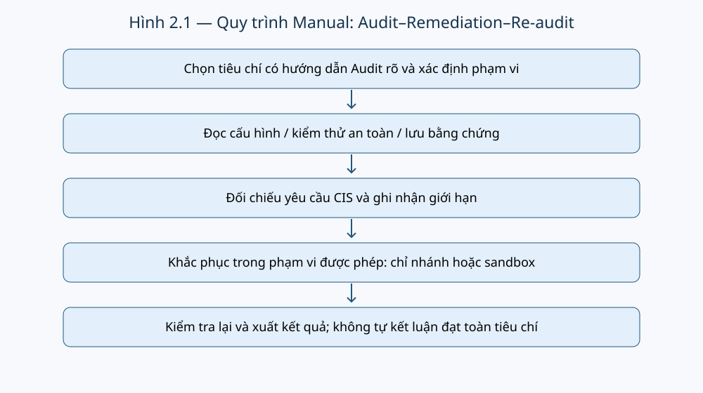

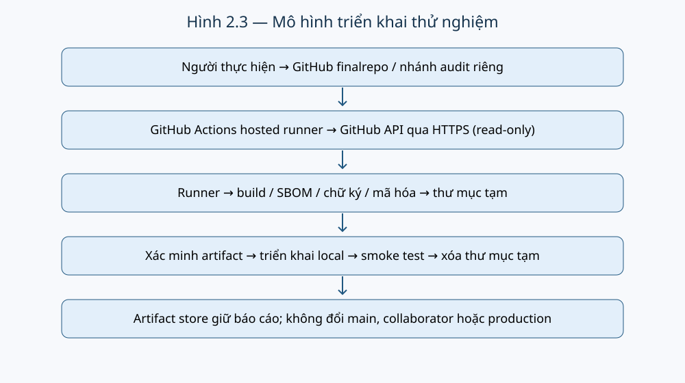

## 2.1 Manual

Với mỗi tiêu chí, đọc Description, Audit, Remediation và phạm vi áp dụng; xác định đối tượng GitHub thực tế; quan sát cấu hình; thực hiện kiểm thử hành vi nếu an toàn; ghi bằng chứng; đối chiếu yêu cầu; lập đề xuất khắc phục; kiểm tra lại sau khắc phục. Bằng chứng phải ghi repository, nhánh, tài khoản thực hiện, thời điểm và mã tiêu chí. Thiếu quyền xem cấu hình được ghi là chưa kiểm tra được.

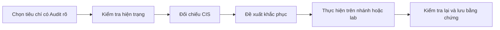

Ví dụ 1.1.3: Audit số phê duyệt và quy tắc có hiệu lực; đề xuất yêu cầu tối thiểu hai người phê duyệt độc lập, đối chiếu giá trị 2 trong Audit của bản CIS; kiểm tra xác thực mạnh theo phạm vi tiêu chí. Không dùng số lượng review làm bằng chứng MFA. Thử nghiệm PR thiếu review phải bị chặn, PR đủ review còn phải đáp ứng các điều kiện khác. Ví dụ 1.1.4: quan sát dismiss-stale, tạo PR đã phê duyệt và cập nhật mã để kiểm chứng phê duyệt cũ mất hiệu lực. Những thao tác thay đổi protection/Rulesets của main hiện không được thực hiện do phạm vi đánh giá không bao gồm thay đổi nhánh main.

Đối với 1.2.1, đọc SECURITY.md chứ không chỉ kiểm tra tên tệp. Cần kênh báo cáo riêng tư cụ thể. Đối với quyền nhóm, xác minh quyền hiện có và tính phù hợp với nhiệm vụ; bảng phân công đề xuất không được trình bày như bằng chứng đã cấp quyền.

### Hình và bằng chứng thuộc phần 2

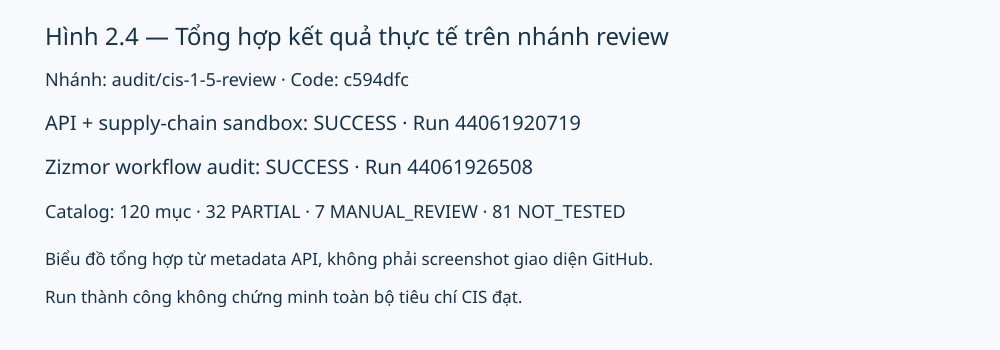

Các sơ đồ Mermaid ở tài liệu này là hình giải thích phương pháp, không phải ảnh chụp thực nghiệm. Bằng chứng đã có: [các phiên chạy trước](../integration/RESULTS.vi.md), [snapshot API](evidence/github-api.json), [kết quả lab cục bộ](evidence/sandbox.json). [Bảng phiên chạy nhánh](RESULTS.vi.md) đã có kết quả remote và artifact thực tế. Không tạo ảnh giả cấu hình GitHub.

Ảnh Settings, thành viên và PR bị chặn cần người có quyền chụp thực tế. Khi bổ sung, đặt ảnh dưới docs/audit/images và nhúng tại phần 2 này; phần 3 chỉ dẫn số hình. Chưa có các ảnh đó thì phải giữ trạng thái thiếu minh chứng.

## 2.2 Automated

Công cụ thực thi các bước lặp lại nhưng người thực hiện vẫn xác định phạm vi và kết luận cuối cùng. Chọn đầu vào có khóa hash, chạy kiểm tra, phân loại phát hiện, xuất báo cáo, đối chiếu lại điều kiện CIS. Với scanner, phải phân biệt công cụ chạy thành công với không có phát hiện và với cơ chế thực sự ngăn thay đổi mất an toàn.

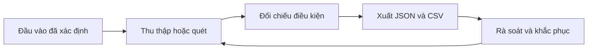

| Tool/step | Kết quả | Giới hạn |
|---|---|---|
| Gitleaks | Báo cáo secret đã che | Lịch sử nguồn còn phát hiện; không thêm allowlist |
| Actionlint + Zizmor | Lỗi workflow và cấu hình bảo mật | Không chứng minh toàn bộ pipeline an toàn |
| Trivy | Findings package/IaC/license | Filesystem scan không tự quét image nền |
| audit_github.py | 7 phép kiểm tra và trạng thái HTTP | Read-only; chưa suy diễn toàn bộ Rulesets/bypass |
| supply_chain_lab.py | Khóa input, artifact tái lập, SBOM, chữ ký, mã hóa, triển khai sandbox | First-party demo; không phải production hoặc registry bên ngoài |

Script API xuất configuration_result và overall_status riêng. PASS của cấu hình thành phần không tự thành PASS toàn tiêu chí Manual. HTTP 403/404 không biến thành FAIL; thiếu trường từ chối force push/xóa nhánh không biến thành PASS. Script có kiểm thử hồi quy cho các trường hợp này.

Lab tạo artifact ZIP hai lần và so byte; tạo SBOM có phạm vi khai báo rõ; ký artifact/SBOM/provenance bằng khóa tạm; kiểm chứng bản gốc và bản sửa đổi; ký ciphertext trước khi giải mã; triển khai bản đã xác minh vào thư mục tạm rồi smoke test. Khóa riêng và mật khẩu mã hóa không nằm trong thư mục upload. Mọi kết quả chỉ áp dụng cho lab.

## 2.3 Remote Automated và GitHub API

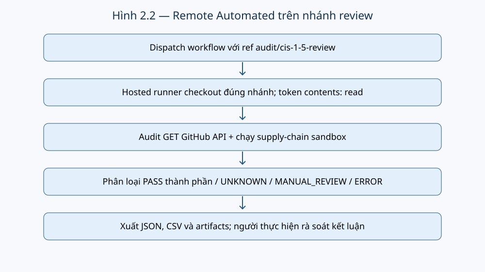

Cùng script được chạy trên GitHub-hosted runner bằng workflow_dispatch, chỉ định ref audit/cis-1-5-review. Workflow pipeline-io.yml đã có trên default branch nên có thể gọi phiên bản nhánh. Không cần thay main để thử nghiệm. Token mặc định chỉ được khai báo contents: read; endpoint cần quyền Administration read có thể trả 403. Không mở rộng quyền để né giới hạn này.

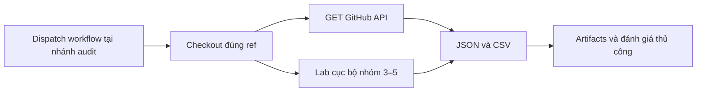

| Endpoint GET | Mục đích | Quyền/giới hạn |
|---|---|---|
| /repos/{owner}/{repo} | Xác định repository và default branch | Đọc metadata |
| /repos/{owner}/{repo}/branches/{branch}/protection | Đọc classic protection | Thường cần Administration read; 403 không kết luận không bảo vệ |
| /repos/{owner}/{repo}/rules/branches/{branch} | Quy tắc Rulesets có hiệu lực | Danh sách rỗng không loại trừ classic protection |
| /repos/{owner}/{repo}/contents/{path} | Tìm SECURITY.md | Kiểm tra thêm nội dung và policy kế thừa |

Tên nhánh được percent-encode, host cố định api.github.com, có timeout và phiên bản API. Token chỉ đọc từ biến môi trường, không ghi file. Các endpoint có danh sách lớn phải xử lý phân trang trước khi dùng để thống kê toàn tổ chức; script hiện chỉ kiểm tra một repository, không tuyên bố bao phủ cả tổ chức.

Quy trình khắc phục từ xa của đợt này chỉ sửa mã và tài liệu trên nhánh. Remediation cấu hình main, thành viên, production, registry hay cấp quyền chưa được thực hiện. Re-audit trên nhánh kiểm chứng script/workflow, không chứng minh cấu hình main đã đổi.

## Bổ sung phương pháp cho toàn bộ 120 mục

Mỗi mục có Audit, Remediation đề xuất, Re-audit và yêu cầu bằng chứng trong [runbooks](RESULTS-HISTORY.vi.md). Bộ thu thập readiness thực hiện GET metadata; 403, thiếu IdP/registry/production được ghi BLOCKED_PREREQUISITE. Registry fixture chỉ kiểm thử logic ủy quyền, claim MFA giả, chữ ký, phiên bản bất biến, từ chối anonymous/tampering và log; không chứng minh MFA/SSO thật. Inventory dependency ghi SHA, tag, release date và tuổi, không suy từ tuổi commit sang tuổi phiên bản. Scanner self-test dùng credential tổng hợp trong thư mục tạm, kiểm cả trường hợp sạch và có phát hiện.

### Hình 2.5 — Ảnh chụp thực tế workflow nhánh mới

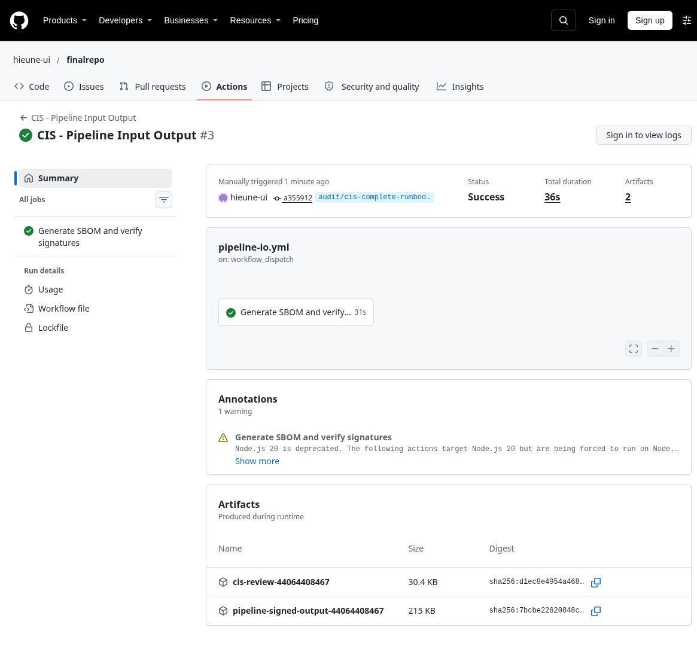

Ảnh thật từ run 44064408467, commit a355912: workflow thành công nhưng có cảnh báo Node.js 20 của checkout. Ảnh giữ lại làm bằng chứng trước Remediation; bản khắc phục cập nhật checkout lên SHA của v7.0.1 và được kiểm tra riêng. Không chỉnh sửa ảnh để xóa cảnh báo.

### Hình 2.6 — Ảnh thực tế sau khắc phục runtime

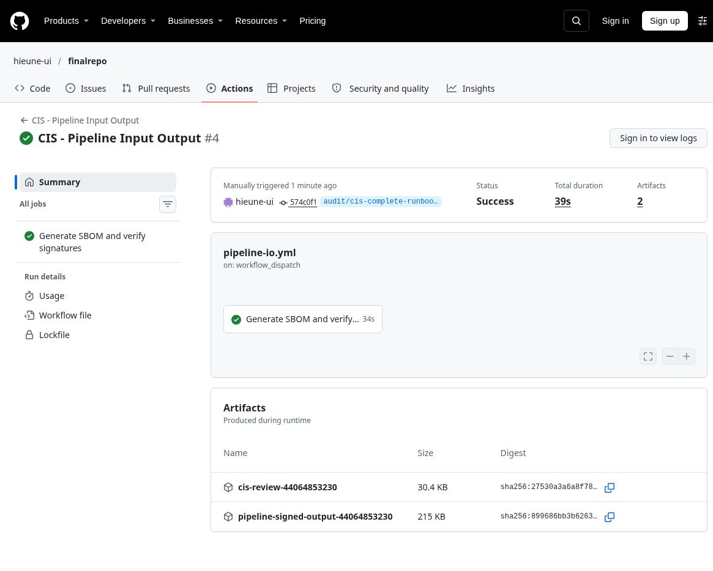

Run 44064853230, code 574c0f1, nhánh audit/cis-complete-runbooks. Đây là screenshot GitHub thật; trang summary không còn cảnh báo checkout Node.js 20. Ảnh chỉ chứng minh trạng thái phiên chạy và artifact, không chứng minh 120 tiêu chí đạt.

### Hình 2.7 — Minh chứng thực tế sau khắc phục nguồn và container

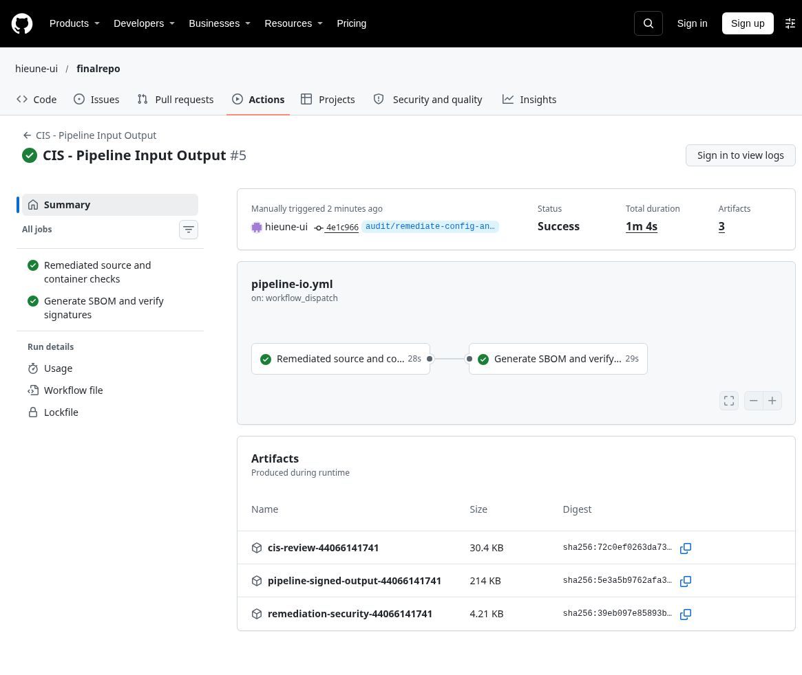

Run 44066141741, code 4e1c966, nhánh audit/remediate-config-and-scans. Job source-security dùng Gitleaks current tree; workflow full-history cũ giữ nguyên. Trivy source và image đều fail khi có HIGH/CRITICAL; artifact đã được tải/đọc. Scope source không được diễn giải như đã làm sạch lịch sử.

## Bổ sung phương pháp cho Organization, SAST và toolchain

Audit tổ chức dùng GET-only, phân biệt null/thiếu/403 với false; không xuất PII hoặc webhook secrets. SAST Bandit dùng ngưỡng HIGH. pip-audit quét 32 package pinned/hashed của scanner toolchain. Hash wheel được đối chiếu PyPI; license/tuổi wheel vẫn cần review theo scope, không suy thành supplier compliance. Xem ORGANIZATION.vi.md và kết quả remote. Ảnh Organization Settings thật vẫn cần người có quyền.

### Hình 2.8 — Workflow thành công trên Organization

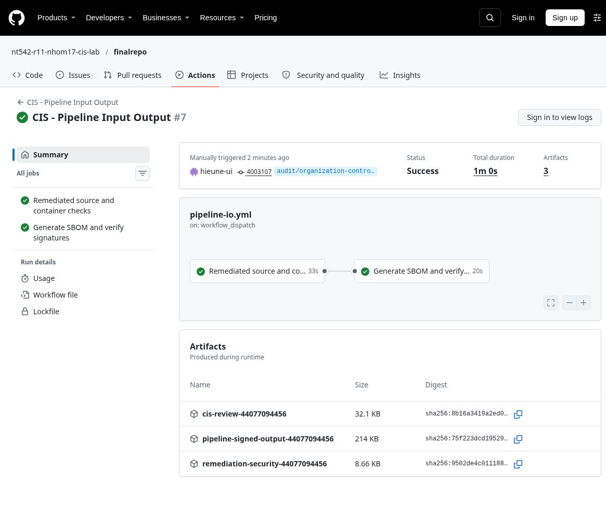

Ảnh thật từ run 44077094456, commit 4003107, nhánh audit/organization-controls. Security và review artifact đã được tải đọc: Bandit 0 HIGH, kiểm CVE đủ 32 package, 32 hash khớp. Ảnh summary chỉ chứng minh trạng thái job/artifact; giá trị kiểm tra lấy từ JSON trong evidence, không suy diễn từ màu xanh.

## Bổ sung phương pháp cho 48 mục hướng Free

Hướng dẫn thao tác riêng theo mã ở [PROCEDURES.vi.md](PROCEDURES.vi.md). Workflow lớn: chốt phạm vi → đọc cấu hình/API → kiểm tra nguồn/runtime/bundle → ghi thiếu bằng chứng → owner khắc phục trên nhánh thử → re-audit và lưu minh chứng. Không suy từ source scan sang bảo vệ main, hoặc từ khóa ký tạm sang release authority.

### Hình 2.9 — Sơ đồ tổng hợp từ kết quả đợt Free

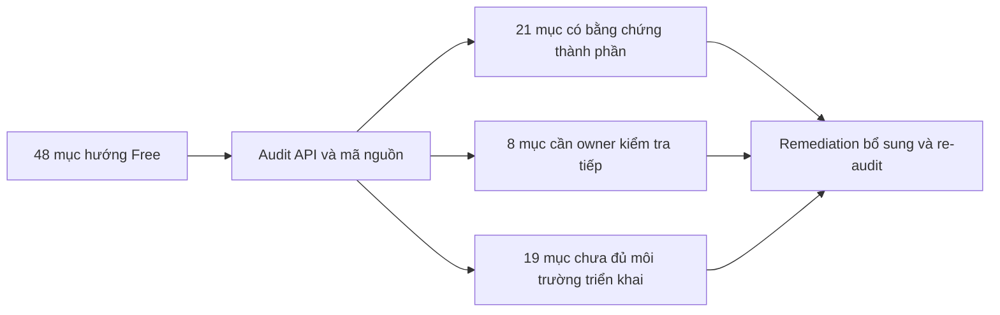

Đây là sơ đồ giải thích kết quả, không phải ảnh chụp Settings. Run thực tế: 44108703310, 44108703867, 44108703323 trên code f1df426. Đã tải artifact và đối chiếu signed bundle theo fingerprint log. Ảnh run/Settings mới chưa được bổ sung; các hình chụp phía trên vẫn thuộc đúng các run cũ ghi trong chú thích. Khi owner làm thủ công, chụp cấu hình trước/sau và phép thử bị từ chối, che dữ liệu nhạy cảm, đặt ảnh ở phần 2; phần 3 chỉ tham chiếu.

## Kiểm thử HTTPS và bản build registry đã khắc phục

Quy trình: kiểm kê và xác minh input → chạy dịch vụ loopback → thử yêu cầu hợp lệ/bị từ chối → quét binary với coverage guard → khắc phục dependency/runtime → build lại và re-audit. Webhook có 11 phép thử; registry có 23 phép thử, đều qua HTTPS thực. TLS/signing keys và password chỉ ở thư mục tạm, report không chứa giá trị bí mật. Các phép thử không thay cấu hình GitHub hoặc triển khai production.

### Hình 2.10 — Kết quả quét registry trước/sau khắc phục

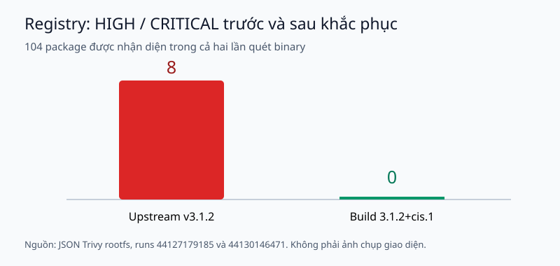

Đây là biểu đồ từ dữ liệu scanner, không phải ảnh chụp Settings. Baseline run 44127179185 có tám HIGH; run 44130146471 của code 545c3a2 xác nhận 104 package và zero HIGH/CRITICAL sau build bằng Go 1.27.4 và dependency locks đã cập nhật. Không dùng report rỗng của lần quét filesystem đầu tiên để kết luận sạch. Xem INTEGRATION.vi.md, JSON/CSV tổng hợp và artifact gốc. Ảnh GitHub Settings/delivery thực vẫn cần owner bổ sung vào phần 2 khi thực hiện thao tác thủ công.
