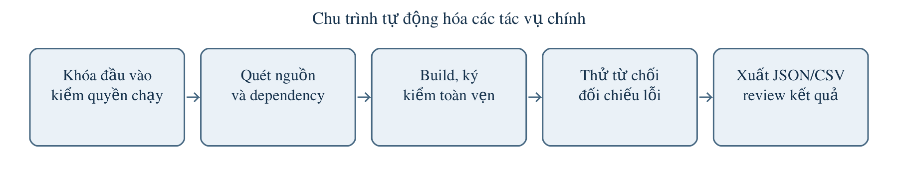
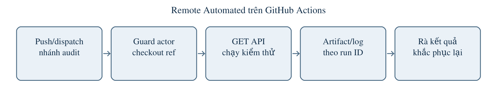
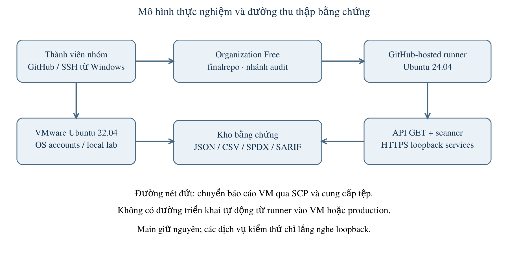
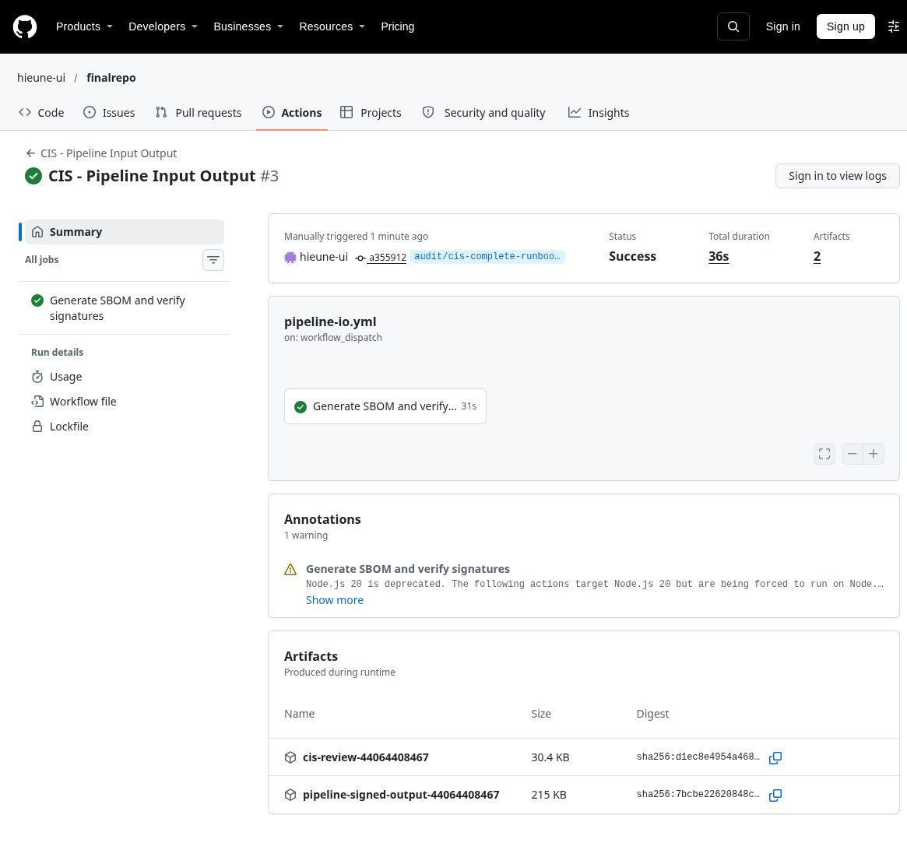

# 1. Giới thiệu benchmark

## 1.1. Tổng quan

CIS GitHub Benchmark là bộ khuyến nghị cấu hình và kiểm tra bảo mật do Center for Internet Security (CIS) phát hành cho môi trường phát triển phần mềm sử dụng GitHub. Báo cáo này áp dụng phiên bản **1.2.0, ngày 18/02/2026**, theo tài liệu benchmark dùng trong đề tài [1]. CIS ở đây là tổ chức xây dựng hướng dẫn bảo mật, không phải Cisco. Benchmark cung cấp một cơ sở đối chiếu có cấu trúc để đánh giá hiện trạng, xác định khoảng thiếu và lựa chọn biện pháp khắc phục phù hợp với phạm vi hệ thống.

GitHub tham gia nhiều công đoạn của chuỗi cung ứng phần mềm: quản lý mã, cộng tác và review, chạy pipeline, tiếp nhận dependency, lưu artifact và hỗ trợ triển khai. Một thay đổi thiếu kiểm soát ở đầu chuỗi có thể ảnh hưởng sản phẩm cuối cùng. Chẳng hạn, action tham chiếu theo nhánh có thể thay đổi ngoài dự kiến; token pipeline có quyền quá lớn có thể bị sử dụng sai mục đích; artifact không được xác minh có thể bị thay sau build. Vì vậy, đánh giá chỉ dựa trên việc repository có scanner hoặc job CI hiển thị thành công là chưa đủ.

Benchmark được chia thành năm nhóm: **Source Code, Build Pipelines, Dependencies, Artifacts và Deployment**. Nhóm Source Code xem xét truy vết thay đổi, phê duyệt, bảo vệ nhánh, quyền cộng tác và ứng dụng kết nối. Nhóm Build Pipelines tập trung vào quyền truy cập môi trường build, an toàn chỉ dẫn pipeline, runner, input/output và tính toàn vẹn của quá trình build. Nhóm Dependencies đánh giá nguồn gốc, phiên bản, metadata, SBOM và quản lý thành phần bên ngoài. Nhóm Artifacts quan tâm đến chữ ký, mã hóa, registry và xác minh các phiên bản được phân phối. Nhóm Deployment xem xét cấu hình, quyền truy cập và credential tại môi trường triển khai.

Mỗi khuyến nghị được nhận diện bằng mã, tên và phân loại đánh giá; nội dung chi tiết gồm mô tả, lý do, hướng dẫn Audit và Remediation. **Audit** chỉ ra đối tượng, cấu hình hoặc hành vi cần kiểm tra. **Remediation** nêu hướng khắc phục khi hiện trạng chưa đáp ứng. Trong thực nghiệm, sau khắc phục cần kiểm tra lại trên cùng đối tượng và ghi bằng chứng trước/sau. Một giá trị cấu hình đúng chỉ là một phần bằng chứng; còn phải xét hiệu lực, ngoại lệ, phạm vi người dùng và khả năng bypass.

Danh mục được đối chiếu trong đề tài gồm **120 tiêu chí: 118 Manual và 2 Automated**. Đây là nhãn do benchmark quy định, không phải cách đặt tên cho công cụ của nhóm. Tiêu chí Manual có thể được script hỗ trợ thu thập dữ liệu nhưng vẫn cần đánh giá của con người. Ngược lại, một tiêu chí Automated không tự động trở thành đạt chỉ vì công cụ đã chạy. Ví dụ, đếm hai approval chưa chứng minh hai reviewer độc lập có xác thực mạnh; scanner phát hiện được dữ liệu mẫu chưa chứng minh mọi thay đổi mất an toàn đều bị chặn trước khi merge.

Các mức profile được dùng để lựa chọn phạm vi tăng cường phù hợp. Level 2 mở rộng các yêu cầu của Level 1; việc thực hiện một số mục của hai mức không tương đương đạt toàn profile. Báo cáo này trình bày theo từng mã và bằng chứng thực nghiệm, không cấp chứng nhận CIS và không đưa ra tỷ lệ đạt toàn benchmark từ số lượng script, số test hoặc màu trạng thái của workflow.

Môi trường thực hành là Organization GitHub Free và repository public `nt542-r11-nhom17-cis-lab/finalrepo`. Mã và cấu hình thực nghiệm được tổng hợp trên nhánh `audit/remaining-free-integration`; nhánh main và hai repository nguồn được giữ nguyên. Hệ thống còn gồm GitHub-hosted runner, container demo, receiver/registry chạy loopback và VM VMware Ubuntu. Các môi trường này cho phép kiểm tra những hướng dẫn Audit rõ ràng, nhưng không đại diện mọi thành phần hạ tầng do GitHub vận hành hoặc production của một tổ chức.

Phạm vi Free có ý nghĩa thực tiễn đối với lab sinh viên. Các chức năng được phép và sẵn có được sử dụng trước; không mua, dùng thử hoặc mô phỏng tính năng Enterprise để gán kết quả đạt. Ba tiêu chí 1.3.10, 1.3.11 và 1.3.12 về hạn chế email notification theo verified domain, SSH CA và IP allow list chưa được triển khai trong phạm vi này. Chúng vẫn được giữ trong bảng 120 tiêu chí với lý do rõ ràng, thay vì bị loại khỏi thống kê toàn benchmark hoặc mặc định không áp dụng.

Một khó khăn khác là phạm vi nhìn thấy của API. Token có thể đọc repository public nhưng không được đọc protection, invitations hoặc cấu hình quản trị. HTTP 403, 422 hay field vắng mặt không đủ cơ sở kết luận cấu hình tắt, không có thành viên hoặc đã đáp ứng yêu cầu. Tương tự, danh sách public members rỗng chỉ là dữ liệu nhìn thấy; tuổi commit không phải last-login của thành viên. Các giới hạn này phải đi cùng kết quả để người đọc có thể đánh giá đúng giá trị bằng chứng.

Đề tài chọn **Audit → Remediation → Re-audit** làm phương pháp xuyên suốt và thực hiện theo ba chế độ: thủ công, tự động cục bộ và tự động từ xa. Kết quả được lưu bằng JSON, CSV, SPDX, SARIF, log và ảnh gốc có nguồn phiên chạy. Các phép thử từ chối được ưu tiên khi an toàn: sai chữ ký, dữ liệu bị sửa, replay, người không được cấp quyền và context build không hợp lệ. Không thử phá hủy repository, dùng credential thực để kiểm tra tùy tiện hoặc đổi bảo vệ main nhằm tạo bằng chứng.

Giá trị của thực nghiệm nằm ở khả năng lặp lại kiểm tra, liên kết phát hiện với biện pháp khắc phục và phân biệt điều đã chứng minh với điều còn thiếu. Báo cáo vì vậy giữ riêng kết quả công cụ, kết quả thành phần và kết luận toàn tiêu chí. Các xác nhận từ người thực hiện trên VM cũng được phân biệt với phép đo CI/API và signed attestation. Cách trình bày này giúp kết quả có thể được kiểm tra lại và tránh đánh đồng môi trường lab với môi trường production.


## 1.2. Nội dung benchmark

Bảng danh mục bên dưới giữ mã, tên và nhãn Manual/Automated của CIS. “Mô tả ngắn” diễn giải nội dung cần kiểm tra; đây chưa phải kết quả triển khai. Kết quả thực nghiệm được trình bày riêng tại phần 3 và 4.


| Nhóm | Nội dung | Số tiêu chí |
| --- | --- | --- |
| 1 | Source Code — quản lý mã, thay đổi, quyền và scanner | 50 |
| 2 | Build Pipelines — môi trường và quá trình build | 33 |
| 3 | Dependencies — thành phần phần mềm bên ngoài | 12 |
| 4 | Artifacts — tính toàn vẹn và phân phối sản phẩm | 14 |
| 5 | Deployment — cấu hình và môi trường triển khai | 11 |
| Tổng | 118 Manual + 2 Automated | 120 |


### 1.2.1. Manual


| STT | Tên | Mô tả ngắn |
| --- | --- | --- |
| 1 | 1.1.1 — Ensure any changes to code are tracked in a version control platform | Đối chiếu nguồn đang chạy với lịch sử Git và commit của mọi thay đổi |
| 2 | 1.1.2 — Ensure any change to code can be traced back to its associated task | Lấy mẫu commit/PR và truy về issue hoặc task được giao |
| 3 | 1.1.4 — Ensure previous approvals are dismissed when updates are introduced to a code change proposal | Đọc dismiss-stale; đẩy commit thay đổi vào PR đã được duyệt |
| 4 | 1.1.5 — Ensure there are restrictions on who can dismiss code change reviews | Kiểm tra danh sách người/nhóm được dismiss review và bypass |
| 5 | 1.1.6 — Ensure code owners are set for extra sensitive code or configuration | Tìm CODEOWNERS, so đường dẫn nhạy cảm và quyền owner |
| 6 | 1.1.7 — Ensure code owner's review is required when a change affects owned code | Đọc required code-owner review và thử PR sửa file có owner |
| 7 | 1.1.8 — Ensure inactive branches are periodically reviewed and removed | Liệt kê nhánh, ngày commit cuối, chủ sở hữu và biên bản rà soát |
| 8 | 1.1.9 — Ensure all checks have passed before merging new code | Đọc required checks; thử PR có check thất bại |
| 9 | 1.1.10 — Ensure open Git branches are up to date before they can be merged into code base | Kiểm tra strict/up-to-date requirement và PR tụt sau base |
| 10 | 1.1.11 — Ensure all open comments are resolved before allowing code change merging | Kiểm tra conversation resolution và PR còn comment chưa giải quyết |
| 11 | 1.1.12 — Ensure verification of signed commits for new changes before merging | Kiểm tra required signatures và commit verification |
| 12 | 1.1.13 — Ensure linear history is required | Đọc linear-history rule và lịch sử merge |
| 13 | 1.1.14 — Ensure branch protection rules are enforced for administrators | Xem enforce-admins và các bypass actor |
| 14 | 1.1.15 — Ensure pushing or merging of new code is restricted to specific individuals or teams | Đọc push restrictions và danh sách team/user |
| 15 | 1.1.16 — Ensure force push code to branches is denied | Đọc force-push rule; thử trên nhánh disposable được bảo vệ |
| 16 | 1.1.17 — Ensure branch deletions are denied | Đọc deletion rule; thử xóa nhánh disposable, không main |
| 17 | 1.1.18 — Ensure any merging of code is automatically scanned for risks | Đối chiếu mọi PR merge với scanner và kết quả chạy |
| 18 | 1.1.19 — Ensure any changes to branch protection rules are audited | Tìm sự kiện thay đổi protection/ruleset trong audit log và cơ chế cảnh báo |
| 19 | 1.1.20 — Ensure branch protection is enforced on the default branch | Lấy default branch qua API và đối chiếu effective protection |
| 20 | 1.2.1 — Ensure all public repositories contain a SECURITY.md file | Đọc SECURITY.md và xác minh kênh báo cáo riêng tư |
| 21 | 1.2.2 — Ensure repository creation is limited to specific members | Đọc quyền tạo repository ở cấp tổ chức |
| 22 | 1.2.3 — Ensure repository deletion is limited to specific users | Đọc quyền xóa repository và phân quyền quản trị |
| 23 | 1.2.4 — Ensure issue deletion is limited to specific users | Kiểm tra quyền xóa issue theo vai trò và audit log |
| 24 | 1.2.5 — Ensure all copies (forks) of code are tracked and accounted for | Đối chiếu danh sách forks, visibility và người chịu trách nhiệm |
| 25 | 1.2.6 — Ensure all code projects are tracked for changes in visibility status | Đọc audit log visibility change và cấu hình theo dõi |
| 26 | 1.2.7 — Ensure inactive repositories are reviewed and archived periodically | Lấy ngày cập nhật repo và biên bản đánh giá trạng thái |
| 27 | 1.3.1 — Ensure inactive users are reviewed and removed periodically | Đối chiếu thành viên, hoạt động gần nhất và nhu cầu truy cập |
| 28 | 1.3.2 — Ensure team creation is limited to specific members | Kiểm tra quyền tạo team của organization members |
| 29 | 1.3.3 — Ensure minimum number of administrators are set for the organization | Kiểm kê organization owners/admins và lý do từng quyền |
| 30 | 1.3.4 — Ensure Multi-Factor Authentication (MFA) is required for contributors of new code | Kiểm tra MFA bắt buộc cho người đóng góp, kể cả ngoài tổ chức |
| 31 | 1.3.5 — Ensure the organization is requiring members to use Multi- Factor Authentication (MFA) | Đọc yêu cầu MFA của tổ chức và trạng thái thực thi |
| 32 | 1.3.6 — Ensure new members are required to be invited using company-approved email | Đối chiếu email lời mời với domain được công ty chấp thuận |
| 33 | 1.3.7 — Ensure two administrators are set for each repository | Kiểm kê repository admins và xác minh có hai quản trị viên phù hợp |
| 34 | 1.3.8 — Ensure strict base permissions are set for repositories | Đọc default/base repository permission của tổ chức |
| 35 | 1.3.9 — Ensure an organization’s identity is confirmed with a “Verified” badge | Kiểm tra Verified badge và bằng chứng sở hữu domain |
| 36 | 1.3.10 — Ensure Source Code Management (SCM) email notifications are restricted to verified domains | Đọc giới hạn email notification tới verified domains |
| 37 | 1.3.11 — Ensure an organization provides SSH certificates | Kiểm tra SSH CA/certificate policy và vòng đời chứng chỉ |
| 38 | 1.3.12 — Ensure Git access is limited based on IP addresses | Kiểm tra IP allow list và thử nguồn truy cập được phép/không được phép |
| 39 | 1.3.13 — Ensure anomalous code behavior is tracked | Đọc cơ chế phát hiện hành vi bất thường và mẫu cảnh báo |
| 40 | 1.4.1 — Ensure administrator approval is required for every installed application | Liệt kê ứng dụng và quy trình owner approval |
| 41 | 1.4.2 — Ensure stale applications are reviewed and inactive ones are removed | Đối chiếu app installation với hoạt động và chủ sở hữu |
| 42 | 1.4.3 — Ensure the access granted to each installed application is limited to the least privilege needed | Đọc permissions và repository selection của từng app |
| 43 | 1.4.4 — Ensure only secured webhooks are used | Kiểm tra HTTPS và SSL verification của webhook mà không xuất secret |
| 44 | 1.5.1 — Ensure scanners are in place to identify and prevent sensitive data in code | Kiểm tra secret scanner, mẫu phát hiện giả và cơ chế chặn |
| 45 | 1.5.2 — Ensure scanners are in place to secure Continuous Integration (CI) pipeline instructions | Quét mọi workflow bằng công cụ kiểm tra cấu hình CI |
| 46 | 1.5.3 — Ensure scanners are in place to secure Infrastructure as Code (IaC) instructions | Kiểm kê IaC và xem report misconfiguration |
| 47 | 1.5.4 — Ensure scanners are in place for code vulnerabilities | Kiểm tra code-scanning setup và report trên đúng commit |
| 48 | 1.5.5 — Ensure scanners are in place for open-source vulnerabilities in used packages | Kiểm kê dependency, Dependabot và SCA report |
| 49 | 1.5.6 — Ensure scanners are in place for open-source license issues in used packages | Đối chiếu package licenses với chính sách sử dụng |
| 50 | 2.1.1 — Ensure each pipeline has a single responsibility | Kiểm tra trách nhiệm và quyền của từng pipeline |
| 51 | 2.1.2 — Ensure all aspects of the pipeline infrastructure and configuration are immutable | Đối chiếu image/infrastructure/config với phiên bản và cơ chế sửa trực tiếp |
| 52 | 2.1.3 — Ensure the build environment is logged | Kiểm tra log môi trường build và chính sách giữ log |
| 53 | 2.1.4 — Ensure the creation of the build environment is automated | Tạo lại môi trường build từ mã trong môi trường sạch |
| 54 | 2.1.5 — Ensure access to build environments is limited | Liệt kê người/app có quyền vào môi trường build |
| 55 | 2.1.6 — Ensure users must authenticate to access the build environment | Thử truy cập chưa xác thực trong môi trường kiểm thử |
| 56 | 2.1.7 — Ensure build secrets are limited to the minimal necessary scope | Đọc metadata phạm vi secrets mà không đọc giá trị |
| 57 | 2.1.8 — Ensure the build infrastructure is automatically scanned for vulnerabilities | Xem scan của hạ tầng build, phạm vi và chu kỳ cập nhật |
| 58 | 2.1.9 — Ensure default passwords are not used | Đối chiếu cấu hình dịch vụ với danh sách default credentials, không brute-force |
| 59 | 2.1.10 — Ensure webhooks of the build environment are secured | Đọc cấu hình webhook build: HTTPS, certificate verification, auth |
| 60 | 2.1.11 — Ensure minimum number of administrators are set for the build environment | Kiểm kê admin của build system và lý do cấp quyền |
| 61 | 2.2.1 — Ensure build workers are single-used | Kiểm tra runner lifecycle, reuse và dữ liệu tồn dư giữa job |
| 62 | 2.2.2 — Ensure build worker environments and commands are passed and not pulled | Kiểm tra nguồn lệnh/config được cung cấp cho worker |
| 63 | 2.2.3 — Ensure the duties of each build worker are segregated | Đối chiếu nhiệm vụ/credentials giữa các worker |
| 64 | 2.2.4 — Ensure build workers have minimal network connectivity | Kiểm tra egress policy và thử endpoint allowed/denied |
| 65 | 2.2.5 — Ensure run-time security is enforced for build workers | Kiểm tra runtime security agent/policy và sự kiện thử nghiệm |
| 66 | 2.2.6 — Ensure build workers are automatically scanned for vulnerabilities | Quét package của worker đúng image/version |
| 67 | 2.2.7 — Ensure build workers' deployment configuration is stored in a version control platform | Đối chiếu cấu hình triển khai worker với Git commit |
| 68 | 2.2.8 — Ensure resource consumption of build workers is monitored | Theo dõi CPU/RAM/disk trong tải thực tế và cảnh báo |
| 69 | 2.3.1 — Ensure all build steps are defined as code | So toàn bộ bước build với YAML/script đang version-control |
| 70 | 2.3.2 — Ensure steps have clearly defined build stage input and output | Kiểm tra contract input/output từng stage |
| 71 | 2.3.3 — Ensure output is written to a separate, secured storage repository | Xác định kho output, quyền truy cập và tách biệt nguồn |
| 72 | 2.3.4 — Ensure changes to pipeline files are tracked and reviewed | Lấy mẫu thay đổi workflow và review tương ứng |
| 73 | 2.3.5 — Ensure access to build process triggering is minimized | Kiểm kê ai có thể dispatch/rerun/trigger qua token hoặc event |
| 74 | 2.3.6 — Ensure pipelines are automatically scanned for misconfigurations | Quét misconfiguration toàn bộ pipeline files |
| 75 | 2.3.7 — Ensure pipelines are automatically scanned for vulnerabilities | Kiểm tra vulnerability scanner cho pipeline và tools được dùng |
| 76 | 2.4.1 — Ensure all artifacts on all releases are signed | Kiểm kê mọi release và mọi artifact có chữ ký hợp lệ |
| 77 | 2.4.2 — Ensure all external dependencies used in the build process are locked | Kiểm kê dependency và lock/version/hash thực tế |
| 78 | 2.4.3 — Ensure dependencies are validated before being used | Đối chiếu hash/chữ ký với trusted source trước sử dụng |
| 79 | 2.4.4 — Ensure the build pipeline creates reproducible artifacts | Build lặp lại cùng input trong môi trường đã kiểm soát |
| 80 | 2.4.5 — Ensure pipeline steps produce a Software Bill of Materials (SBOM) | Đọc SBOM, kiểm package coverage và liên kết artifact digest |
| 81 | 2.4.6 — Ensure pipeline steps sign the Software Bill of Materials (SBOM) produced | Kiểm chữ ký SBOM và danh tính signer |
| 82 | 3.1.1 — Ensure third-party artifacts and open-source libraries are verified | Đối chiếu third-party package với checksum/chữ ký/nguồn tin cậy |
| 83 | 3.1.2 — Ensure Software Bill of Materials (SBOM) is required from all third-party suppliers | Kiểm kê nhà cung cấp và SBOM cho từng thành phần |
| 84 | 3.1.3 — Ensure signed metadata of the build process is required and verified | Kiểm signed build metadata và đối chiếu artifact digest |
| 85 | 3.1.4 — Ensure dependencies are monitored between open-source components | Đọc dependency graph và thay đổi quan hệ/transitive dependencies |
| 86 | 3.1.5 — Ensure trusted package managers and repositories are defined and prioritized | Đọc cấu hình package manager, registry precedence và namespace |
| 87 | 3.1.6 — Ensure a signed Software Bill of Materials (SBOM) of the code is supplied | Kiểm SBOM của mã giao cho bên nhận và chữ ký |
| 88 | 3.1.7 — Ensure dependencies are pinned to a specific, verified version | Kiểm mọi dependency pinned và bằng chứng verified version |
| 89 | 3.1.8 — Ensure all packages used are more than 60 days old | Tính tuổi phiên bản từ ngày phát hành tin cậy tới ngày kiểm tra |
| 90 | 3.2.1 — Ensure an organization-wide dependency usage policy is enforced | Đối chiếu chính sách dependency đã phê duyệt với enforcement |
| 91 | 3.2.2 — Ensure packages are automatically scanned for known vulnerabilities | Kiểm lịch SCA scan và freshness của vulnerability database |
| 92 | 3.2.3 — Ensure packages are automatically scanned for license implications | Đọc license inventory, policy và mẫu vi phạm |
| 93 | 3.2.4 — Ensure packages are automatically scanned for ownership change | Đối chiếu package owner hiện tại với baseline đáng tin |
| 94 | 4.1.1 — Ensure all artifacts are signed by the build pipeline itself | Xác minh artifact do pipeline ký và gắn đúng commit |
| 95 | 4.1.2 — Ensure artifacts are encrypted before distribution | Kiểm plaintext/ciphertext ở đường phân phối và thử sửa ciphertext |
| 96 | 4.1.3 — Ensure only authorized platforms have decryption capabilities of artifacts | Đối chiếu quyền giải mã, nơi giữ khóa và nền tảng được phép |
| 97 | 4.2.1 — Ensure the authority to certify artifacts is limited | Kiểm ai được ký/chứng nhận artifact và key policy |
| 98 | 4.2.2 — Ensure number of permitted users who may upload new artifacts is minimized | Kiểm registry uploader roles và nhu cầu công việc |
| 99 | 4.2.3 — Ensure user access to the package registry utilizes Multi- Factor Authentication (MFA) | Kiểm MFA/SSO của người truy cập registry và ngoại lệ |
| 100 | 4.2.4 — Ensure user management of the package registry is not local | Xác định registry identity provider và local accounts |
| 101 | 4.2.5 — Ensure anonymous access to artifacts is revoked | Thử anonymous download của artifact cần bảo vệ |
| 102 | 4.2.6 — Ensure minimum number of administrators are set for the package registry | Kiểm kê registry admins và lý do cấp quyền |
| 103 | 4.3.1 — Ensure all signed artifacts are validated upon uploading the package registry | Thử upload artifact ký hợp lệ và artifact bị sửa vào registry lab |
| 104 | 4.3.2 — Ensure all versions of an existing artifact have their signatures validated | Kiểm mọi version và chữ ký, thử downgrade hoặc overwrite |
| 105 | 4.3.3 — Ensure changes in package registry configuration are audited | Đọc audit log thay đổi registry configuration |
| 106 | 4.3.4 — Ensure webhooks of the repository are secured | Đọc webhook registry HTTPS/verification/auth metadata |
| 107 | 4.4.1 — Ensure artifacts contain information about their origin | Đọc provenance repo/commit/build/run và xác minh chữ ký |
| 108 | 5.1.1 — Ensure deployment configuration files are separated from source code | Kiểm vị trí quản lý config deploy và trust boundary với source |
| 109 | 5.1.2 — Ensure changes in deployment configuration are audited | Lấy mẫu thay đổi deploy config và audit/review trail |
| 110 | 5.1.3 — Ensure scanners are in place to identify and prevent sensitive data in deployment configuration | Quét config deployment với secret scanner và fixture giả |
| 111 | 5.1.4 — Limit access to deployment configurations | Đọc quyền thay config deployment và danh sách approver |
| 112 | 5.1.5 — Scan Infrastructure as Code (IaC) | Kiểm kê deployment IaC và report misconfiguration |
| 113 | 5.1.6 — Ensure deployment configuration manifests are verified | Kiểm chữ ký/hash deployment manifest trước áp dụng |
| 114 | 5.1.7 — Ensure deployment configuration manifests are pinned to a specific, verified version | Đối chiếu deployment manifest với phiên bản/digest đã phê duyệt |
| 115 | 5.2.1 — Ensure deployments are automated | Theo dõi pipeline triển khai và thao tác thủ công còn lại |
| 116 | 5.2.2 — Ensure the deployment environment is reproducible | Tái tạo môi trường từ input/config đã khóa và so cấu hình |
| 117 | 5.2.3 — Ensure access to production environment is limited | Kiểm kê production identities, roles, network và break-glass |
| 118 | 5.2.4 — Ensure default passwords are not used | Kiểm tra cấu hình production không còn default password, không đăng nhập thử tùy tiện |


### 1.2.2. Automated


| STT | Tên | Mô tả ngắn |
| --- | --- | --- |
| 1 | 1.1.3 — Ensure any change to code receives approval of two strongly authenticated users | Kiểm tra yêu cầu hai người phê duyệt độc lập có xác thực mạnh và hiệu lực ngăn merge khi thiếu điều kiện. |
| 2 | 2.3.8 — Ensure scanners are in place to identify and prevent sensitive data in pipeline files | Kiểm tra scanner nhận diện và ngăn dữ liệu nhạy cảm trong pipeline files; đối chiếu phạm vi và cơ chế chặn. |


# 2. Phương pháp làm việc

Phương pháp được lựa chọn là **đánh giá cấu hình theo Audit, khắc phục theo Remediation và kiểm tra lại sau thay đổi**. Manual, Automated và Remote Automated là ba cách thực hiện cùng phương pháp. Ưu tiên các mục có hướng dẫn Audit rõ, đầu vào quan sát được và phép thử an toàn; không đổi phân loại gốc của benchmark khi thêm script.

## 2.1. Manual

Manual được dùng khi kết luận phụ thuộc ý nghĩa cấu hình, danh tính, phân công, hồ sơ phê duyệt hoặc quan sát hành vi. Đầu tiên chọn mã CIS, xác định repository/organization/máy đích và đọc chính xác Audit. Người kiểm tra ghi hiện trạng trước khi đổi: giá trị Settings, vai trò được cấp, nội dung policy hoặc đầu ra lệnh. Cần phân biệt quyền trực tiếp với kế thừa và cấu hình hiển thị với cấu hình thực sự có hiệu lực.

Ở bước Remediation, chỉ thay đổi phần được phép và có cách kiểm tra lại. Ví dụ, đổi base permissions cần tải lại trang; tạo tài khoản triển khai phải giữ phiên quản trị đang mở; chỉnh SSH cần kiểm tra cú pháp trước reload. Không xóa repository, thay visibility hoặc sửa rule của main để tạo tình huống thử. Các quyết định như chọn admin dự phòng, lịch rà thành viên và nguồn email được duyệt phải được nhóm xác nhận, không được tự điền thành việc đã hoàn tất.

Re-audit ưu tiên một trường hợp hợp lệ và một trường hợp bị từ chối. Trong VM, cisdeploy tạo được file tại thư mục triển khai còn nobody bị từ chối; sau reload SSH, các phiên đăng nhập mới của user/cisdeploy vẫn hoạt động. Bằng chứng phải ghi rõ đối tượng, thời điểm, lệnh/cấu hình, kết quả và giới hạn. Trạng thái mật khẩu P chỉ cho biết có mật khẩu; chưa chứng minh mật khẩu khác mặc định. Thiếu ảnh gốc hoặc quyền đọc phải được nêu trong kết luận.

Workflow chung gồm các bước lớn trong Hình 2.1. Với mỗi tiêu chí, hồ sơ cuối cùng nối hiện trạng → thiếu hụt → thay đổi được phép → kết quả kiểm tra lại. Một mục chỉ được kết luận đầy đủ khi bằng chứng bao phủ toàn yêu cầu; tài liệu dự thảo hoặc xác nhận cá nhân không thay bằng chứng enforcement.


{width=95%}


\newpage


## 2.2. Automated

Tự động hóa được dùng cho các tác vụ lặp lại: kiểm hash, kiểm cấu trúc báo cáo, quét mã/dependency, xác minh chữ ký và chạy negative tests. Audit bắt đầu bằng xác định input, phiên bản công cụ, ngưỡng thất bại và loại đầu ra. Remediation sửa nguồn hoặc cấu hình có phát hiện; Re-audit chạy lại cùng phép kiểm và đối chiếu điều kiện trước/sau. Việc thay scanner, tắt rule hoặc bỏ qua lỗi để làm job xanh không được dùng thay khắc phục.

Workflow chỉ thể hiện các giai đoạn lớn trong Hình 2.2. Đầu vào được ghim bằng commit, digest hoặc wheel hash. Sau kiểm quyền chạy, pipeline quét, build và xác minh; cuối cùng xuất kết quả có cấu trúc. Với artifact, bản gốc phải xác minh được và bản bị sửa phải thất bại. Với scanner, báo cáo rỗng hoặc không nhận diện package mục tiêu không đủ cơ sở kết luận sạch.


{width=95%}


| Tool / step | Kết quả | Điều kiện diễn giải |
| --- | --- | --- |
| Bandit / pip-audit | Finding SAST và advisory theo lock | Giới hạn ở ngôn ngữ/package đã quét |
| Trivy + coverage guard | Finding binary/image và inventory | Từ chối scan rỗng hoặc sai binary |
| OpenSSL + negative tests | Bản gốc hợp lệ, bản sửa bị từ chối | Khóa tạm không thay danh tính supplier |
| JSON/CSV/SPDX/SARIF | Báo cáo máy đọc được theo phạm vi | Job thành công chưa phải full-control PASS |


Đối chiếu đầu ra là bước bắt buộc. Trường configuration_result có thể mô tả giá trị cấu hình thành phần, trong khi overall_cis vẫn PARTIAL hoặc MANUAL_REVIEW. Hai cảnh báo CodeQL về public digest được rà data flow và phân tích lại với cùng 43 rule, không dùng suppression để xóa cảnh báo. Các mục Manual được hỗ trợ bằng công cụ vẫn giữ nhãn Manual của CIS.


\newpage


## 2.3. Remote Automated và GitHub API

Remote Automated thực thi các script trên GitHub-hosted runner, gắn kết quả với ref, commit và run ID. Push/dispatch chỉ dùng nhánh audit được cho phép. Job condition và guard đối chiếu repository ID, actor ID, triggering actor và event trước các tác vụ kiểm tra. Checkout không lưu credential; token mặc định contents:read, riêng job CodeQL có security-events:write để upload SARIF. Không thêm token mới hoặc gửi credential vào báo cáo.

Audit từ xa dùng HTTPS GET tới api.github.com, header phiên bản API và timeout. Danh sách phải được phân trang; response chỉ được dùng khi có kiểu dữ liệu phù hợp. Token đọc từ biến môi trường và không được xuất ra JSON. HTTP 403/404, field vắng hoặc danh sách nhìn thấy giới hạn không được đổi thành PASS/FAIL cấu hình.


{width=95%}


| Endpoint GET | Dữ liệu phục vụ Audit | Giới hạn |
| --- | --- | --- |
| /repos/{owner}/{repo} | Metadata và default branch | Không bao phủ mọi quyền quản trị |
| /branches/{branch}/protection; /rulesets | Protection hoặc snapshot rule | 403/thiếu field → UNKNOWN |
| /collaborators; org members | Role counts, inventory phân trang | Caller-visible khác toàn bộ thành viên |
| /actions/permissions; /actions/runners | Cấu hình quyền và runner | Có thể thiếu Administration read |


Remediation của code được push lên nhánh audit rồi runner chạy lại. Với Settings cần owner, script chỉ ghi thiếu bằng chứng, không tự POST cấu hình. Artifact được tải và đọc nội dung, không suy kết quả từ màu xanh. Không dùng Organization Audit Log API Enterprise trong phương án Free. So digest ruleset chỉ phát hiện khác snapshot, không thay event có actor/time. Runner không tự kết nối VM: báo cáo VM được chuyển qua SCP và cung cấp riêng.


\newpage


## 2.4. Mô hình và hình ảnh thực nghiệm

Hình 2.4 minh họa các thành phần được giải thích chi tiết bằng chữ trong mục 3.1. Sơ đồ là hình phương pháp, không phải screenshot cấu hình. Nhánh audit và runner là một luồng; VM VMware được người thực nghiệm vận hành riêng. Đường chuyển báo cáo VM không biểu diễn một kết nối triển khai tự động hoặc quyền production.


{width=95%}


{width=95%}


\newpage


{width=95%}


{width=95%}


\newpage


{width=95%}


Các hình 2.6–2.8 được giữ đúng nguồn/phiên chạy lịch sử, không trình bày như ảnh của commit mới nhất. Bản gốc nằm trong repository. Các ảnh Settings và terminal cung cấp trong quá trình hướng dẫn chưa có bộ file ảnh gốc riêng trong gói này; kết quả được ghi theo JSON/biên bản và nêu nguồn. Không tạo ảnh giả để thay phần bằng chứng còn thiếu. Toàn bộ hình của báo cáo được đặt ở phần 2; phần 3 chỉ dùng chữ và bảng.


# 3. Triển khai

## 3.1. Mô hình (Topology)

### 3.1.1. Repository và Organization

Organization Free quản lý repository public finalrepo. Nhánh tổng hợp hiện tại là audit/remaining-free-integration; main giữ tại e052945db5b4a2bace480b5ab98446a8b82da02e. Hai repository nguồn không thay đổi. Sáu nhánh audit trung gian đã được kiểm tra là tổ tiên của nhánh tổng hợp, sao lưu và xóa ref dư; các commit lịch sử vẫn nằm trong nhánh hiện tại. Hình 2.4 mô tả luồng tổng thể.

### 3.1.2. Thành viên và quyền truy cập

API đọc được bốn collaborator; quyền dưới đây được đối chiếu thêm với xác nhận của người thực nghiệm. Bảng không chứng minh toàn bộ quyền kế thừa, danh sách Org Owners hoặc enforcement MFA.


| Tài khoản | Quyền repository | Trạng thái liên quan |
| --- | --- | --- |
| hieune-ui | Admin | MFA theo xác nhận: đã bật; tài khoản quản trị chính |
| Vuongdlx | Write | MFA theo xác nhận: đã bật; có quyền phù hợp để review |
| HiepTran01 | Write | MFA theo xác nhận: đã bật; có quyền phù hợp để review |
| dtk0106 | Read | MFA chưa hoàn tất; không tính approval Read vào required Write+ reviewers |


Chưa có phê duyệt phân công admin dự phòng hoặc PR thử được hai reviewer độc lập phê duyệt. CODEOWNERS có vai trò mô tả sở hữu mã, không tự cấp quyền hoặc cưỡng chế review. Danh sách public members/owners rỗng không được dùng làm tổng số thành viên thực tế.

### 3.1.3. Runner, công cụ và kho kết quả

GitHub-hosted runner Ubuntu 24.04 checkout nguồn, thực hiện guard quyền chạy, unit tests, scanner và kiểm thử dịch vụ. Input được ghim bằng SHA/digest/hash. Khóa ký và mật khẩu lab được sinh trong thư mục tạm, không nằm trong output upload. Artifact lưu JSON, CSV, SPDX, SARIF và signed bundle để đối chiếu ngoài đĩa runner; retention có giới hạn, không phải kho production riêng có ACL đã được kiểm thử.

Receiver Python và Distribution custom registry chạy thành tiến trình riêng, chỉ bind loopback qua TLS. Webhook xác thực HMAC, giới hạn event/body và chống replay trong bộ nhớ. Registry dùng bcrypt account thử nghiệm; pipeline/client kiểm chữ ký artifact tải lên/tải xuống. Chưa có IdP, MFA thật hoặc admission policy của registry để chặn mọi upload không ký.

### 3.1.4. VMware và ranh giới triển khai

VM dùng Ubuntu 22.04.4 LTS, Python 3.10.12 và 2 vCPU. Đầu ra ban đầu ghi RAM khoảng 2 GiB; việc tăng lên 4 GiB đã được hướng dẫn nhưng chưa có số liệu đo xác nhận. Phân vùng root ban đầu còn khoảng 4.3 GiB. Người thực nghiệm dùng SSH từ Windows qua mạng VMware NAT; tài khoản user giữ đường quản trị, cisdeploy làm tài khoản triển khai không có sudo.

Thư mục /opt/cis-deploy-lab thuộc cisdeploy, mode 700. Người được cấp quyền ghi được, nobody bị từ chối. Cấu hình SSH root login và empty passwords là no; user/cisdeploy đăng nhập được sau reload. Đây là kiểm chứng OS/thư mục trong lab, không phải production hay kiểm kê mọi service credential. Báo cáo VM là đầu ra được cung cấp, không có signed remote attestation ràng buộc nguồn thực thi với commit.


## 3.2. Triển khai Manual

Bảng sau liệt kê các thao tác đã thực hiện và giới hạn kết luận. “Đạt thành phần” chỉ áp dụng phép kiểm nêu trong dòng; “chưa đủ toàn mục” nghĩa chưa có bằng chứng bao phủ đầy đủ tiêu chí. Các hình nguồn liên quan nằm ở phần 2; đầu ra Settings/VM chưa có file ảnh riêng được đối chiếu qua biên bản JSON.


| Mục | Kết quả | Đạt hay không đạt |
| --- | --- | --- |
| 1.2.1 — SECURITY.md | Có policy trong repository; kênh báo cáo riêng tư chưa cụ thể | Có triển khai; chưa đủ toàn mục |
| 1.2.3 — Xóa/chuyển repo | Ảnh cho thấy tùy chọn cho thành viên delete/transfer bị tắt; không thử phá hủy repo | Cần xác minh lưu/hiệu lực đầy đủ |
| 1.2.4 — Xóa issue | Tùy chọn cho repo admin xóa issue bị tắt trong giao diện | Cần xác minh hiệu lực theo vai trò |
| 1.2.6 — Visibility | Hạn chế đổi visibility; audit log đã thấy transfer/add/remove, chưa có visibility event | Chưa đủ yêu cầu theo dõi thay đổi |
| 1.3.2 — Tạo team | Tùy chọn cho thành viên tạo team bỏ chọn | Chưa đủ re-audit hành vi |
| 1.3.4/1.3.5 — MFA | Ba người xác nhận đã bật; Dương chưa hoàn tất; field API UNKNOWN | Chưa xác minh policy bắt buộc |
| 1.3.7 — Repo admins | Một Admin, hai Write, một Read; chưa chọn admin dự phòng | Chưa đủ toàn mục |
| 1.3.8 — Base permissions | Đổi Read thành No permission; đã có quan sát sau tải lại | Đạt cấu hình thành phần; thiếu full effective access |
| 1.4.1 — App approval | Tắt cho repo admin cài app theo quan sát giao diện | Thiếu saved-state/approval trail đầy đủ |
| 1.4.2 — Rà ứng dụng | Đã rà app hiện tại và mục đích sử dụng | Thiếu chu kỳ/người rà được duyệt |
| 1.4.3 — Least privilege app | ChatGPT Codex Connector giới hạn vào finalrepo; đã xem quyền | Thiếu biện minh đủ permission tối thiểu |
| 1.4.4 — Webhook | Trang repo/org không có hook tại thời điểm xem; receiver thử riêng | Chưa có delivery thật từ GitHub |
| 1.5.1 — Secret scanning | Secret Protection và Push protection bật; zero native open alert khi xem | Không suy lịch sử sạch hoặc đã rotate credential |
| 1.5.5/3.2.2 — Dependency alerts | Graph/alerts On; hai auto-dismiss presets Disabled; zero open alert | Chưa bao phủ mọi dependency/supplier |
| 3.1.4 — Native SBOM | Export SPDX 2.3: repo + 9 action/version entries của 8 action repo | Đạt export; phạm vi main lúc xuất |
| 5.2.3 — Quyền triển khai | cisdeploy không sudo; thư mục 700; nobody bị từ chối; SSH hợp lệ thành công | Đạt các phép kiểm lab; chưa đủ production |
| 5.2.4 — Mật khẩu mặc định | root L; user/cisdeploy P; root SSH no, empty passwords no | Đạt cấu hình nêu trên; nguồn password user/service chưa xác minh |


Các quyết định về số admin tối thiểu, lịch rà người dùng/ứng dụng, email mời và policy license còn cần nhóm phê duyệt. Không điền người phê duyệt, thời gian rà hoặc chữ ký khi chưa có hoạt động thực tế. Các kiểm thử quyền thư mục không chặn root hoặc người quản trị có sudo; đây là ranh giới quản trị cần được nêu rõ.


## 3.3. Triển khai tự động hóa

### 3.3.1. Các workflow chính

Các workflow hiện hành chỉ chạy phần thực nghiệm trên nhánh audit được cho phép. Những bước thu thập bằng chứng từ workflow gắn với nhánh cũ đã được chuyển vào workflow tích hợp. Bảng Tool/step ở mục 2.2 mô tả các giai đoạn lớn; bảng dưới liên kết công cụ với mã CIS và file xuất thực tế.


| Mục / nhóm | Tool / step và kết quả thành phần | File xuất / nguồn |
| --- | --- | --- |
| 1.1.3 và protection liên quan | audit_github.py: GET protection/rules; 403 giữ UNKNOWN | [github-api.json](../audit/evidence/github-api.json), [CSV](../audit/evidence/github-api.csv) |
| 1.1.19; 1.3.1/.3/.4/.6; 2.1.11 | Collector 12 mục: phân trang, policy digest, missing evidence | [pending-free-baseline.json](../audit/evidence/pending-free-baseline.json) |
| 1.3.13 | Monitor code/workflow; ghi sensitive paths và selected-pattern findings | Artifact run 44259692512: code-monitor/results.json |
| 2.1.5/2.1.6 | Job condition + guard repository/ref/actor/rerun; negative tests | Artifact run 44259692512: build-access/results.json |
| 1.1.8/1.2.5/1.2.7 | Inventory branch/fork/repository; không tự xóa tài nguyên | [governance-review](../audit/evidence/governance-review-2026-11-18.json), [organization-review](../audit/evidence/organization-review-2026-11-18.json) |
| 1.5.1/2.3.8 | Gitleaks current source và scanner self-test với dữ liệu tổng hợp | [current-source-gitleaks.json](../audit/evidence/current-source-gitleaks.json), [scanner-selftest.json](../audit/evidence/scanner-selftest.json) |
| 1.5.2/2.3.7 | Actionlint/Zizmor quét chỉ dẫn pipeline | Log Pipeline Security Scan 44259692655 |
| 1.5.4 | Bandit HIGH gate; CodeQL đối chiếu public digest | [bandit-org-run.json](../audit/evidence/bandit-org-run.json), [codeql-review-summary.json](../audit/evidence/codeql-review-summary.json) |
| 1.5.3/1.5.5/2.1.8 | Trivy source/image/binary, kiểm inventory và HIGH/CRITICAL gate | [trivy-source.json](../audit/evidence/trivy-source.json), [trivy-image.json](../audit/evidence/trivy-image.json), integration artifact |
| 3.2.2 | pip-audit exact lock; kiểm coverage version/hash | [python audit](../audit/evidence/python-package-audit-org-run.json), [coverage](../audit/evidence/dependency-coverage-org-run.json) |
| 3.1.2 | Ledger 43 đầu vào trực tiếp, ghi supplier SBOM thiếu | [supplier-intake-review.json](../audit/evidence/supplier-intake-review.json) |
| 3.1.4/3.1.6 | Dependency graph, scoped SPDX và native export | [free-dependency-graph.json](../audit/evidence/free-dependency-graph.json), [native SPDX](../audit/evidence/github-native-sbom.spdx.json) |
| 3.2.4 | So numeric repository/owner IDs của 9 Actions | [action-owners review](../audit/evidence/action-owners-review-2026-11-18.json) |
| 2.4.1; 3.1.3; nhóm 4/5 lab | Signed source bundle; original/tampered/wrong-key tests | [free-bundle-verification.json](../audit/evidence/free-bundle-verification.json), [signed export](../audit/evidence/free-controls-export.zip) |
| 1.4.4/2.1.10 | 11 kiểm thử receiver HTTPS thực trên loopback | [webhook-reaudit](../audit/evidence/webhook-reaudit-2026-11-18.json) |
| 4.2.2/4.2.5/4.3.2 | 23 kiểm thử registry HTTPS, hai phiên bản, tải và kiểm chữ ký | [registry-reaudit](../audit/evidence/registry-reaudit-2026-11-18.json), [CSV 34 tests](../audit/evidence/remaining-integration-checks.csv) |
| 5.2.3/5.2.4 | Host preflight chỉ đọc; VM OS kiểm thủ công riêng | [cloud preflight](../audit/evidence/pending-cloud-preflight.json), [VM access review](../audit/evidence/vm-access-review.json) |


### 3.3.2. Ví dụ chu trình khắc phục có kiểm tra lại

**Registry binary.** Bản quét filesystem đầu tiên không nhận diện binary Go nên không được chấp nhận làm bằng chứng sạch. Chuyển sang rootfs/list-all-packages và coverage guard nhận diện 104 package cùng 8 HIGH. Bản custom build 3.1.2+cis.1 cập nhật dependency và Go SDK theo lock; re-audit nhận diện 104 package, zero HIGH/CRITICAL tại lần đo. Đây là kết quả theo database/time của scanner, không phải khẳng định mọi mức độ lỗ hổng bằng zero. Chi tiết và Hình 2.5 gắn với runs 44127179185/44130146471.

**CodeQL public digest.** Hai cảnh báo clear-text storage/logging được truy data flow tới SHA256 của public key, không phải private key. Tên biến và helper được làm rõ theo ý nghĩa dữ liệu; có regression tests bảo đảm private signing material không vào output/log. Re-audit cùng 43 rule ghi zero result và executionSuccessful=true. Không exclude query, suppress hoặc dismiss để làm sạch bảng cảnh báo.

**Input/output và chữ ký.** Bundle gắn commit/tree, hash các payload, scoped SBOM và provenance. Bản gốc xác minh được; payload hoặc manifest bị sửa và expected digest sai bị từ chối. Khóa ký tạm chứng minh tính toàn vẹn giới hạn của phiên thử, không thay trust root hay supplier signing identity. Các điều kiện này không đủ để suy mọi release/production artifact đã được bảo vệ.

### 3.3.3. Cách lặp lại và lấy kết quả

Các script cần chạy từ thư mục repository. Các collector GET dùng quyền hiện có; thiếu quyền phải được giữ trong báo cáo. Không gửi token vào chat hoặc hardcode vào lệnh. Native registry phải đúng executable SHA256 trong lock; không tự thay bằng bản tải bất kỳ.


```bash
python3 -m unittest discover -s tests -v
python3 scripts/audit_free_controls.py --repo nt542-r11-nhom17-cis-lab/finalrepo
python3 scripts/audit_pending_free.py --previous docs/audit/evidence/pending-free-baseline.json
python3 scripts/webhook_integration.py
python3 scripts/registry_integration.py --registry /duong-dan/registry-da-xac-minh
```

Các output mới nằm trong reports/; artifact CI được gắn run ID và thời hạn lưu. Gói bằng chứng kèm báo cáo giữ nguyên JSON/CSV đã có và hash manifest để kiểm tra tính toàn vẹn bản sao. Không gọi test unit là kiểm thử bằng tài khoản thật, không gọi registry fixture là xác thực IdP và không gọi cloud workspace preflight là kiểm production của VM.


# 4. Kết quả

## 4.1. Quy ước đánh giá

Các trạng thái được dùng để phân biệt mức bằng chứng. **PARTIAL**: có triển khai/bằng chứng thành phần nhưng chưa đủ toàn yêu cầu. **MANUAL_REVIEW**: đã rà hoặc thử thu thập, còn cần quyền, quyết định hay kiểm chứng thủ công. **LAB_ONLY**: bằng chứng còn giới hạn ở mô hình lab. **NOT_TESTED**: chưa triển khai thực tế theo phạm vi yêu cầu. **Full-control PASS** chỉ dành cho trường hợp có đủ bằng chứng toàn tiêu chí; hiện chưa có mục được gán trạng thái này.

“Chưa đủ bằng chứng” không tự động có nghĩa cấu hình thực tế sai; ngược lại, “có code/CI thành công” không tự động có nghĩa đạt CIS. Ghi chú từng dòng xác định điều đã làm, chưa làm và lý do. Hai mục deployment đã có phép kiểm OS/thư mục trong VM nên được ghi PARTIAL, vẫn giữ giới hạn production và nguồn mật khẩu.

## 4.2. Kết quả theo môi trường


| Phạm vi | Kết quả | Giới hạn |
| --- | --- | --- |
| CI kiểm thử | 71 unit/negative tests; bốn workflow thành công | Code/workflow snapshot 09aeae0; không thay CIS enforcement |
| CodeQL | Zero result, 43 rule ở phiên đã đối chiếu SARIF | Không suy mọi loại lỗ hổng đều không tồn tại |
| HTTPS độc lập | 11 webhook + 23 registry checks PASS | Loopback/synthetic deliveries, không production |
| VM reports | 5 supply chain + 13 registry fixture + 11 webhook = 29 PASS | Báo cáo được cung cấp, không remote attestation |
| VM accounts/SSH | Least-privilege account, thư mục 700, root SSH no/empty password no | Chưa full production/service credential audit |
| Dependency metadata | 32/32 wheel hash khớp; 9 action owner IDs không đổi | 20 license cần review; supplier SBOM chưa đủ |


| Workflow / snapshot | Run ID | Kết quả |
| --- | --- | --- |
| Pipeline Security Scan / 09aeae0 | 44259692655 | SUCCESS |
| CodeQL Python Audit / 09aeae0 | 44259692668 | SUCCESS |
| Pipeline Input Output / 09aeae0 | 44259692722 | SUCCESS |
| Remaining Free integrations / 09aeae0 | 44259692512 | SUCCESS |


Run IDs có thể tra tại `https://github.com/nt542-r11-nhom17-cis-lab/finalrepo/actions/runs/{run_id}`. Chỉnh tài liệu thuần túy ở commit 4df397d không thay mã kiểm thử; các số liệu gắn đúng snapshot của chúng.

## 4.3. Thống kê theo mức bằng chứng


| Phạm vi | PARTIAL | MANUAL_REVIEW | LAB_ONLY | NOT_TESTED |
| --- | --- | --- | --- | --- |
| Toàn bộ 120 tiêu chí | 82 | 28 | 7 | 3 |
| 48 tiêu chí Free được lựa chọn | 34 | 14 | 0 | 0 |


Số full-control PASS hiện bằng **0**. Không còn NOT_TESTED trong nhóm 48 không có nghĩa 48 mục đã hoàn tất: từng dòng vẫn có giới hạn hoặc điều kiện cần xác minh. Ba NOT_TESTED toàn bảng là 1.3.10/1.3.11/1.3.12 thuộc phạm vi Enterprise chưa triển khai. Các mục còn lại được đánh giá theo mức bằng chứng thực có, không cộng số test vào số tiêu chí đạt.

## 4.4. Bảng đối chiếu toàn bộ 120 tiêu chí

Cột “Mục” giữ mã và tên; cột “Kết quả” nêu mức bằng chứng; cột “Ghi chú” cho biết đã làm được gì và nguyên nhân chưa đủ. Bản máy đọc được nằm trong COVERAGE.csv kèm gói xuất. Bảng không bỏ các mục chưa làm.


### Nhóm 1. Source Code


| Mục | Kết quả | Ghi chú |
| --- | --- | --- |
| 1.1.1 — Ensure any changes to code are tracked in a version control platform | Một phần | Đã đóng gói đúng commit/tree từ Git; chưa chứng minh mọi thay đổi ngoài checkout đều được quản lý. |
| 1.1.2 — Ensure any change to code can be traced back to its associated task | Một phần | Mẫu PR yêu cầu task/issue và mã CIS; chưa có enforcement và mẫu PR thật để kết luận toàn mục. |
| 1.1.3 — Ensure any change to code receives approval of two strongly authenticated users | Cần xác minh | API protection trả 403; cần quyền đọc và thử hành vi; không đổi main. |
| 1.1.4 — Ensure previous approvals are dismissed when updates are introduced to a code change proposal | Cần xác minh | API protection trả 403; cần quyền đọc và thử hành vi; không đổi main. |
| 1.1.5 — Ensure there are restrictions on who can dismiss code change reviews | Cần xác minh | Đã thử đọc classic protection: HTTP 403; mẫu ruleset chỉ cho nhánh thử đã chuẩn bị nhưng chưa áp dụng. Cần owner thao tác và kiểm thử hành vi theo PROCEDURES.vi.md. |
| 1.1.6 — Ensure code owners are set for extra sensitive code or configuration | Một phần | Có CODEOWNERS cho cấu hình nhạy cảm; bốn username đã được người dùng xác nhận nhưng chưa có quyết định phân công Code Owner mới; không đồng nghĩa required review. |
| 1.1.7 — Ensure code owner's review is required when a change affects owned code | Một phần | Có Code Owner được xác định; protection API 403, chưa chứng minh bắt buộc review. |
| 1.1.8 — Ensure inactive branches are periodically reviewed and removed | Một phần | Đã lấy branch/SHA/tuổi commit; chưa có owner review định kỳ và quyết định xóa. Không tự xóa. |
| 1.1.9 — Ensure all checks have passed before merging new code | Cần xác minh | API protection trả 403; cần quyền đọc và thử hành vi; không đổi main. |
| 1.1.10 — Ensure open Git branches are up to date before they can be merged into code base | Cần xác minh | Đã thử đọc classic protection: HTTP 403; mẫu ruleset chỉ cho nhánh thử đã chuẩn bị nhưng chưa áp dụng. Cần owner thao tác và kiểm thử hành vi theo PROCEDURES.vi.md. |
| 1.1.11 — Ensure all open comments are resolved before allowing code change merging | Cần xác minh | Đã thử đọc classic protection: HTTP 403; mẫu ruleset chỉ cho nhánh thử đã chuẩn bị nhưng chưa áp dụng. Cần owner thao tác và kiểm thử hành vi theo PROCEDURES.vi.md. |
| 1.1.12 — Ensure verification of signed commits for new changes before merging | Cần xác minh | Đã thử đọc classic protection: HTTP 403; mẫu ruleset chỉ cho nhánh thử đã chuẩn bị nhưng chưa áp dụng. Cần owner thao tác và kiểm thử hành vi theo PROCEDURES.vi.md. |
| 1.1.13 — Ensure linear history is required | Cần xác minh | Đã thử đọc classic protection: HTTP 403; mẫu ruleset chỉ cho nhánh thử đã chuẩn bị nhưng chưa áp dụng. Cần owner thao tác và kiểm thử hành vi theo PROCEDURES.vi.md. |
| 1.1.14 — Ensure branch protection rules are enforced for administrators | Cần xác minh | Đã thử đọc classic protection: HTTP 403; mẫu ruleset chỉ cho nhánh thử đã chuẩn bị nhưng chưa áp dụng. Cần owner thao tác và kiểm thử hành vi theo PROCEDURES.vi.md. |
| 1.1.15 — Ensure pushing or merging of new code is restricted to specific individuals or teams | Cần xác minh | Đã thử đọc classic protection: HTTP 403; mẫu ruleset chỉ cho nhánh thử đã chuẩn bị nhưng chưa áp dụng. Cần owner thao tác và kiểm thử hành vi theo PROCEDURES.vi.md. |
| 1.1.16 — Ensure force push code to branches is denied | Cần xác minh | API protection trả 403; cần quyền đọc và thử hành vi; không đổi main. |
| 1.1.17 — Ensure branch deletions are denied | Cần xác minh | API protection trả 403; cần quyền đọc và thử hành vi; không đổi main. |
| 1.1.18 — Ensure any merging of code is automatically scanned for risks | Một phần | Đã tự động quét push nhánh audit; chưa bắt buộc mọi merge hoặc áp rule main. |
| 1.1.19 — Ensure any changes to branch protection rules are audited | Một phần | Đã thu snapshot classic protection/rulesets và thêm so sánh digest. Classic HTTP 403 là UNKNOWN; rulesets nhìn thấy là danh sách rỗng. Chưa có audit event actor/time hoặc thử đổi rule thật. |
| 1.1.20 — Ensure branch protection is enforced on the default branch | Cần xác minh | API protection trả 403; cần quyền đọc và thử hành vi; không đổi main. |
| 1.2.1 — Ensure all public repositories contain a SECURITY.md file | Một phần | Có policy; kênh liên hệ riêng tư chưa cụ thể. |
| 1.2.2 — Ensure repository creation is limited to specific members | Cần xác minh | Đã thu thập trên Organization thật. Trường cấu hình không có/HTTP 403 phải UNKNOWN; cần evidence Settings và đúng quyền, không thay main. |
| 1.2.3 — Ensure repository deletion is limited to specific users | Cần xác minh | Đã thu thập trên Organization thật. Trường cấu hình không có/HTTP 403 phải UNKNOWN; cần evidence Settings và đúng quyền, không thay main. Bổ sung UI: Allow members to delete or transfer repositories unchecked. Do not test destruction of finalrepo; saved-state and permission scope require review. |
| 1.2.4 — Ensure issue deletion is limited to specific users | Cần xác minh | Đã thu thập trên Organization thật. Trường cấu hình không có/HTTP 403 phải UNKNOWN; cần evidence Settings và đúng quyền, không thay main. Bổ sung UI: Allow repository administrators to delete issues unchecked. Saved-state and role scope require review. |
| 1.2.5 — Ensure all copies (forks) of code are tracked and accounted for | Một phần | Đã kiểm kê fork qua API có phân trang; cần ledger mục đích/người phê duyệt và lịch rà soát. |
| 1.2.6 — Ensure all code projects are tracked for changes in visibility status | Cần xác minh | Đã thu thập trên Organization thật. Trường cấu hình không có/HTTP 403 phải UNKNOWN; cần evidence Settings và đúng quyền, không thay main. Bổ sung UI: Allow members to change repository visibility unchecked; transfer/add-remove events visible in audit log. No visibility-change event or recurring review verified. |
| 1.2.7 — Ensure inactive repositories are reviewed and archived periodically | Một phần | Kiểm kê Organization qua GET API: một repo nhìn thấy, trạng thái archive và tuổi lần push; chưa có owner review định kỳ hoặc quyết định archive. |
| 1.3.1 — Ensure inactive users are reviewed and removed periodically | Một phần | Đã kiểm kê phân trang người nhìn thấy và quyền repo để chuẩn bị rà: 4 collaborator. Member API chỉ thấy 0 public/visible entry, không phải tổng thành viên. Chưa có last-login, quyết định thu hồi hay lịch rà đã duyệt. |
| 1.3.2 — Ensure team creation is limited to specific members | Cần xác minh | Đã thu thập trên Organization thật. Trường cấu hình không có/HTTP 403 phải UNKNOWN; cần evidence Settings và đúng quyền, không thay main. Bổ sung UI: Allow members to create teams unchecked. Saved-state re-audit and authorized/unauthorized behavior not verified. |
| 1.3.3 — Ensure minimum number of administrators are set for the organization | Cần xác minh | Đã thử kiểm kê owners phân trang; kết quả 0 chỉ là caller-visible, không suy organization không có owner. Repo có 1 Admin; full org owner count, lý do quyền và phương án dự phòng cần owner xác minh. |
| 1.3.4 — Ensure Multi-Factor Authentication (MFA) is required for contributors of new code | Cần xác minh | Đã thử đọc yêu cầu MFA và filter 2fa_disabled: field UNKNOWN, filter HTTP 422. Người dùng xác nhận 3 tài khoản đã bật, Dương chưa hoàn tất. Không thay enforcement hoặc dùng mô phỏng thay MFA thật. |
| 1.3.5 — Ensure the organization is requiring members to use Multi- Factor Authentication (MFA) | Cần xác minh | Đã thu thập trên Organization thật. Trường cấu hình không có/HTTP 403 phải UNKNOWN; cần evidence Settings và đúng quyền, không thay main. |
| 1.3.6 — Ensure new members are required to be invited using company-approved email | Cần xác minh | Đã thử đọc lời mời: HTTP 403; không xuất email hoặc gửi lời mời. Đã có dự thảo quy trình nhưng chưa có approved-email list/quyết định nhóm và invitation comparison thực. |
| 1.3.7 — Ensure two administrators are set for each repository | Cần xác minh | Snapshot API người dùng thấy một admin; workflow token thấy tập con. Cần owner xác minh full access và quyết định admin thứ hai, không tự cấp quyền. |
| 1.3.8 — Ensure strict base permissions are set for repositories | Cần xác minh | Đã đổi base permissions thành No permission và có quan sát sau tải lại. Còn thiếu kiểm kê toàn bộ quyền trực tiếp/kế thừa và ngoại lệ; chưa kết luận toàn mục. |
| 1.3.9 — Ensure an organization’s identity is confirmed with a “Verified” badge | Cần xác minh | API is_verified=false: phát hiện cấu hình chưa Verified. Cần domain thật và quyền DNS; không giả lập xác minh hoặc đánh dấu đạt. |
| 1.3.10 — Ensure Source Code Management (SCM) email notifications are restricted to verified domains | Chưa triển khai | Chưa có bằng chứng Settings/tài khoản/tổ chức hoặc kiểm thử hành vi; không thay cấu hình main. |
| 1.3.11 — Ensure an organization provides SSH certificates | Chưa triển khai | Chưa có bằng chứng Settings/tài khoản/tổ chức hoặc kiểm thử hành vi; không thay cấu hình main. |
| 1.3.12 — Ensure Git access is limited based on IP addresses | Chưa triển khai | Chưa có bằng chứng Settings/tài khoản/tổ chức hoặc kiểm thử hành vi; không thay cấu hình main. |
| 1.3.13 — Ensure anomalous code behavior is tracked | Một phần | Đã triển khai code_change_monitor: ghi thay đổi đường dẫn nhạy cảm/hash workflow, từ chối một số mẫu workflow nguy hiểm, lưu artifact CI. Không thay phát hiện hành vi toàn diện hoặc bằng chứng người nhận xử lý cảnh báo. |
| 1.4.1 — Ensure administrator approval is required for every installed application | Một phần | Đã xem tùy chọn giới hạn cài app của repo admin và rà app hiện có. Chưa xác minh độc lập trạng thái lưu/tải lại và hồ sơ phê duyệt cho mọi app. |
| 1.4.2 — Ensure stale applications are reviewed and inactive ones are removed | Một phần | Đã rà ChatGPT Codex Connector đang dùng trong phạm vi công việc. Thiếu chu kỳ/người rà và tiêu chí nhận diện app không hoạt động được nhóm phê duyệt. |
| 1.4.3 — Ensure the access granted to each installed application is limited to the least privilege needed | Một phần | Connector được giới hạn vào finalrepo; đã xem quyền hiển thị. Cần biện minh đầy đủ các quyền, gồm issues/PR, và xác định bộ quyền tối thiểu thực sự cần thiết. |
| 1.4.4 — Ensure only secured webhooks are used | Một phần | Receiver HTTPS thật trên loopback: HMAC SHA256, event allowlist, giới hạn body và chống replay đã kiểm thử; chưa cài GitHub webhook hoặc endpoint công khai. Bổ sung UI: Organization and repository webhook pages empty at screenshot time. Actual GitHub delivery not performed; local receiver is a separate integration. Có thêm báo cáo lab do người dùng chạy trên VMware; giới hạn phạm vi giữ nguyên, không phải bằng chứng production. |
| 1.5.1 — Ensure scanners are in place to identify and prevent sensitive data in code | Một phần | Đã bỏ credential cứng ở cây mã hiện tại; Gitleaks current tree 0 phát hiện. Lịch sử nguồn vẫn có phát hiện; chưa thu hồi hoặc rewrite lịch sử. Bổ sung UI: Secret Protection enabled; Push protection On; zero open/closed native secret alerts. Zero alerts does not establish complete history coverage or revoke historical credentials. |
| 1.5.2 — Ensure scanners are in place to secure Continuous Integration (CI) pipeline instructions | Một phần | Có kiểm tra workflow; chưa chứng minh mọi pipeline và cổng chặn. |
| 1.5.3 — Ensure scanners are in place to secure Infrastructure as Code (IaC) instructions | Một phần | Đã quét source/IaC và chặn HIGH/CRITICAL; 0 phát hiện trong ngưỡng tại commit kiểm tra. Không suy ra mọi IaC đều an toàn. |
| 1.5.4 — Ensure scanners are in place for code vulnerabilities | Một phần | Đã chạy SAST Python trên Organization: 0 HIGH. Chưa chứng minh mọi loại lỗ hổng hoặc bật CodeQL mặc định; xem phạm vi trong RESULTS.vi.md. CodeQL Python: hai cảnh báo do public SHA256 bị nhận diện là secret đã được đối chiếu; phân tích lại với cùng 43 rule ghi nhận zero result. Chưa kết luận đạt toàn bộ tiêu chí. |
| 1.5.5 — Ensure scanners are in place for open-source vulnerabilities in used packages | Một phần | Đã build và quét package của image Alpine pin digest; 0 HIGH/CRITICAL tại thời điểm kiểm tra; chưa supplier/Dependabot toàn tổ chức. Bổ sung UI: Dependency graph and Dependabot alerts On; security/version updates not enabled. Alert scope and dependency coverage remain limited. |
| 1.5.6 — Ensure scanners are in place for open-source license issues in used packages | Một phần | Có scanner; cần đối tượng phù hợp, report và chính sách; fs không quét image nền. Có inventory license scanner toolchain; các mục unknown vẫn cần xử lý thủ công. |


### Nhóm 2. Build Pipelines


| Mục | Kết quả | Ghi chú |
| --- | --- | --- |
| 2.1.1 — Ensure each pipeline has a single responsibility | Một phần | Có demo/hosted runner; cần đánh giá hạ tầng, quyền và phạm vi đầy đủ; runner scan không chặn CVE. |
| 2.1.2 — Ensure all aspects of the pipeline infrastructure and configuration are immutable | Một phần | Có digest/SHA/hash pins và source commit; GitHub-hosted runner image vẫn do nhà cung cấp cập nhật. |
| 2.1.3 — Ensure the build environment is logged | Một phần | Đã ghi allowlist OS/tool/runner image/commit/run metadata; retention 7 ngày, chưa có policy lưu log được nhóm duyệt. |
| 2.1.4 — Ensure the creation of the build environment is automated | Một phần | Có demo/hosted runner; cần đánh giá hạ tầng, quyền và phạm vi đầy đủ; runner scan không chặn CVE. |
| 2.1.5 — Ensure access to build environments is limited | Một phần | Bốn workflow audit có job condition kiểm repository ID/ref/actor và bước guard actor ID/rerun actor; chỉ 3 tài khoản Write/Admin hiện tại. Không cấp quyền mới. Workflow writer vẫn có thể sửa policy; chưa kiểm toàn bộ host/platform ACL. |
| 2.1.6 — Ensure users must authenticate to access the build environment | Một phần | Guard yêu cầu context Actions, actor ID và rerun identity; anonymous GET runner metadata bị HTTP 403. Có negative unit tests cho thiếu/giả context, Read actor, fork và main. Đây không phải thử đăng nhập thật hay xác nhận mọi đường quản trị build. |
| 2.1.7 — Ensure build secrets are limited to the minimal necessary scope | Một phần | Token contents:read; khóa ký tạm không xuất; chưa xác minh mọi secret/credential của nền tảng. |
| 2.1.8 — Ensure the build infrastructure is automatically scanned for vulnerabilities | Một phần | Đã quét image/toolchain; không thay quét toàn hạ tầng host runner. |
| 2.1.9 — Ensure default passwords are not used | Một phần | Source dùng env, không hardcode credential ở HEAD; chưa xoay credential cũ hoặc chứng minh mọi tài khoản build không mặc định. |
| 2.1.10 — Ensure webhooks of the build environment are secured | Một phần | Đã kiểm thử receiver HTTPS/HMAC và từ chối request sai; receiver không chạy lệnh build, chưa nối webhook vào nền tảng build thực. Có thêm báo cáo lab do người dùng chạy trên VMware; giới hạn phạm vi giữ nguyên, không phải bằng chứng production. |
| 2.1.11 — Ensure minimum number of administrators are set for the build environment | Cần xác minh | Đã kiểm kê repo: 1 Admin/2 Write/1 Read; API runner/Actions admin bị hạn chế. Chưa xác minh quản trị viên nền tảng hosted hoặc quyết định số admin tối thiểu. |
| 2.2.1 — Ensure build workers are single-used | Một phần | Có demo/hosted runner; cần đánh giá hạ tầng, quyền và phạm vi đầy đủ; runner scan không chặn CVE. |
| 2.2.2 — Ensure build worker environments and commands are passed and not pulled | Một phần | Demo truyền lệnh cục bộ, không mạng; job scanner khác vẫn tải tool/package nên chưa đạt mọi worker. |
| 2.2.3 — Ensure the duties of each build worker are segregated | Một phần | Có demo/hosted runner; cần đánh giá hạ tầng, quyền và phạm vi đầy đủ; runner scan không chặn CVE. |
| 2.2.4 — Ensure build workers have minimal network connectivity | Một phần | Có demo/hosted runner; cần đánh giá hạ tầng, quyền và phạm vi đầy đủ; runner scan không chặn CVE. |
| 2.2.5 — Ensure run-time security is enforced for build workers | Một phần | Đã kiểm tra non-root, CapEff=0, NoNewPrivs=1 và từ chối ghi; chưa có runtime detection cho mọi worker. |
| 2.2.6 — Ensure build workers are automatically scanned for vulnerabilities | Một phần | Có demo/hosted runner; cần đánh giá hạ tầng, quyền và phạm vi đầy đủ; runner scan không chặn CVE. |
| 2.2.7 — Ensure build workers' deployment configuration is stored in a version control platform | Một phần | Cấu hình demo/worker workflow nằm trong Git; chưa đối chiếu provisioning bên nhà cung cấp. |
| 2.2.8 — Ensure resource consumption of build workers is monitored | Một phần | Có demo/hosted runner; cần đánh giá hạ tầng, quyền và phạm vi đầy đủ; runner scan không chặn CVE. |
| 2.3.1 — Ensure all build steps are defined as code | Một phần | Có code và input/output; chưa đủ review/quy trình trên toàn hệ thống. |
| 2.3.2 — Ensure steps have clearly defined build stage input and output | Một phần | Có code và input/output; chưa đủ review/quy trình trên toàn hệ thống. |
| 2.3.3 — Ensure output is written to a separate, secured storage repository | Một phần | Có artifact ngoài đĩa runner và retention; repo public, chưa có kho riêng an toàn với kiểm thử ACL. |
| 2.3.4 — Ensure changes to pipeline files are tracked and reviewed | Một phần | Có code và input/output; chưa đủ review/quy trình trên toàn hệ thống. |
| 2.3.5 — Ensure access to build process triggering is minimized | Một phần | Trigger bổ sung chỉ đúng nhánh audit, không cấp token write; chưa áp least privilege cho toàn bộ người kích hoạt build. |
| 2.3.6 — Ensure pipelines are automatically scanned for misconfigurations | Một phần | Zizmor và Trivy source đã chạy thành công trên nhánh; required checks của main chưa thay đổi. |
| 2.3.7 — Ensure pipelines are automatically scanned for vulnerabilities | Một phần | Đã tự động quét mọi workflow của nhánh; chưa có required check thực thi trên main. |
| 2.3.8 — Ensure scanners are in place to identify and prevent sensitive data in pipeline files | Một phần | Chưa đánh giá đầy đủ hạ tầng build, quyền hoặc registry; workflow demo không đủ kết luận. Fixture giả được phát hiện; chưa chứng minh required check hay mọi deployment config. |
| 2.4.1 — Ensure all artifacts on all releases are signed | Một phần | Đã ký ba payload bundle của run và thử chống sửa; không phải mọi artifact/mọi release, khóa chưa có trust authority production. Có thêm báo cáo lab do người dùng chạy trên VMware; giới hạn phạm vi giữ nguyên, không phải bằng chứng production. |
| 2.4.2 — Ensure all external dependencies used in the build process are locked | Một phần | Đã pin digest base image và action SHAs; chưa khóa/xác minh toàn bộ toolchain và transitive dependency. |
| 2.4.3 — Ensure dependencies are validated before being used | Một phần | Checksum Gitleaks được đối chiếu trước chạy; chưa xác minh mọi dependency hoặc trust root độc lập. |
| 2.4.4 — Ensure the build pipeline creates reproducible artifacts | Một phần | Lab input first-party và SBOM/chữ ký; chưa supplier verification hoặc mọi phụ thuộc. |
| 2.4.5 — Ensure pipeline steps produce a Software Bill of Materials (SBOM) | Một phần | Lab input first-party và SBOM/chữ ký; chưa supplier verification hoặc mọi phụ thuộc. |
| 2.4.6 — Ensure pipeline steps sign the Software Bill of Materials (SBOM) produced | Một phần | Lab input first-party và SBOM/chữ ký; chưa supplier verification hoặc mọi phụ thuộc. |


### Nhóm 3. Dependencies


| Mục | Kết quả | Ghi chú |
| --- | --- | --- |
| 3.1.1 — Ensure third-party artifacts and open-source libraries are verified | Một phần | Chưa có supplier/package registry và bằng chứng SBOM/provenance/chính sách được phê duyệt; không tự coi không áp dụng. Có inventory SHA/tag/release age cho action, chưa supplier hoặc policy toàn tổ chức. |
| 3.1.2 — Ensure Software Bill of Materials (SBOM) is required from all third-party suppliers | Cần xác minh | Đã lập ledger 43 đầu vào trực tiếp: 32 PyPI, 9 Actions, base image và registry binary. Supplier-issued SBOM chưa được xác minh cho cả 43; GitHub export và SBOM tự sinh không thay supplier evidence. Không đủ đạt yêu cầu. |
| 3.1.3 — Ensure signed metadata of the build process is required and verified | Một phần | Đã ký metadata commit/tree/source hash; chưa phải signed provenance độc lập từ mọi supplier. Có thêm báo cáo lab do người dùng chạy trên VMware; giới hạn phạm vi giữ nguyên, không phải bằng chứng production. |
| 3.1.4 — Ensure dependencies are monitored between open-source components | Một phần | Đã xuất 32 node/145 quan hệ khai báo (32 active ở môi trường mặc định); còn Actions/OS/binary/extras resolution. Đã đọc SPDX GitHub native: 10 package (repo + 9 action/version entries), snapshot main, không bao phủ toàn bộ audit branch. |
| 3.1.5 — Ensure trusted package managers and repositories are defined and prioritized | Một phần | Chưa có supplier/package registry và bằng chứng SBOM/provenance/chính sách được phê duyệt; không tự coi không áp dụng. Có inventory SHA/tag/release age cho action, chưa supplier hoặc policy toàn tổ chức. |
| 3.1.6 — Ensure a signed Software Bill of Materials (SBOM) of the code is supplied | Một phần | Đã ký SBOM 32 scanner wheels của đúng commit; chưa bao phủ mọi thành phần phần mềm. Có thêm báo cáo lab do người dùng chạy trên VMware; giới hạn phạm vi giữ nguyên, không phải bằng chứng production. |
| 3.1.7 — Ensure dependencies are pinned to a specific, verified version | Một phần | Lab input first-party và SBOM/chữ ký; chưa supplier verification hoặc mọi phụ thuộc. Có inventory SHA/tag/release age cho action, chưa supplier hoặc policy toàn tổ chức. |
| 3.1.8 — Ensure all packages used are more than 60 days old | Một phần | Chưa có supplier/package registry và bằng chứng SBOM/provenance/chính sách được phê duyệt; không tự coi không áp dụng. Có inventory SHA/tag/release age cho action, chưa supplier hoặc policy toàn tổ chức. |
| 3.2.1 — Ensure an organization-wide dependency usage policy is enforced | Một phần | Chưa có supplier/package registry và bằng chứng SBOM/provenance/chính sách được phê duyệt; không tự coi không áp dụng. Có inventory SHA/tag/release age cho action, chưa supplier hoặc policy toàn tổ chức. |
| 3.2.2 — Ensure packages are automatically scanned for known vulnerabilities | Một phần | Đã audit đủ 32/32 package trong scanner lock, đúng version, 0 advisory tại thời điểm kiểm tra; phạm vi chỉ scanner toolchain. Bổ sung UI: Dependabot alerts On; both auto-dismiss presets Disabled; no open or auto-dismissed alerts shown. No conclusion of vulnerability absence across all dependencies. |
| 3.2.3 — Ensure packages are automatically scanned for license implications | Một phần | Inventory metadata license của 32 scanner packages; 20 mục cần review, policy chưa được Organization phê duyệt. Không đánh dấu đạt. |
| 3.2.4 — Ensure packages are automatically scanned for ownership change | Một phần | Đã theo dõi numeric repo/owner ID cho 8 Actions và chặn drift/lỗi; chưa theo dõi maintainers của 32 PyPI packages. |


### Nhóm 4. Artifacts


| Mục | Kết quả | Ghi chú |
| --- | --- | --- |
| 4.1.1 — Ensure all artifacts are signed by the build pipeline itself | Một phần | Demo ký/mã hóa/provenance/negative tests; không có root tin cậy, registry hoặc quản trị khóa production. |
| 4.1.2 — Ensure artifacts are encrypted before distribution | Một phần | Demo ký/mã hóa/provenance/negative tests; không có root tin cậy, registry hoặc quản trị khóa production. |
| 4.1.3 — Ensure only authorized platforms have decryption capabilities of artifacts | Một phần | Demo ký/mã hóa/provenance/negative tests; không có root tin cậy, registry hoặc quản trị khóa production. |
| 4.2.1 — Ensure the authority to certify artifacts is limited | Giới hạn lab | Chưa có package registry, IAM/SSO, khóa tin cậy và dữ liệu mọi release/version để kiểm tra. Bổ sung policy fixture offline (vai trò/MFA là dữ liệu giả, không phải kiểm soát registry thật). |
| 4.2.2 — Ensure number of permitted users who may upload new artifacts is minimized | Một phần | Registry Distribution thật có một tài khoản publisher bcrypt trong môi trường tạm; chưa có RBAC và rà quyền toàn tổ chức. |
| 4.2.3 — Ensure user access to the package registry utilizes Multi- Factor Authentication (MFA) | Giới hạn lab | Chưa có package registry, IAM/SSO, khóa tin cậy và dữ liệu mọi release/version để kiểm tra. Bổ sung policy fixture offline (vai trò/MFA là dữ liệu giả, không phải kiểm soát registry thật). Registry HTTPS bổ sung dùng Basic auth, chưa triển khai MFA. |
| 4.2.4 — Ensure user management of the package registry is not local | Giới hạn lab | Chưa có package registry, IAM/SSO, khóa tin cậy và dữ liệu mọi release/version để kiểm tra. Bổ sung policy fixture offline (vai trò/MFA là dữ liệu giả, không phải kiểm soát registry thật). Registry HTTPS bổ sung dùng htpasswd cục bộ, chưa kết nối IdP ngoài. |
| 4.2.5 — Ensure anonymous access to artifacts is revoked | Một phần | Registry HTTPS thực từ chối truy cập/upload/download ẩn danh bằng HTTP 401; phạm vi chỉ registry tạm trên loopback. |
| 4.2.6 — Ensure minimum number of administrators are set for the package registry | Giới hạn lab | Chưa có package registry, IAM/SSO, khóa tin cậy và dữ liệu mọi release/version để kiểm tra. Bổ sung policy fixture offline (vai trò/MFA là dữ liệu giả, không phải kiểm soát registry thật). |
| 4.3.1 — Ensure all signed artifacts are validated upon uploading the package registry | Giới hạn lab | Chưa có package registry, IAM/SSO, khóa tin cậy và dữ liệu mọi release/version để kiểm tra. Bổ sung policy fixture offline (vai trò/MFA là dữ liệu giả, không phải kiểm soát registry thật). Chữ ký trong integration mới được kiểm tra phía pipeline client; chưa có registry-side admission. |
| 4.3.2 — Ensure all versions of an existing artifact have their signatures validated | Một phần | Hai phiên bản test được upload, kiểm kê tag, tải manifest/blob/chữ ký và xác minh; file hoặc chữ ký sửa bị từ chối phía client. Chưa bắt buộc admission tại registry. |
| 4.3.3 — Ensure changes in package registry configuration are audited | Giới hạn lab | Chưa có package registry, IAM/SSO, khóa tin cậy và dữ liệu mọi release/version để kiểm tra. Bổ sung policy fixture offline (vai trò/MFA là dữ liệu giả, không phải kiểm soát registry thật). |
| 4.3.4 — Ensure webhooks of the repository are secured | Giới hạn lab | Chưa có package registry, IAM/SSO, khóa tin cậy và dữ liệu mọi release/version để kiểm tra. Bổ sung policy fixture offline (vai trò/MFA là dữ liệu giả, không phải kiểm soát registry thật). |
| 4.4.1 — Ensure artifacts contain information about their origin | Một phần | Demo ký/mã hóa/provenance/negative tests; không có root tin cậy, registry hoặc quản trị khóa production. |


### Nhóm 5. Deployment


| Mục | Kết quả | Ghi chú |
| --- | --- | --- |
| 5.1.1 — Ensure deployment configuration files are separated from source code | Một phần | Sandbox tạm; config cùng repo, hash pin; chưa production, ACL độc lập hay môi trường tái lập đầy đủ. Có thêm báo cáo lab do người dùng chạy trên VMware; giới hạn phạm vi giữ nguyên, không phải bằng chứng production. |
| 5.1.2 — Ensure changes in deployment configuration are audited | Một phần | Sandbox tạm; config cùng repo, hash pin; chưa production, ACL độc lập hay môi trường tái lập đầy đủ. |
| 5.1.3 — Ensure scanners are in place to identify and prevent sensitive data in deployment configuration | Một phần | Chưa có môi trường production và quyền đánh giá triển khai thực tế; sandbox không thay bằng chứng production. Fixture giả được phát hiện; chưa chứng minh required check hay mọi deployment config. |
| 5.1.4 — Limit access to deployment configurations | Cần xác minh | Đã rà quyền repo qua API và file CODEOWNERS; token CI chỉ thấy một tập con tài khoản, protection API 403. Cần owner xác minh quyền hiệu lực và review bắt buộc cho deployment config. |
| 5.1.5 — Scan Infrastructure as Code (IaC) | Một phần | IaC container lab được quét và chạy smoke test; chưa deployment IaC/production độc lập. |
| 5.1.6 — Ensure deployment configuration manifests are verified | Một phần | Sandbox tạm; config cùng repo, hash pin; chưa production, ACL độc lập hay môi trường tái lập đầy đủ. |
| 5.1.7 — Ensure deployment configuration manifests are pinned to a specific, verified version | Một phần | Sandbox tạm; config cùng repo, hash pin; chưa production, ACL độc lập hay môi trường tái lập đầy đủ. |
| 5.2.1 — Ensure deployments are automated | Một phần | Sandbox tạm; config cùng repo, hash pin; chưa production, ACL độc lập hay môi trường tái lập đầy đủ. |
| 5.2.2 — Ensure the deployment environment is reproducible | Một phần | Sandbox tạm; config cùng repo, hash pin; chưa production, ACL độc lập hay môi trường tái lập đầy đủ. |
| 5.2.3 — Ensure access to production environment is limited | Một phần | VM lab: cisdeploy không có sudo; thư mục owner cisdeploy/mode 700, cisdeploy ghi được, nobody bị từ chối; SSH login mới thành công. Bằng chứng do người thực nghiệm cung cấp, chưa đánh giá production hoặc toàn bộ effective access. |
| 5.2.4 — Ensure default passwords are not used | Một phần | VM lab: root password L, user/cisdeploy P; PermitRootLogin no và PermitEmptyPasswords no, SSH user/cisdeploy vẫn hoạt động. P không chứng minh password không mặc định; nguồn password user và mọi service credential chưa được xác minh. Không phải production. |


## 4.5. Nhận xét và điều kiện hoàn thiện

Thực nghiệm đã tạo được chu trình lặp lại từ Audit đến Remediation và Re-audit, với kiểm đầu vào, quét, ký/xác minh, negative tests, báo cáo có cấu trúc và thao tác quyền trên VM. Những trường hợp như scan binary rỗng, public digest bị heuristic nhận diện nhầm hoặc role inventory thiếu quyền cho thấy cần đọc nội dung kết quả thay vì dựa vào trạng thái workflow.

Để kết luận thêm các mục đầy đủ, cần hoàn thiện bằng chứng effective protection và PR thật; xác nhận MFA enforcement theo người đóng góp; phê duyệt và thực hiện kỳ rà thành viên/app; đối chiếu lời mời với email được duyệt; thu supplier SBOM/provenance phù hợp; rà đầy đủ quyền và credential ở production được phép. Một số việc thuộc quyền hoặc quyết định của nhóm, không thể được thay bằng code hoặc dữ liệu mô phỏng.

Không có đánh giá production trong báo cáo này. Cấu hình OS của VM không chứng minh mọi dịch vụ an toàn; root password locked không tự chặn root qua khóa SSH nếu chưa có PermitRootLogin no; passwd -S P không khẳng định password khác mặc định. Các kết luận này được giữ để xác định chính xác phạm vi có thể bảo vệ khi kiểm tra lại.


# Phụ lục A. Danh mục file xuất và nguồn bằng chứng

Bản nộp kèm Word/PDF có gói evidence JSON/CSV/SPDX/tar và SHA256 manifest. Bản sao được giữ nguyên nội dung gốc; tên file lịch sử không phải chỉ báo kết quả hiện hành. Các tệp signed export vẫn giữ chữ ký/hash riêng và không được sửa để cập nhật nội dung. Không kèm benchmark PDF gốc hoặc credential.


| File | Nội dung | Phạm vi |
| --- | --- | --- |
| COVERAGE.csv | Đối chiếu 120 mục hiện hành | Xem scope/checked_at/commit trong tệp; không trộn các snapshot |
| pending-free-baseline.json | GET scope, counts và policy digests | Xem scope/checked_at/commit trong tệp; không trộn các snapshot |
| supplier-intake-review.json | 43 đầu vào, supplier SBOM còn thiếu | Xem scope/checked_at/commit trong tệp; không trộn các snapshot |
| vm-lab-review.json | Review 29 phép thử VM và archive/report hashes | Xem scope/checked_at/commit trong tệp; không trộn các snapshot |
| vm-lab-results.tar.gz | Ba báo cáo VM gốc | Xem scope/checked_at/commit trong tệp; không trộn các snapshot |
| vm-access-review.json | Biên bản account/SSH/thư mục lab | Xem scope/checked_at/commit trong tệp; không trộn các snapshot |
| manual-settings-review.json | Quan sát giao diện và giới hạn saved-state | Xem scope/checked_at/commit trong tệp; không trộn các snapshot |
| github-native-sbom.spdx.json | SPDX export GitHub native | Xem scope/checked_at/commit trong tệp; không trộn các snapshot |
| github-native-sbom-review.json | Đối chiếu phạm vi native SPDX | Xem scope/checked_at/commit trong tệp; không trộn các snapshot |
| remaining-integration-summary.json | Registry/webhook và before-after scan snapshot | Xem scope/checked_at/commit trong tệp; không trộn các snapshot |
| remaining-integration-checks.csv | 34 phép thử HTTPS snapshot | Xem scope/checked_at/commit trong tệp; không trộn các snapshot |
| codeql-review-summary.json | SARIF trước/sau public digest review | Xem scope/checked_at/commit trong tệp; không trộn các snapshot |
| free-controls-export.zip | Gói bằng chứng lịch sử có signed source bundle | Xem scope/checked_at/commit trong tệp; không trộn các snapshot |


Trong repository, các tệp nằm ở docs/audit/evidence/, riêng COVERAGE.csv ở docs/audit/. Signed export và các báo cáo chi tiết bổ sung được giữ trong gói bằng chứng. Những output chỉ có trong artifact hoặc log được ghi đúng nguồn run ID, không tạo file giả để lấp khoảng thiếu.

# Tài liệu tham khảo

[1] Center for Internet Security. *CIS GitHub Benchmark*, phiên bản 1.2.0, ngày 18/02/2026. Tài liệu benchmark dùng để đối chiếu trong đề tài; không phân phối lại bản PDF gốc.

[2] GitHub Docs. REST API documentation: <https://docs.github.com/en/rest>. Tra cứu endpoint, authentication, permissions, pagination và API version.

[3] GitHub Docs. GitHub Actions security: <https://docs.github.com/en/actions/security-for-github-actions>. Phạm vi token, untrusted input và an toàn workflow.

[4] GitHub Docs. Code security: <https://docs.github.com/en/code-security>. Code scanning, secret scanning và Dependabot.

[5] Repository thực nghiệm: <https://github.com/nt542-r11-nhom17-cis-lab/finalrepo>. Các phiên chạy, commit và artifact được tham chiếu riêng trong bảng kết quả.

[6] Hai nguồn tích hợp: <https://github.com/NT542-R11-Nhom-17-D-an/NT542.R11---Nhom-17---Do-an> và <https://github.com/dtk01062006/cis-github-actions-lab>. Phạm vi tích hợp và commit nguồn được lưu trong docs/integration/sources.json.
