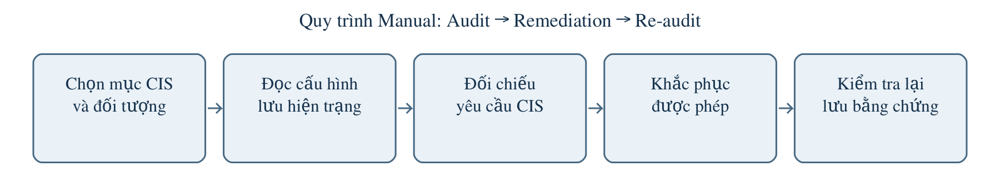
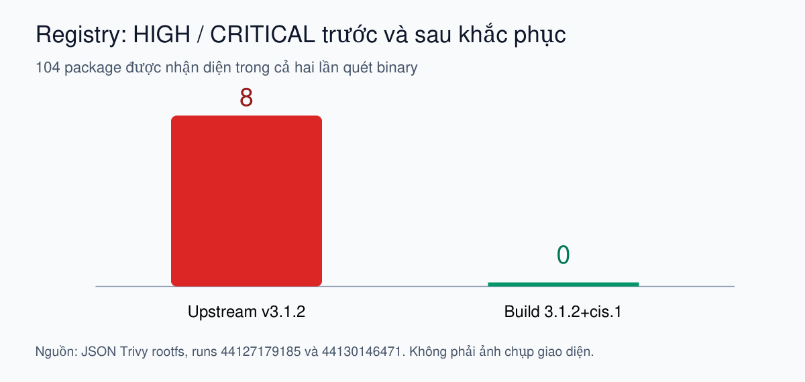
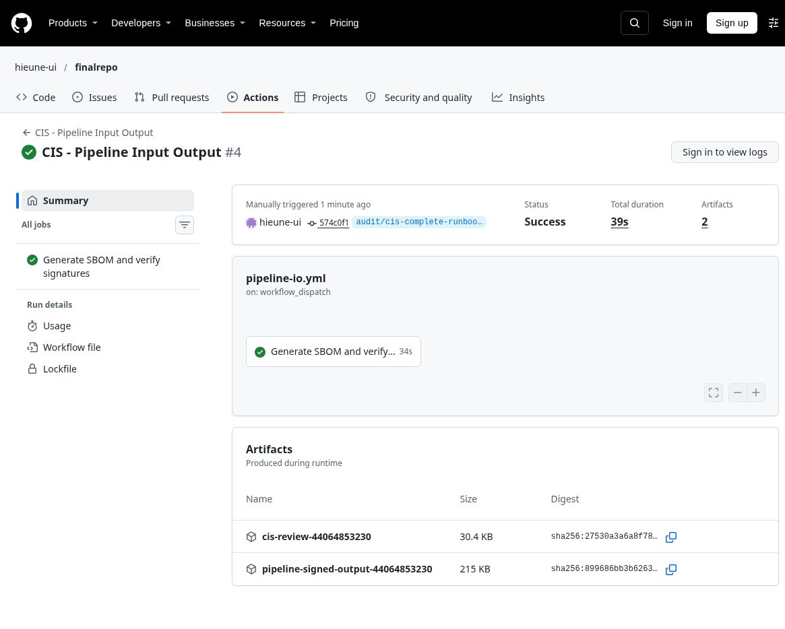
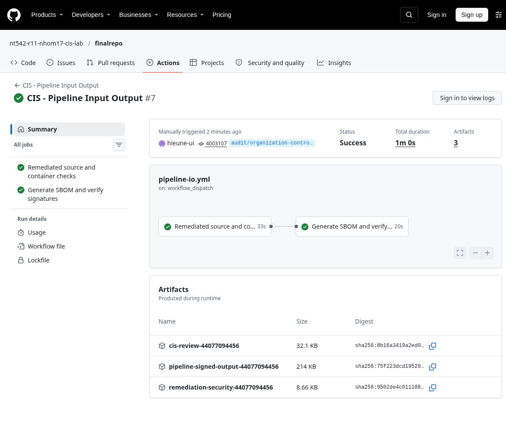

# 1. Giới thiệu benchmark

## 1.1. Tóm tắt

CIS GitHub Benchmark là bộ khuyến nghị bảo mật do Center for Internet Security phát hành. Nhóm dùng phiên bản 1.2.0, ngày 18/02/2026. Bộ khuyến nghị giúp kiểm tra cách quản lý mã, build, dependency, artifact và triển khai phần mềm. CIS trong đề tài là tổ chức xây dựng hướng dẫn bảo mật, không phải Cisco.

GitHub tham gia nhiều bước của quá trình phát triển. Thành viên đẩy mã, tạo PR, review thay đổi và chạy pipeline trên cùng nền tảng. Vì vậy, một cấu hình thiếu kiểm soát có thể ảnh hưởng nhiều bước tiếp theo. Ví dụ, token có quyền quá lớn hoặc action thay đổi ngoài dự kiến có thể làm tăng rủi ro cho sản phẩm.

Benchmark chia thành năm nhóm. Source Code có 50 tiêu chí về mã nguồn, review, quyền cộng tác và scanner. Build Pipelines có 33 tiêu chí về môi trường build, runner và các bước xử lý. Dependencies có 12 tiêu chí về thành phần bên ngoài. Artifacts có 14 tiêu chí về ký, mã hóa và phân phối. Deployment có 11 tiêu chí về cấu hình, quyền và tài khoản triển khai.

Tổng cộng có 120 tiêu chí, gồm 118 Manual và 2 Automated. Nhóm giữ cách phân loại này khi lập danh mục. Với Manual, người kiểm tra cần đọc cấu hình, xem hồ sơ hoặc thử hành vi. Với Automated, nhóm có thể dùng công cụ để kiểm tra điều kiện kỹ thuật. Script cũng hỗ trợ các mục Manual bằng cách thu dữ liệu và xuất kết quả.

Mỗi tiêu chí có mã, tên, mô tả, lý do, hướng dẫn Audit và Remediation. Audit chỉ ra nội dung cần kiểm tra. Remediation hướng dẫn cách sửa khi cấu hình chưa đáp ứng. Nhóm kiểm tra lại sau thay đổi để xem kết quả thực tế. Ví dụ, sau khi sửa SSH, nhóm mở phiên đăng nhập mới để kiểm tra kết nối.

Các profile giúp chọn mức tăng cường phù hợp. Level 2 mở rộng yêu cầu của Level 1. Nhóm chọn các mục có hướng dẫn Audit rõ và có thể kiểm tra trong lab. Với mục cần quyền cao hơn, nhóm ghi lý do và công việc còn lại. Nhãn kết quả được giải thích ở phần 4.

Môi trường chính là organization GitHub Free và repository public finalrepo của nhóm. Mã thực nghiệm nằm trên nhánh audit/remaining-free-integration. Nhóm giữ nguyên main và hai repository nguồn. GitHub-hosted runner chạy các tác vụ kiểm tra. Một VM VMware riêng được dùng cho tài khoản OS, SSH và thư mục triển khai.

Trong phạm vi Free, nhóm triển khai các chức năng hiện có. Ba mục 1.3.10, 1.3.11 và 1.3.12 cần tính năng Enterprise nên chưa làm. Nhóm vẫn liệt kê ba mục trong bảng kết quả. Cách này giúp thấy đầy đủ nội dung đã kiểm tra và nội dung còn thiếu.

Quyền API ảnh hưởng đến việc thu bằng chứng. Nhóm có thể đọc metadata repository nhưng bị chặn ở một số cấu hình quản trị. Khi API trả 403, nhóm ghi rõ cần kiểm tra Settings. Danh sách thành viên công khai cũng có thể ít hơn số người thực tế. Nhóm đối chiếu thêm quyền repository và xác nhận của thành viên.

Đề tài chọn Audit → Remediation → Re-audit làm phương pháp chung. Nhóm thực hiện theo ba cách: thủ công, tự động hóa và tự động từ xa. Dữ liệu đầu ra gồm JSON, CSV, SPDX, SARIF, log và ảnh workflow. Các tệp giúp kiểm tra lại phát hiện, cấu hình và kết quả của từng lần chạy.

Ngoài trường hợp hợp lệ, nhóm thử cả trường hợp cần bị từ chối. Các ví dụ gồm chữ ký sai, dữ liệu bị sửa, yêu cầu phát lại và tài khoản không được cấp quyền. Nhóm cũng kiểm tra việc từ chối người chạy build ngoài danh sách. Những phép thử này giúp đánh giá hành vi cụ thể thay vì chỉ xem trạng thái job.

Kết quả được gắn với môi trường và thời điểm đo. Trong lab, nhóm kiểm tra được nhiều thành phần của chuỗi cung ứng phần mềm. Các yêu cầu còn thiếu thường liên quan đến quyền quản trị, hồ sơ nhóm, dữ liệu supplier hoặc production. Bảng 120 tiêu chí ở phần 4 nêu riêng kết quả và lý do của từng mục.

## 1.2. Nội dung benchmark

Nhóm giữ mã, tên và phân loại của CIS trong hai bảng dưới. Cột mô tả ngắn nêu nội dung kiểm tra. Phần 4 ghi kết quả thực nghiệm.


| Nhóm | Nội dung | Số tiêu chí |
| --- | --- | --- |
| 1 | Source Code — quản lý mã, thay đổi, quyền và scanner | 50 |
| 2 | Build Pipelines — môi trường và quá trình build | 33 |
| 3 | Dependencies — thành phần phần mềm bên ngoài | 12 |
| 4 | Artifacts — tính toàn vẹn và phân phối sản phẩm | 14 |
| 5 | Deployment — cấu hình và môi trường triển khai | 11 |
| Tổng | 118 Manual + 2 Automated | 120 |


### 1.2.1. Manual


| STT | Tên | Mô tả ngắn |
| --- | --- | --- |
| 1 | 1.1.1 — Ensure any changes to code are tracked in a version control platform | Đối chiếu nguồn đang chạy với lịch sử Git và commit của mọi thay đổi |
| 2 | 1.1.2 — Ensure any change to code can be traced back to its associated task | Lấy mẫu commit/PR và truy về issue hoặc task được giao |
| 3 | 1.1.4 — Ensure previous approvals are dismissed when updates are introduced to a code change proposal | Đọc dismiss-stale; đẩy commit thay đổi vào PR đã được duyệt |
| 4 | 1.1.5 — Ensure there are restrictions on who can dismiss code change reviews | Kiểm tra danh sách người/nhóm được dismiss review và bypass |
| 5 | 1.1.6 — Ensure code owners are set for extra sensitive code or configuration | Tìm CODEOWNERS, so đường dẫn nhạy cảm và quyền owner |
| 6 | 1.1.7 — Ensure code owner's review is required when a change affects owned code | Đọc required code-owner review và thử PR sửa file có owner |
| 7 | 1.1.8 — Ensure inactive branches are periodically reviewed and removed | Liệt kê nhánh, ngày commit cuối, chủ sở hữu và biên bản rà soát |
| 8 | 1.1.9 — Ensure all checks have passed before merging new code | Đọc required checks; thử PR có check thất bại |
| 9 | 1.1.10 — Ensure open Git branches are up to date before they can be merged into code base | Kiểm tra strict/up-to-date requirement và PR tụt sau base |
| 10 | 1.1.11 — Ensure all open comments are resolved before allowing code change merging | Kiểm tra conversation resolution và PR còn comment chưa giải quyết |
| 11 | 1.1.12 — Ensure verification of signed commits for new changes before merging | Kiểm tra required signatures và commit verification |
| 12 | 1.1.13 — Ensure linear history is required | Đọc linear-history rule và lịch sử merge |
| 13 | 1.1.14 — Ensure branch protection rules are enforced for administrators | Xem enforce-admins và các bypass actor |
| 14 | 1.1.15 — Ensure pushing or merging of new code is restricted to specific individuals or teams | Đọc push restrictions và danh sách team/user |
| 15 | 1.1.16 — Ensure force push code to branches is denied | Đọc force-push rule; thử trên nhánh disposable được bảo vệ |
| 16 | 1.1.17 — Ensure branch deletions are denied | Đọc deletion rule; thử xóa nhánh disposable, không main |
| 17 | 1.1.18 — Ensure any merging of code is automatically scanned for risks | Đối chiếu mọi PR merge với scanner và kết quả chạy |
| 18 | 1.1.19 — Ensure any changes to branch protection rules are audited | Tìm sự kiện thay đổi protection/ruleset trong audit log và cơ chế cảnh báo |
| 19 | 1.1.20 — Ensure branch protection is enforced on the default branch | Lấy default branch qua API và đối chiếu effective protection |
| 20 | 1.2.1 — Ensure all public repositories contain a SECURITY.md file | Đọc SECURITY.md và xác minh kênh báo cáo riêng tư |
| 21 | 1.2.2 — Ensure repository creation is limited to specific members | Đọc quyền tạo repository ở cấp tổ chức |
| 22 | 1.2.3 — Ensure repository deletion is limited to specific users | Đọc quyền xóa repository và phân quyền quản trị |
| 23 | 1.2.4 — Ensure issue deletion is limited to specific users | Kiểm tra quyền xóa issue theo vai trò và audit log |
| 24 | 1.2.5 — Ensure all copies (forks) of code are tracked and accounted for | Đối chiếu danh sách forks, visibility và người chịu trách nhiệm |
| 25 | 1.2.6 — Ensure all code projects are tracked for changes in visibility status | Đọc audit log visibility change và cấu hình theo dõi |
| 26 | 1.2.7 — Ensure inactive repositories are reviewed and archived periodically | Lấy ngày cập nhật repo và biên bản đánh giá trạng thái |
| 27 | 1.3.1 — Ensure inactive users are reviewed and removed periodically | Đối chiếu thành viên, hoạt động gần nhất và nhu cầu truy cập |
| 28 | 1.3.2 — Ensure team creation is limited to specific members | Kiểm tra quyền tạo team của organization members |
| 29 | 1.3.3 — Ensure minimum number of administrators are set for the organization | Kiểm kê organization owners/admins và lý do từng quyền |
| 30 | 1.3.4 — Ensure Multi-Factor Authentication (MFA) is required for contributors of new code | Kiểm tra MFA bắt buộc cho người đóng góp, kể cả ngoài tổ chức |
| 31 | 1.3.5 — Ensure the organization is requiring members to use Multi- Factor Authentication (MFA) | Đọc yêu cầu MFA của tổ chức và trạng thái thực thi |
| 32 | 1.3.6 — Ensure new members are required to be invited using company-approved email | Đối chiếu email lời mời với domain được công ty chấp thuận |
| 33 | 1.3.7 — Ensure two administrators are set for each repository | Kiểm kê repository admins và xác minh có hai quản trị viên phù hợp |
| 34 | 1.3.8 — Ensure strict base permissions are set for repositories | Đọc default/base repository permission của tổ chức |
| 35 | 1.3.9 — Ensure an organization’s identity is confirmed with a “Verified” badge | Kiểm tra Verified badge và bằng chứng sở hữu domain |
| 36 | 1.3.10 — Ensure Source Code Management (SCM) email notifications are restricted to verified domains | Đọc giới hạn email notification tới verified domains |
| 37 | 1.3.11 — Ensure an organization provides SSH certificates | Kiểm tra SSH CA/certificate policy và vòng đời chứng chỉ |
| 38 | 1.3.12 — Ensure Git access is limited based on IP addresses | Kiểm tra IP allow list và thử nguồn truy cập được phép/không được phép |
| 39 | 1.3.13 — Ensure anomalous code behavior is tracked | Đọc cơ chế phát hiện hành vi bất thường và mẫu cảnh báo |
| 40 | 1.4.1 — Ensure administrator approval is required for every installed application | Liệt kê ứng dụng và quy trình owner approval |
| 41 | 1.4.2 — Ensure stale applications are reviewed and inactive ones are removed | Đối chiếu app installation với hoạt động và chủ sở hữu |
| 42 | 1.4.3 — Ensure the access granted to each installed application is limited to the least privilege needed | Đọc permissions và repository selection của từng app |
| 43 | 1.4.4 — Ensure only secured webhooks are used | Kiểm tra HTTPS và SSL verification của webhook mà không xuất secret |
| 44 | 1.5.1 — Ensure scanners are in place to identify and prevent sensitive data in code | Kiểm tra secret scanner, mẫu phát hiện giả và cơ chế chặn |
| 45 | 1.5.2 — Ensure scanners are in place to secure Continuous Integration (CI) pipeline instructions | Quét mọi workflow bằng công cụ kiểm tra cấu hình CI |
| 46 | 1.5.3 — Ensure scanners are in place to secure Infrastructure as Code (IaC) instructions | Kiểm kê IaC và xem report misconfiguration |
| 47 | 1.5.4 — Ensure scanners are in place for code vulnerabilities | Kiểm tra code-scanning setup và report trên đúng commit |
| 48 | 1.5.5 — Ensure scanners are in place for open-source vulnerabilities in used packages | Kiểm kê dependency, Dependabot và SCA report |
| 49 | 1.5.6 — Ensure scanners are in place for open-source license issues in used packages | Đối chiếu package licenses với chính sách sử dụng |
| 50 | 2.1.1 — Ensure each pipeline has a single responsibility | Kiểm tra trách nhiệm và quyền của từng pipeline |
| 51 | 2.1.2 — Ensure all aspects of the pipeline infrastructure and configuration are immutable | Đối chiếu image/infrastructure/config với phiên bản và cơ chế sửa trực tiếp |
| 52 | 2.1.3 — Ensure the build environment is logged | Kiểm tra log môi trường build và chính sách giữ log |
| 53 | 2.1.4 — Ensure the creation of the build environment is automated | Tạo lại môi trường build từ mã trong môi trường sạch |
| 54 | 2.1.5 — Ensure access to build environments is limited | Liệt kê người/app có quyền vào môi trường build |
| 55 | 2.1.6 — Ensure users must authenticate to access the build environment | Thử truy cập chưa xác thực trong môi trường kiểm thử |
| 56 | 2.1.7 — Ensure build secrets are limited to the minimal necessary scope | Đọc metadata phạm vi secrets mà không đọc giá trị |
| 57 | 2.1.8 — Ensure the build infrastructure is automatically scanned for vulnerabilities | Xem scan của hạ tầng build, phạm vi và chu kỳ cập nhật |
| 58 | 2.1.9 — Ensure default passwords are not used | Đối chiếu cấu hình dịch vụ với danh sách default credentials, không brute-force |
| 59 | 2.1.10 — Ensure webhooks of the build environment are secured | Đọc cấu hình webhook build: HTTPS, certificate verification, auth |
| 60 | 2.1.11 — Ensure minimum number of administrators are set for the build environment | Kiểm kê admin của build system và lý do cấp quyền |
| 61 | 2.2.1 — Ensure build workers are single-used | Kiểm tra runner lifecycle, reuse và dữ liệu tồn dư giữa job |
| 62 | 2.2.2 — Ensure build worker environments and commands are passed and not pulled | Kiểm tra nguồn lệnh/config được cung cấp cho worker |
| 63 | 2.2.3 — Ensure the duties of each build worker are segregated | Đối chiếu nhiệm vụ/credentials giữa các worker |
| 64 | 2.2.4 — Ensure build workers have minimal network connectivity | Kiểm tra egress policy và thử endpoint allowed/denied |
| 65 | 2.2.5 — Ensure run-time security is enforced for build workers | Kiểm tra runtime security agent/policy và sự kiện thử nghiệm |
| 66 | 2.2.6 — Ensure build workers are automatically scanned for vulnerabilities | Quét package của worker đúng image/version |
| 67 | 2.2.7 — Ensure build workers' deployment configuration is stored in a version control platform | Đối chiếu cấu hình triển khai worker với Git commit |
| 68 | 2.2.8 — Ensure resource consumption of build workers is monitored | Theo dõi CPU/RAM/disk trong tải thực tế và cảnh báo |
| 69 | 2.3.1 — Ensure all build steps are defined as code | So toàn bộ bước build với YAML/script đang version-control |
| 70 | 2.3.2 — Ensure steps have clearly defined build stage input and output | Kiểm tra contract input/output từng stage |
| 71 | 2.3.3 — Ensure output is written to a separate, secured storage repository | Xác định kho output, quyền truy cập và tách biệt nguồn |
| 72 | 2.3.4 — Ensure changes to pipeline files are tracked and reviewed | Lấy mẫu thay đổi workflow và review tương ứng |
| 73 | 2.3.5 — Ensure access to build process triggering is minimized | Kiểm kê ai có thể dispatch/rerun/trigger qua token hoặc event |
| 74 | 2.3.6 — Ensure pipelines are automatically scanned for misconfigurations | Quét misconfiguration toàn bộ pipeline files |
| 75 | 2.3.7 — Ensure pipelines are automatically scanned for vulnerabilities | Kiểm tra vulnerability scanner cho pipeline và tools được dùng |
| 76 | 2.4.1 — Ensure all artifacts on all releases are signed | Kiểm kê mọi release và mọi artifact có chữ ký hợp lệ |
| 77 | 2.4.2 — Ensure all external dependencies used in the build process are locked | Kiểm kê dependency và lock/version/hash thực tế |
| 78 | 2.4.3 — Ensure dependencies are validated before being used | Đối chiếu hash/chữ ký với trusted source trước sử dụng |
| 79 | 2.4.4 — Ensure the build pipeline creates reproducible artifacts | Build lặp lại cùng input trong môi trường đã kiểm soát |
| 80 | 2.4.5 — Ensure pipeline steps produce a Software Bill of Materials (SBOM) | Đọc SBOM, kiểm package coverage và liên kết artifact digest |
| 81 | 2.4.6 — Ensure pipeline steps sign the Software Bill of Materials (SBOM) produced | Kiểm chữ ký SBOM và danh tính signer |
| 82 | 3.1.1 — Ensure third-party artifacts and open-source libraries are verified | Đối chiếu third-party package với checksum/chữ ký/nguồn tin cậy |
| 83 | 3.1.2 — Ensure Software Bill of Materials (SBOM) is required from all third-party suppliers | Kiểm kê nhà cung cấp và SBOM cho từng thành phần |
| 84 | 3.1.3 — Ensure signed metadata of the build process is required and verified | Kiểm signed build metadata và đối chiếu artifact digest |
| 85 | 3.1.4 — Ensure dependencies are monitored between open-source components | Đọc dependency graph và thay đổi quan hệ/transitive dependencies |
| 86 | 3.1.5 — Ensure trusted package managers and repositories are defined and prioritized | Đọc cấu hình package manager, registry precedence và namespace |
| 87 | 3.1.6 — Ensure a signed Software Bill of Materials (SBOM) of the code is supplied | Kiểm SBOM của mã giao cho bên nhận và chữ ký |
| 88 | 3.1.7 — Ensure dependencies are pinned to a specific, verified version | Kiểm mọi dependency pinned và bằng chứng verified version |
| 89 | 3.1.8 — Ensure all packages used are more than 60 days old | Tính tuổi phiên bản từ ngày phát hành tin cậy tới ngày kiểm tra |
| 90 | 3.2.1 — Ensure an organization-wide dependency usage policy is enforced | Đối chiếu chính sách dependency đã phê duyệt với enforcement |
| 91 | 3.2.2 — Ensure packages are automatically scanned for known vulnerabilities | Kiểm lịch SCA scan và freshness của vulnerability database |
| 92 | 3.2.3 — Ensure packages are automatically scanned for license implications | Đọc license inventory, policy và mẫu vi phạm |
| 93 | 3.2.4 — Ensure packages are automatically scanned for ownership change | Đối chiếu package owner hiện tại với baseline đáng tin |
| 94 | 4.1.1 — Ensure all artifacts are signed by the build pipeline itself | Xác minh artifact do pipeline ký và gắn đúng commit |
| 95 | 4.1.2 — Ensure artifacts are encrypted before distribution | Kiểm plaintext/ciphertext ở đường phân phối và thử sửa ciphertext |
| 96 | 4.1.3 — Ensure only authorized platforms have decryption capabilities of artifacts | Đối chiếu quyền giải mã, nơi giữ khóa và nền tảng được phép |
| 97 | 4.2.1 — Ensure the authority to certify artifacts is limited | Kiểm ai được ký/chứng nhận artifact và key policy |
| 98 | 4.2.2 — Ensure number of permitted users who may upload new artifacts is minimized | Kiểm registry uploader roles và nhu cầu công việc |
| 99 | 4.2.3 — Ensure user access to the package registry utilizes Multi- Factor Authentication (MFA) | Kiểm MFA/SSO của người truy cập registry và ngoại lệ |
| 100 | 4.2.4 — Ensure user management of the package registry is not local | Xác định registry identity provider và local accounts |
| 101 | 4.2.5 — Ensure anonymous access to artifacts is revoked | Thử anonymous download của artifact cần bảo vệ |
| 102 | 4.2.6 — Ensure minimum number of administrators are set for the package registry | Kiểm kê registry admins và lý do cấp quyền |
| 103 | 4.3.1 — Ensure all signed artifacts are validated upon uploading the package registry | Thử upload artifact ký hợp lệ và artifact bị sửa vào registry lab |
| 104 | 4.3.2 — Ensure all versions of an existing artifact have their signatures validated | Kiểm mọi version và chữ ký, thử downgrade hoặc overwrite |
| 105 | 4.3.3 — Ensure changes in package registry configuration are audited | Đọc audit log thay đổi registry configuration |
| 106 | 4.3.4 — Ensure webhooks of the repository are secured | Đọc webhook registry HTTPS/verification/auth metadata |
| 107 | 4.4.1 — Ensure artifacts contain information about their origin | Đọc provenance repo/commit/build/run và xác minh chữ ký |
| 108 | 5.1.1 — Ensure deployment configuration files are separated from source code | Kiểm vị trí quản lý config deploy và trust boundary với source |
| 109 | 5.1.2 — Ensure changes in deployment configuration are audited | Lấy mẫu thay đổi deploy config và audit/review trail |
| 110 | 5.1.3 — Ensure scanners are in place to identify and prevent sensitive data in deployment configuration | Quét config deployment với secret scanner và fixture giả |
| 111 | 5.1.4 — Limit access to deployment configurations | Đọc quyền thay config deployment và danh sách approver |
| 112 | 5.1.5 — Scan Infrastructure as Code (IaC) | Kiểm kê deployment IaC và report misconfiguration |
| 113 | 5.1.6 — Ensure deployment configuration manifests are verified | Kiểm chữ ký/hash deployment manifest trước áp dụng |
| 114 | 5.1.7 — Ensure deployment configuration manifests are pinned to a specific, verified version | Đối chiếu deployment manifest với phiên bản/digest đã phê duyệt |
| 115 | 5.2.1 — Ensure deployments are automated | Theo dõi pipeline triển khai và thao tác thủ công còn lại |
| 116 | 5.2.2 — Ensure the deployment environment is reproducible | Tái tạo môi trường từ input/config đã khóa và so cấu hình |
| 117 | 5.2.3 — Ensure access to production environment is limited | Kiểm kê production identities, roles, network và break-glass |
| 118 | 5.2.4 — Ensure default passwords are not used | Kiểm tra cấu hình production không còn default password, không đăng nhập thử tùy tiện |


### 1.2.2. Automated


| STT | Tên | Mô tả ngắn |
| --- | --- | --- |
| 1 | 1.1.3 — Ensure any change to code receives approval of two strongly authenticated users | Kiểm tra yêu cầu hai người phê duyệt độc lập có xác thực mạnh và hiệu lực ngăn merge khi thiếu điều kiện. |
| 2 | 2.3.8 — Ensure scanners are in place to identify and prevent sensitive data in pipeline files | Kiểm tra scanner nhận diện và ngăn dữ liệu nhạy cảm trong pipeline files; đối chiếu phạm vi và cơ chế chặn. |

# 2. Phương pháp làm việc

Nhóm dùng Audit → Remediation → Re-audit cho từng mục. Audit xác định hiện trạng. Remediation xử lý điểm cần sửa. Re-audit kiểm tra lại sau thay đổi.

## 2.1. Manual

Nhóm bắt đầu bằng cách đọc hướng dẫn Audit và chọn đối tượng kiểm tra. Đối tượng có thể là repository, organization, tài khoản hoặc VM. Sau đó, nhóm ghi lại cấu hình ban đầu và so với yêu cầu của tiêu chí. Với quyền truy cập, nhóm xem cả quyền trực tiếp và quyền kế thừa.

Ở bước Remediation, nhóm sửa cấu hình trong phạm vi được phép. Ví dụ, nhóm đổi base permissions thành No permission và bật Push protection trên finalrepo. Với VM, nhóm tạo tài khoản cisdeploy không có sudo và đặt thư mục triển khai ở mode 700. Các thay đổi đều có bước kiểm tra lại.

Re-audit gồm kiểm tra cấu hình sau lưu và thử hành vi nếu an toàn. Nhóm dùng cisdeploy tạo tệp trong thư mục triển khai. Tiếp đó, nhóm dùng nobody thử tạo tệp và nhận Permission denied. Khi sửa SSH, nhóm giữ phiên quản trị cũ rồi thử đăng nhập từ PowerShell mới.

Nhóm ghi lệnh, kết quả, mã tiêu chí và đối tượng kiểm tra. Những mục cần quyết định quản trị phải có xác nhận của người có quyền. Ví dụ, số admin dự phòng và lịch rà thành viên phải được nhóm thống nhất. Tên người duyệt và thời gian rà chỉ được ghi khi có hoạt động thật.

Khi thiếu quyền đọc, nhóm nêu rõ bước chưa thực hiện. Với ảnh Settings và terminal VM còn thiếu tệp gốc, nhóm giữ kết quả theo đầu ra đã nhận. Công việc bổ sung được ghi trong bảng kết quả.

Workflow Manual chỉ gồm các bước lớn dưới đây. Nhóm áp dụng cùng chu trình cho các mục có hướng dẫn Audit rõ.

{width=95%}

\newpage

## 2.2. Automated

Nhóm tự động hóa các tác vụ lặp lại như kiểm hash, quét mã và xác minh chữ ký. Trước khi chạy, nhóm xác định đầu vào, phiên bản công cụ và điều kiện lỗi. Action được ghim bằng SHA; image và wheel có digest hoặc hash tương ứng.

Sau bước Audit, nhóm sửa nguồn hoặc cấu hình có phát hiện. Re-audit chạy lại cùng phép kiểm để so kết quả trước và sau. Với artifact, bản gốc phải xác minh được. Bản bị sửa và chữ ký sai phải bị từ chối.

Trường hợp registry cho thấy cần đọc kỹ đầu ra scanner. Lần quét filesystem đầu tiên không nhận diện binary Go. Nhóm chuyển sang quét rootfs và kiểm tra danh sách package. Lần quét này nhận diện 104 package và 8 HIGH. Sau khắc phục, kết quả còn 0 HIGH/CRITICAL ở thời điểm đo.

{width=95%}

| Tool / step | Kết quả | Nội dung nhóm kiểm tra |
| --- | --- | --- |
| Bandit / pip-audit | Lỗi mã và advisory | Đúng phạm vi Python và package đã khóa |
| Trivy và kiểm kê package | CVE, image và binary | Danh sách package phải nhận diện đúng đối tượng |
| OpenSSL và phép thử từ chối | Chữ ký và dữ liệu gốc | Bản sửa hoặc khóa sai phải thất bại |
| JSON / CSV / SPDX / SARIF | Tệp kết quả | Đối chiếu số liệu, phạm vi và lỗi công cụ |

Nhóm đọc nội dung tệp trước khi kết luận. CodeQL được kiểm tra bằng SARIF và đường truyền dữ liệu của cảnh báo. Các test hồi quy giúp phát hiện lỗi xử lý quyền, dữ liệu sửa và chữ ký sai. Kết quả từng công cụ được đưa vào bảng triển khai.

\newpage

## 2.3. Remote automated

Nhóm chạy các script trên GitHub-hosted runner bằng push hoặc thao tác chạy workflow thủ công. Các job chỉ dùng nhánh audit được phép. Trước tác vụ chính, nhóm kiểm repository ID, actor ID và người yêu cầu chạy lại. Checkout không lưu credential vào cấu hình Git.

Token mặc định chỉ có quyền đọc nội dung. Riêng job CodeQL được ghi kết quả phân tích bảo mật. Nhóm đặt token trong biến môi trường và loại giá trị bí mật khỏi báo cáo đầu ra. Các job có thời hạn chạy và kho artifact theo từng phiên.

GitHub API cung cấp dữ liệu cho bước Audit. Nhóm dùng HTTPS GET, phiên bản API và timeout. Với danh sách dài, script đọc phân trang trước khi đếm. Nếu field thiếu hoặc API chặn đọc, nhóm ghi việc cần kiểm tra bằng Settings.

{width=95%}

| Endpoint GET | Dữ liệu nhóm thu | Cách đối chiếu |
| --- | --- | --- |
| /repos/{owner}/{repo} | Metadata, nhánh mặc định | Đúng repository cần đánh giá |
| /branches/{branch}/protection; /rulesets | Quy tắc nhánh | Đọc quyền truy cập và cấu hình hiệu lực |
| /collaborators; org members | Vai trò, danh sách thành viên | Phân trang và đối chiếu phạm vi đọc |
| /actions/permissions; /actions/runners | Quyền Actions và runner | Ghi mã HTTP nếu bị chặn |

Nhóm tải artifact và đọc JSON, CSV hoặc SARIF để chốt kết quả. Các thay đổi mã được đẩy lên nhánh audit rồi chạy lại. VM VMware được vận hành riêng qua SSH từ Windows. Nhóm chuyển báo cáo VM bằng SCP, sau đó đối chiếu các phép kiểm trong tệp.

\newpage

{width=95%}

{width=95%}

\newpage

{width=95%}

{width=95%}

\newpage

{width=95%}

# 3. Triển khai

## 3.1. Mô hình (Topology)

Nhóm triển khai mô hình trong Hình 2.4. Các thành phần chính gồm GitHub Organization, repository, runner, dịch vụ thử và VM VMware.

### 3.1.1. GitHub Organization và repository

Organization Free quản lý repository public finalrepo. Nhóm dùng nhánh audit/remaining-free-integration để tổng hợp mã thực nghiệm. Sáu nhánh trung gian đã được sao lưu rồi xóa sau khi kiểm tra lịch sử. Các commit cũ vẫn nằm trong nhánh tổng hợp. Main và hai repository nguồn được giữ nguyên.

### 3.1.2. Thành viên và quyền

Nhóm đối chiếu bốn tài khoản qua API repository và xác nhận của thành viên. Bảng dưới ghi quyền hiện có và tình trạng MFA đã được cung cấp.

| Tài khoản | Quyền repository | Tình trạng |
| --- | --- | --- |
| hieune-ui | Admin | Đã xác nhận bật MFA |
| Vuongdlx | Write | Đã xác nhận bật MFA |
| HiepTran01 | Write | Đã xác nhận bật MFA |
| dtk0106 | Read | Chưa hoàn tất MFA |

Repository hiện có một Admin, hai Write và một Read. Nhóm chưa chốt admin dự phòng. CODEOWNERS đã khai báo tệp nhạy cảm. Việc yêu cầu hai reviewer độc lập còn cần PR thử và cấu hình bảo vệ nhánh.

### 3.1.3. Runner và dịch vụ thử

GitHub-hosted runner dùng Ubuntu 24.04. Runner checkout mã, kiểm quyền chạy, thực hiện unit test và chạy scanner. Artifact lưu JSON, CSV, SPDX, SARIF và gói có chữ ký. Nhóm lưu khóa ký tạm ngoài thư mục đầu ra và xóa sau phép thử.

Receiver Python chạy HTTPS trên loopback. Nhóm thử HMAC, phát lại yêu cầu, loại sự kiện và kích thước dữ liệu. Registry Distribution cũng chạy loopback với TLS và tài khoản bcrypt. Nhóm tải lên hai phiên bản, tải lại manifest/blob/chữ ký và kiểm tra dữ liệu sửa.

### 3.1.4. VM VMware

VM dùng Ubuntu 22.04.4 LTS, Python 3.10.12 và 2 vCPU. Đầu ra ban đầu ghi RAM khoảng 2 GiB và phân vùng root còn 4.3 GiB. Nhóm chưa có số đo sau hướng dẫn tăng RAM lên 4 GiB.

Thành viên dùng SSH từ Windows qua mạng NAT. Tài khoản user giữ quyền quản trị VM. Tài khoản cisdeploy chỉ thuộc nhóm riêng và không có sudo. Thư mục /opt/cis-deploy-lab thuộc cisdeploy, mode 700.

Nhóm dùng cisdeploy tạo tệp thành công, còn nobody bị từ chối. Sau reload SSH, user và cisdeploy đăng nhập được từ phiên mới. Root có trạng thái mật khẩu L; user và cisdeploy có trạng thái P. Nhóm ghi nhận PermitRootLogin no và PermitEmptyPasswords no.

## 3.2. Triển khai Manual

Nhóm ghi thao tác, kết quả và trạng thái theo bằng chứng hiện có. Hình 2.6–2.8 là ảnh workflow; ảnh Settings và terminal VM cần được bổ sung riêng.

| Mục | Kết quả | Đạt hay không đạt |
| --- | --- | --- |
| 1.2.1 — SECURITY.md | Nhóm có policy; kênh báo cáo riêng tư còn cần địa chỉ cụ thể. | Đạt một phần |
| 1.2.3 — Xóa/chuyển repository | Nhóm thấy tùy chọn cho thành viên xóa/chuyển repository đã tắt; cần ảnh sau lưu. | Chưa làm |
| 1.2.4 — Xóa issue | Tùy chọn cho repo admin xóa issue đã tắt theo quan sát; nhóm cần ảnh gốc. | Chưa làm |
| 1.2.6 — Visibility | Nhóm hạn chế đổi visibility; chưa kiểm tra sự kiện đổi visibility và kỳ rà. | Chưa làm |
| 1.3.2 — Tạo team | Nhóm thấy quyền tạo team đã tắt; cần ảnh sau tải lại và phép thử quyền. | Chưa làm |
| 1.3.4/1.3.5 — MFA | Ba người xác nhận đã bật; dtk0106 chưa hoàn tất; nhóm cần kiểm cơ chế bắt buộc. | Chưa làm |
| 1.3.7 — Admin repository | Nhóm thấy một Admin; quyết định quản trị viên dự phòng còn thiếu. | Chưa làm |
| 1.3.8 — Quyền nền | Nhóm đổi thành No permission; cần ảnh sau tải lại và kiểm tra quyền kế thừa. | Chưa làm |
| 1.4.1 — Phê duyệt ứng dụng | Nhóm rà giới hạn cài app; hồ sơ phê duyệt và trạng thái sau lưu còn thiếu. | Đạt một phần |
| 1.4.2 — Rà ứng dụng | Nhóm kiểm tra ứng dụng đang dùng; lịch rà và tiêu chí gỡ chưa được duyệt. | Đạt một phần |
| 1.4.3 — Quyền ứng dụng | ChatGPT Codex Connector giới hạn vào finalrepo; nhóm cần giải trình quyền issues và PR. | Đạt một phần |
| 1.4.4 — Webhook | Nhóm chưa cài hook GitHub; receiver riêng đã qua 11 phép thử HTTPS. | Đạt một phần |
| 1.5.1 — Secret scanning | Nhóm bật Secret Protection và Push protection; lịch sử credential còn cần xử lý. | Đạt một phần |
| 1.5.5/3.2.2 — Dependency alerts | Nhóm bật Dependency graph và Dependabot alerts; hai quy tắc tự đóng cảnh báo đã tắt. | Đạt một phần |
| 3.1.4 — SBOM GitHub | Nhóm xuất SPDX 2.3: 10 package, gồm repository và 9 mục action/phiên bản của 8 action repo. | Đạt một phần |
| 5.2.3 — Quyền triển khai | cisdeploy không sudo, thư mục mode 700; nobody bị từ chối và phiên SSH hợp lệ thành công. | Đạt một phần |
| 5.2.4 — Mật khẩu | Root bị khóa mật khẩu và chặn SSH; nhóm cần xác nhận mật khẩu user và tài khoản dịch vụ. | Đạt một phần |

## 3.3. Triển khai tự động hóa

Nhóm chạy bốn workflow chính. Pipeline Input Output kiểm tra mã, container và dữ liệu đầu ra. Pipeline Security Scan quét cấu hình workflow. Remaining Free integrations thử dịch vụ HTTPS và thu dữ liệu. CodeQL Python Audit phân tích mã Python.

### 3.3.1. Công cụ và file xuất kết quả

| Mục / nhóm | Tool / step → Kết quả | File xuất |
| --- | --- | --- |
| 1.1.3 và bảo vệ nhánh | Nhóm gọi API protection và rules; API quản trị có trả 403. | [github-api.json](../audit/evidence/github-api.json), [CSV](../audit/evidence/github-api.csv) |
| 1.1.19; 1.3; 2.1.11 | Nhóm thu dữ liệu cho 12 mục và so cấu hình ruleset. | [pending-free-baseline.json](../audit/evidence/pending-free-baseline.json) |
| 1.3.13 | Nhóm ghi thay đổi tệp nhạy cảm và mẫu workflow nguy hiểm. | Artifact run 44259692512: code-monitor/results.json |
| 2.1.5/2.1.6 | Nhóm kiểm repository, actor, nhánh và lần chạy lại. | Artifact run 44259692512: build-access/results.json |
| 1.1.8/1.2.5/1.2.7 | Nhóm kiểm kê nhánh, fork và repository. | [governance](../audit/evidence/governance-review-2026-11-18.json), [organization](../audit/evidence/organization-review-2026-11-18.json) |
| 1.5.1/2.3.8 | Gitleaks quét mã hiện tại và phát hiện mẫu nhạy cảm. | [Gitleaks](../audit/evidence/current-source-gitleaks.json), [phép thử scanner](../audit/evidence/scanner-selftest.json) |
| 1.5.2/2.3.7 | Nhóm dùng Actionlint và Zizmor kiểm tra workflow. | Log Pipeline Security Scan 44259692655 |
| 1.5.4 | Bandit ghi 0 HIGH; CodeQL ghi 0 cảnh báo với 43 quy tắc. | [Bandit](../audit/evidence/bandit-org-run.json), [CodeQL](../audit/evidence/codeql-review-summary.json) |
| 1.5.3/1.5.5/2.1.8 | Nhóm quét mã, image và binary, có bước kiểm kê package. | [Trivy mã nguồn](../audit/evidence/trivy-source.json), [Trivy image](../audit/evidence/trivy-image.json) |
| 3.2.2 | Nhóm quét đúng 32/32 package, ghi 0 advisory tại thời điểm đo. | [pip-audit](../audit/evidence/python-package-audit-org-run.json), [coverage](../audit/evidence/dependency-coverage-org-run.json) |
| 3.1.2 | Nhóm kiểm kê 43 đầu vào; còn thiếu SBOM từ nhà cung cấp. | [supplier-intake-review.json](../audit/evidence/supplier-intake-review.json) |
| 3.1.4/3.1.6 | Nhóm xuất 32 nút, 145 quan hệ; 32 quan hệ hoạt động ở môi trường mặc định. | [dependency graph](../audit/evidence/free-dependency-graph.json), [SPDX GitHub](../audit/evidence/github-native-sbom.spdx.json) |
| 3.2.4 | Nhóm đối chiếu ID của chín repository action và chủ sở hữu. | [action-owners-review](../audit/evidence/action-owners-review-2026-11-18.json) |
| 2.4.1; 3.1.3; nhóm 4/5 | Nhóm ký gói nguồn và thử dữ liệu sửa, chữ ký sai. | [xác minh bundle](../audit/evidence/free-bundle-verification.json), [gói có chữ ký](../audit/evidence/free-controls-export.zip) |
| 1.4.4/2.1.10 | Receiver hoàn thành 11 phép thử HTTPS. | [webhook-reaudit](../audit/evidence/webhook-reaudit-2026-11-18.json) |
| 4.2.2/4.2.5/4.3.2 | Registry hoàn thành 23 phép thử với hai phiên bản. | [registry-reaudit](../audit/evidence/registry-reaudit-2026-11-18.json), [CSV 34 phép thử](../audit/evidence/remaining-integration-checks.csv) |
| 5.2.3/5.2.4 | Nhóm kiểm tài khoản, SSH và thư mục VM theo thao tác riêng. | [VM access review](../audit/evidence/vm-access-review.json), [preflight](../audit/evidence/pending-cloud-preflight.json) |

### 3.3.2. Các trường hợp khắc phục

**Registry.** Nhóm chuyển từ quét filesystem sang rootfs khi binary Go không được nhận diện. Bản quét đúng ghi 104 package và 8 HIGH. Nhóm build lại Distribution 3.1.2 thành 3.1.2+cis.1 bằng Go 1.27.4 và dependency đã khóa. Lần kiểm tra sau ghi 0 HIGH/CRITICAL. Hình 2.5 thể hiện hai kết quả.

**CodeQL.** Nhóm nhận hai cảnh báo lưu và ghi log dữ liệu nhạy cảm. Dữ liệu thực tế là SHA256 của public key. Nhóm làm rõ tên biến rồi chạy lại cùng 43 quy tắc. SARIF ghi 0 cảnh báo và quá trình phân tích hoàn tất. Nhóm cũng thử để vật liệu khóa riêng không xuất hiện trong tệp hoặc log.

**Artifact.** Nhóm tạo ZIP hai lần và so byte. Gói kết quả gồm ba tệp được ký cùng metadata về mã nguồn. Bản gốc xác minh được. Tệp bị sửa, manifest bị sửa hoặc khóa đối chiếu sai đều bị từ chối. Phép thử mã hóa kiểm chữ ký trước giải mã và từ chối ciphertext bị sửa.

**VM.** Nhóm nhận ba báo cáo từ Ubuntu: 5 phép thử supply chain, 13 phép thử registry mô hình và 11 phép thử webhook. Cả 29 phép thử thành công. Các bước tài khoản và SSH được kiểm tra riêng trên VM. Registry mô hình dùng dữ liệu vai trò và MFA mẫu.

### 3.3.3. Chạy lại các phép kiểm

Nhóm chạy lệnh từ thư mục repository. Registry integration cần binary đúng SHA256 trong tệp khóa. Các kết quả mới được ghi vào reports/.

```bash
python3 -m unittest discover -s tests -v
python3 scripts/audit_free_controls.py --repo nt542-r11-nhom17-cis-lab/finalrepo
python3 scripts/webhook_integration.py
python3 scripts/registry_integration.py --registry /duong-dan/registry-da-xac-minh
```

Nhóm lưu JSON, CSV, SPDX và SARIF trong reports/ để đối chiếu từng phép kiểm.

# 4. Kết quả

## 4.1. Cách ghi kết quả

Nhóm dùng bốn nhãn dưới đây. Với các mục thiếu ảnh hoặc quyền xác minh, nhóm ghi công việc còn lại trong cột Ghi chú.

| Nhãn | Cách hiểu | Điều kiện |
| --- | --- | --- |
| Đạt | Nhóm đã kiểm chứng đầy đủ yêu cầu. | Có bằng chứng phù hợp cho toàn tiêu chí. |
| Đạt một phần | Nhóm đã kiểm tra được một phần yêu cầu. | Còn phạm vi hoặc bước kiểm tra khác. |
| Không đạt | Phép kiểm cho thấy yêu cầu không được đáp ứng. | Có kết quả thực tế để kết luận. |
| Chưa làm | Bước xác minh yêu cầu chưa được thực hiện. | Ghi lý do cần quyền, ảnh, quyết định hoặc môi trường. |

## 4.2. Phiên chạy và mốc mã nguồn

Nhóm gắn kết quả với các mốc trong bảng. Số 71 test và bốn workflow thành công thuộc mốc mã kiểm thử. Các phép đo registry, CodeQL và VM có nguồn riêng.

| Đối tượng | Commit | Dữ liệu liên quan |
| --- | --- | --- |
| Mã kiểm thử/workflow | [09aeae0](https://github.com/nt542-r11-nhom17-cis-lab/finalrepo/commit/09aeae0f04e9724a30acdf60e3810a5614d2d18c) | 71 test và bốn workflow trong bảng phiên chạy. |
| Tài liệu và dữ liệu nguồn | [6cbf635](https://github.com/nt542-r11-nhom17-cis-lab/finalrepo/commit/6cbf6352d9d67696e365161fe825b5e56c2e6777) | Danh mục tiêu chí và số liệu nguồn. |
| Hướng dẫn thực hành | 4df397d | Quy trình thao tác trên nhánh audit. |
| Main được giữ nguyên | [e052945](https://github.com/nt542-r11-nhom17-cis-lab/finalrepo/commit/e052945db5b4a2bace480b5ab98446a8b82da02e) | Nhóm không sửa main trong thực nghiệm. |

| Workflow | Run ID | Kết quả chạy |
| --- | --- | --- |
| Pipeline Security Scan | 44259692655 | Thành công |
| CodeQL Python Audit | 44259692668 | Thành công |
| Pipeline Input Output | 44259692722 | Thành công |
| Remaining Free integrations | 44259692512 | Thành công |

| Phép kiểm | Kết quả | Nguồn |
| --- | --- | --- |
| CodeQL | 0 cảnh báo, 43 quy tắc; phân tích hoàn tất. | SARIF và dữ liệu đối chiếu CodeQL. |
| HTTPS | 11 webhook và 23 registry thành công. | Báo cáo dịch vụ loopback. |
| Registry trước/sau | 104 package; 8 HIGH trước, 0 HIGH/CRITICAL sau. | Runs 44127179185 và 44130146471. |
| VM | 5 supply chain + 13 registry mô hình + 11 webhook thành công. | Ba JSON do nhóm chuyển từ VM. |
| Wheel và giấy phép | 32/32 hash khớp; 20 giấy phép cần xét thủ công. | Metadata PyPI và danh mục công cụ. |
| Actions | ID của chín action và chủ sở hữu không đổi. | Bản đối chiếu ID trong evidence. |

## 4.3. Thống kê

Nhóm có bằng chứng thành phần cho 82 tiêu chí. 38 mục còn lại cần kiểm tra thực tế, quyền truy cập hoặc tính năng Enterprise.

| Phạm vi | Đạt | Đạt một phần | Không đạt | Chưa làm |
| --- | --- | --- | --- | --- |
| Toàn bộ 120 tiêu chí | 0 | 82 | 0 | 38 |
| 48 tiêu chí Free được chọn | 0 | 34 | 0 | 14 |

Tổng bảng là 120 mục; nhóm Free có 48 mục. Nhóm chưa có mục Đạt. Các mục có quan sát ban đầu nhưng thiếu ảnh hoặc kiểm tra hiệu lực vẫn nêu kết quả quan sát trong ghi chú.

## 4.4. Đối chiếu 120 tiêu chí

### Nhóm 1. Source Code

| Mục | Kết quả | Ghi chú |
| --- | --- | --- |
| 1.1.1 — Ensure any changes to code are tracked in a version control platform | Đạt một phần | Nhóm đóng gói mã theo cây Git; còn mã ngoài repository chưa được kiểm kê. |
| 1.1.2 — Ensure any change to code can be traced back to its associated task | Đạt một phần | Nhóm thêm mã công việc vào mẫu PR; cần PR thật để kiểm tra liên kết nhiệm vụ. |
| 1.1.3 — Ensure any change to code receives approval of two strongly authenticated users | Chưa làm | API chặn đọc branch protection; nhóm cần ảnh Settings và PR thử với hai người phê duyệt. |
| 1.1.4 — Ensure previous approvals are dismissed when updates are introduced to a code change proposal | Chưa làm | Nhóm chưa kiểm thử việc hủy phê duyệt cũ vì API chặn đọc quy tắc. |
| 1.1.5 — Ensure there are restrictions on who can dismiss code change reviews | Chưa làm | Mẫu giới hạn người hủy review đã có; nhóm cần áp dụng trên nhánh thử và kiểm tra quyền. |
| 1.1.6 — Ensure code owners are set for extra sensitive code or configuration | Đạt một phần | Nhóm khai báo CODEOWNERS cho tệp nhạy cảm; phân công người sở hữu mới còn chờ xác nhận. |
| 1.1.7 — Ensure code owner's review is required when a change affects owned code | Đạt một phần | Nhóm xác định người sở hữu mã; cần kiểm tra PR bị chặn khi thiếu phê duyệt của họ. |
| 1.1.8 — Ensure inactive branches are periodically reviewed and removed | Đạt một phần | Nhóm kiểm kê nhánh và xóa sáu nhánh đã gộp; lịch rà định kỳ còn chờ duyệt. |
| 1.1.9 — Ensure all checks have passed before merging new code | Chưa làm | Nhóm cần đọc quy tắc bắt buộc kiểm tra và thử PR lỗi; API hiện trả 403. |
| 1.1.10 — Ensure open Git branches are up to date before they can be merged into code base | Chưa làm | Nhóm chưa thử PR chậm hơn nhánh đích; cần quyền đọc và cấu hình nhánh thử. |
| 1.1.11 — Ensure all open comments are resolved before allowing code change merging | Chưa làm | Quy tắc giải quyết hội thoại chưa được kiểm chứng; nhóm cần PR có nhận xét còn mở. |
| 1.1.12 — Ensure verification of signed commits for new changes before merging | Chưa làm | Nhóm cần thử commit có chữ ký và không có chữ ký; quyền đọc cấu hình còn bị chặn. |
| 1.1.13 — Ensure linear history is required | Chưa làm | Lịch sử tuyến tính chưa được thử; nhóm cần đối chiếu quy tắc và thao tác gộp trên nhánh riêng. |
| 1.1.14 — Ensure branch protection rules are enforced for administrators | Chưa làm | Nhóm chưa thử quyền vượt quy tắc của quản trị viên; cần kiểm tra nhánh thử bằng tài khoản thật. |
| 1.1.15 — Ensure pushing or merging of new code is restricted to specific individuals or teams | Chưa làm | Danh sách được phép đẩy mã chưa được kiểm chứng; nhóm cần Settings và thử tài khoản ngoài danh sách. |
| 1.1.16 — Ensure force push code to branches is denied | Chưa làm | API trả 403 khi đọc bảo vệ nhánh; nhóm chưa thử từ chối force push. |
| 1.1.17 — Ensure branch deletions are denied | Chưa làm | Nhóm chưa thử chặn xóa nhánh; cần nhánh dùng một lần với cấu hình bảo vệ rõ ràng. |
| 1.1.18 — Ensure any merging of code is automatically scanned for risks | Đạt một phần | Nhóm quét tự động khi đẩy lên nhánh audit; việc bắt buộc quét trước mọi lần gộp còn thiếu. |
| 1.1.19 — Ensure any changes to branch protection rules are audited | Đạt một phần | Nhóm lưu và so sánh cấu hình ruleset; còn thiếu sự kiện thay đổi có người thực hiện và thời gian. |
| 1.1.20 — Ensure branch protection is enforced on the default branch | Chưa làm | Nhóm chưa xác nhận bảo vệ nhánh mặc định vì API không cho đọc cấu hình. |
| 1.2.1 — Ensure all public repositories contain a SECURITY.md file | Đạt một phần | Nhóm có SECURITY.md; cần bổ sung kênh tiếp nhận báo cáo riêng tư cụ thể. |
| 1.2.2 — Ensure repository creation is limited to specific members | Chưa làm | Tùy chọn tạo repository còn bị giới hạn theo gói; nhóm cần owner xác nhận quyền tạo thực tế. |
| 1.2.3 — Ensure repository deletion is limited to specific users | Chưa làm | Nhóm thấy quyền xóa/chuyển repository đã tắt; cần ảnh sau lưu để chốt kiểm tra. |
| 1.2.4 — Ensure issue deletion is limited to specific users | Chưa làm | Quyền xóa issue đã tắt theo quan sát; nhóm cần ảnh gốc và đối chiếu vai trò. |
| 1.2.5 — Ensure all copies (forks) of code are tracked and accounted for | Đạt một phần | Nhóm kiểm kê fork bằng API có phân trang; sổ mục đích và người duyệt còn thiếu. |
| 1.2.6 — Ensure all code projects are tracked for changes in visibility status | Chưa làm | Nhóm hạn chế đổi visibility; chưa ghi nhận sự kiện đổi visibility và kỳ rà tương ứng. |
| 1.2.7 — Ensure inactive repositories are reviewed and archived periodically | Đạt một phần | Nhóm kiểm kê một repository và tuổi lần đẩy mã; quyết định lưu trữ định kỳ chưa có. |
| 1.3.1 — Ensure inactive users are reviewed and removed periodically | Đạt một phần | Nhóm đọc được bốn cộng tác viên; hoạt động đăng nhập và quyết định thu hồi quyền còn thiếu. |
| 1.3.2 — Ensure team creation is limited to specific members | Chưa làm | Nhóm thấy quyền tạo team đã tắt; cần ảnh sau tải lại và thử theo vai trò. |
| 1.3.3 — Ensure minimum number of administrators are set for the organization | Chưa làm | Danh sách owner qua API chưa đầy đủ; nhóm cần xác nhận số quản trị viên và lý do cấp quyền. |
| 1.3.4 — Ensure Multi-Factor Authentication (MFA) is required for contributors of new code | Chưa làm | Ba người xác nhận bật MFA; dtk0106 chưa hoàn tất, cơ chế bắt buộc chưa được kiểm chứng. |
| 1.3.5 — Ensure the organization is requiring members to use Multi- Factor Authentication (MFA) | Chưa làm | Nhóm chưa đọc được yêu cầu MFA toàn organization; cần ảnh Settings sau xác nhận của owner. |
| 1.3.6 — Ensure new members are required to be invited using company-approved email | Chưa làm | API lời mời trả 403; nhóm cần danh sách email được duyệt và hồ sơ lời mời thực tế. |
| 1.3.7 — Ensure two administrators are set for each repository | Chưa làm | Nhóm thấy một quản trị viên repository; cần xác nhận quyền đầy đủ và quyết định người dự phòng. |
| 1.3.8 — Ensure strict base permissions are set for repositories | Chưa làm | Nhóm đổi quyền nền thành No permission; cần ảnh gốc sau tải lại và kiểm tra quyền kế thừa. |
| 1.3.9 — Ensure an organization’s identity is confirmed with a “Verified” badge | Chưa làm | API ghi organization chưa có Verified; nhóm cần tên miền thật và quyền DNS để xác minh. |
| 1.3.10 — Ensure Source Code Management (SCM) email notifications are restricted to verified domains | Chưa làm | Nhóm chưa giới hạn email thông báo theo tên miền vì tính năng thuộc phạm vi Enterprise. |
| 1.3.11 — Ensure an organization provides SSH certificates | Chưa làm | Chứng chỉ SSH của organization chưa được triển khai; lab không dùng gói Enterprise. |
| 1.3.12 — Ensure Git access is limited based on IP addresses | Chưa làm | Nhóm chưa cấu hình danh sách IP được phép vì chưa triển khai tính năng Enterprise. |
| 1.3.13 — Ensure anomalous code behavior is tracked | Đạt một phần | Nhóm ghi thay đổi tệp nhạy cảm và mẫu workflow nguy hiểm; còn thiếu xác nhận tiếp nhận cảnh báo. |
| 1.4.1 — Ensure administrator approval is required for every installed application | Đạt một phần | Nhóm rà giới hạn cài ứng dụng của quản trị viên repository; hồ sơ phê duyệt còn thiếu. |
| 1.4.2 — Ensure stale applications are reviewed and inactive ones are removed | Đạt một phần | Nhóm rà ứng dụng đang dùng; chu kỳ rà và tiêu chí gỡ ứng dụng chưa được phê duyệt. |
| 1.4.3 — Ensure the access granted to each installed application is limited to the least privilege needed | Đạt một phần | Nhóm giới hạn connector vào finalrepo; cần giải trình các quyền issues và PR đã cấp. |
| 1.4.4 — Ensure only secured webhooks are used | Đạt một phần | Nhóm thử HTTPS, HMAC và chống phát lại; webhook từ GitHub tới điểm nhận thật chưa được cấu hình. |
| 1.5.1 — Ensure scanners are in place to identify and prevent sensitive data in code | Đạt một phần | Nhóm bật Secret Protection và Push protection; Gitleaks ghi 0 phát hiện hiện tại, credential lịch sử còn cần xử lý. |
| 1.5.2 — Ensure scanners are in place to secure Continuous Integration (CI) pipeline instructions | Đạt một phần | Nhóm quét workflow bằng Zizmor; phạm vi cưỡng chế trên toàn bộ pipeline còn cần kiểm tra. |
| 1.5.3 — Ensure scanners are in place to secure Infrastructure as Code (IaC) instructions | Đạt một phần | Nhóm quét mã và IaC, ghi 0 HIGH/CRITICAL; các cấu hình ngoài mẫu chưa được đánh giá. |
| 1.5.4 — Ensure scanners are in place for code vulnerabilities | Đạt một phần | Bandit ghi 0 HIGH; CodeQL còn 0 cảnh báo với 43 quy tắc, phạm vi kiểm tra là Python. |
| 1.5.5 — Ensure scanners are in place for open-source vulnerabilities in used packages | Đạt một phần | Nhóm quét image Alpine và bật Dependabot alerts; phần mềm từ mọi nhà cung cấp chưa được bao phủ. |
| 1.5.6 — Ensure scanners are in place for open-source license issues in used packages | Đạt một phần | Nhóm thu metadata giấy phép; chính sách cho phép sử dụng vẫn chờ phê duyệt. |

### Nhóm 2. Build Pipelines

| Mục | Kết quả | Ghi chú |
| --- | --- | --- |
| 2.1.1 — Ensure each pipeline has a single responsibility | Đạt một phần | Nhóm tách các workflow theo nhiệm vụ; trách nhiệm của mọi pipeline bên ngoài lab chưa được rà. |
| 2.1.2 — Ensure all aspects of the pipeline infrastructure and configuration are immutable | Đạt một phần | Nhóm khóa image, action và wheel bằng hash; image runner do GitHub cập nhật. |
| 2.1.3 — Ensure the build environment is logged | Đạt một phần | Nhóm lưu metadata môi trường và phiên chạy trong bảy ngày; thời hạn lưu chính thức chưa được duyệt. |
| 2.1.4 — Ensure the creation of the build environment is automated | Đạt một phần | GitHub tạo runner khi chạy workflow; nhóm chưa kiểm tra toàn bộ quy trình tạo hạ tầng nhà cung cấp. |
| 2.1.5 — Ensure access to build environments is limited | Đạt một phần | Nhóm giới hạn ba tài khoản chạy build; người có quyền sửa workflow vẫn có thể sửa chính sách. |
| 2.1.6 — Ensure users must authenticate to access the build environment | Đạt một phần | Nhóm kiểm danh tính và lần chạy lại; yêu cầu đọc runner ẩn danh bị từ chối bằng HTTP 403. |
| 2.1.7 — Ensure build secrets are limited to the minimal necessary scope | Đạt một phần | Token chỉ đọc nội dung; nhóm giữ khóa ký tạm ngoài đầu ra, còn quyền bí mật khác chưa được rà. |
| 2.1.8 — Ensure the build infrastructure is automatically scanned for vulnerabilities | Đạt một phần | Nhóm quét image và công cụ build; hệ điều hành của toàn bộ hạ tầng runner chưa được kiểm tra. |
| 2.1.9 — Ensure default passwords are not used | Đạt một phần | Nhóm chuyển credential sang biến môi trường; credential cũ chưa được xác nhận đã thu hồi. |
| 2.1.10 — Ensure webhooks of the build environment are secured | Đạt một phần | Nhóm thử receiver HTTPS/HMAC và yêu cầu sai; receiver chưa nối vào hệ thống build thật. |
| 2.1.11 — Ensure minimum number of administrators are set for the build environment | Chưa làm | Nhóm thấy một Admin, hai Write, một Read; quản trị nền tảng build cần owner xác minh. |
| 2.2.1 — Ensure build workers are single-used | Đạt một phần | Nhóm dùng runner theo từng phiên; vòng đời mọi worker ngoài lab chưa được kiểm tra. |
| 2.2.2 — Ensure build worker environments and commands are passed and not pulled | Đạt một phần | Demo nhận lệnh cục bộ và tắt mạng; các bước quét vẫn tải công cụ bên ngoài. |
| 2.2.3 — Ensure the duties of each build worker are segregated | Đạt một phần | Nhóm chia tác vụ thành các job; cơ chế tách nhiệm vụ trên mọi worker còn cần rà. |
| 2.2.4 — Ensure build workers have minimal network connectivity | Đạt một phần | Nhóm tắt mạng container thử; quyền kết nối của các job còn lại chưa được giới hạn đầy đủ. |
| 2.2.5 — Ensure run-time security is enforced for build workers | Đạt một phần | Container chạy không phải root, CapEff=0, NoNewPrivs=1 và bị chặn ghi; còn thiếu giám sát thời gian chạy. |
| 2.2.6 — Ensure build workers are automatically scanned for vulnerabilities | Đạt một phần | Nhóm quét worker mẫu; phạm vi quét định kỳ trên mọi worker chưa được xác nhận. |
| 2.2.7 — Ensure build workers' deployment configuration is stored in a version control platform | Đạt một phần | Nhóm lưu cấu hình worker mẫu trong Git; cấu hình cấp phát phía GitHub chưa được đối chiếu. |
| 2.2.8 — Ensure resource consumption of build workers is monitored | Đạt một phần | Nhóm có workflow theo dõi tài nguyên; ngưỡng cảnh báo và phạm vi mọi worker chưa được xác minh. |
| 2.3.1 — Ensure all build steps are defined as code | Đạt một phần | Nhóm định nghĩa bước build bằng workflow; các quy trình ngoài repository chưa được kiểm kê. |
| 2.3.2 — Ensure steps have clearly defined build stage input and output | Đạt một phần | Nhóm xác định đầu vào và đầu ra của demo; các bước khác còn cần đối chiếu riêng. |
| 2.3.3 — Ensure output is written to a separate, secured storage repository | Đạt một phần | Artifact nằm ngoài đĩa runner; nhóm chưa kiểm thử kho riêng và quyền truy cập đầu ra. |
| 2.3.4 — Ensure changes to pipeline files are tracked and reviewed | Đạt một phần | Thay đổi pipeline có lịch sử Git; nhóm chưa kiểm chứng yêu cầu review bắt buộc. |
| 2.3.5 — Ensure access to build process triggering is minimized | Đạt một phần | Nhóm giới hạn nhánh và người kích hoạt; các đường khởi chạy khác cần kiểm tra quyền. |
| 2.3.6 — Ensure pipelines are automatically scanned for misconfigurations | Đạt một phần | Zizmor và Trivy đã chạy; nhóm chưa kiểm chứng cơ chế chặn gộp khi cấu hình sai. |
| 2.3.7 — Ensure pipelines are automatically scanned for vulnerabilities | Đạt một phần | Nhóm quét workflow tự động; yêu cầu bắt buộc kết quả quét trên main chưa được thay đổi. |
| 2.3.8 — Ensure scanners are in place to identify and prevent sensitive data in pipeline files | Đạt một phần | Scanner phát hiện dữ liệu mẫu nhạy cảm; nhóm chưa thử cơ chế chặn mọi thay đổi pipeline. |
| 2.4.1 — Ensure all artifacts on all releases are signed | Đạt một phần | Nhóm ký ba tệp trong gói kết quả; mọi artifact của mọi bản phát hành chưa được kiểm kê. |
| 2.4.2 — Ensure all external dependencies used in the build process are locked | Đạt một phần | Nhóm khóa image và action; các phụ thuộc bắc cầu chưa được xác minh đầy đủ. |
| 2.4.3 — Ensure dependencies are validated before being used | Đạt một phần | Nhóm kiểm checksum Gitleaks trước chạy; các dependency khác cần nguồn tin cậy được phê duyệt. |
| 2.4.4 — Ensure the build pipeline creates reproducible artifacts | Đạt một phần | Nhóm tạo artifact hai lần và so byte; tính tái lập của toàn bộ sản phẩm chưa được thử. |
| 2.4.5 — Ensure pipeline steps produce a Software Bill of Materials (SBOM) | Đạt một phần | Nhóm sinh SBOM cho phạm vi lab; các thành phần ngoài bộ công cụ còn thiếu. |
| 2.4.6 — Ensure pipeline steps sign the Software Bill of Materials (SBOM) produced | Đạt một phần | Nhóm ký SBOM bằng khóa tạm; danh tính ký phát hành chính thức chưa được thiết lập. |

### Nhóm 3. Dependencies

| Mục | Kết quả | Ghi chú |
| --- | --- | --- |
| 3.1.1 — Ensure third-party artifacts and open-source libraries are verified | Đạt một phần | Nhóm kiểm kê SHA và tuổi bản phát hành của action; chữ ký từ nhà cung cấp còn thiếu. |
| 3.1.2 — Ensure Software Bill of Materials (SBOM) is required from all third-party suppliers | Chưa làm | Nhóm kiểm kê 43 đầu vào; SBOM do nhà cung cấp phát hành chưa được xác minh cho các đầu vào này. |
| 3.1.3 — Ensure signed metadata of the build process is required and verified | Đạt một phần | Nhóm ký metadata về mã nguồn; nguồn gốc build từ mọi nhà cung cấp chưa được xác minh. |
| 3.1.4 — Ensure dependencies are monitored between open-source components | Đạt một phần | Nhóm xuất 32 nút, 145 quan hệ và SPDX GitHub; còn các thành phần ngoài hai danh mục. |
| 3.1.5 — Ensure trusted package managers and repositories are defined and prioritized | Đạt một phần | Nhóm ghi nguồn tải công cụ; danh sách kho phần mềm được tổ chức duyệt chưa có. |
| 3.1.6 — Ensure a signed Software Bill of Materials (SBOM) of the code is supplied | Đạt một phần | Nhóm ký SBOM của 32 wheel; SBOM toàn bộ phần mềm chưa được hoàn thiện. |
| 3.1.7 — Ensure dependencies are pinned to a specific, verified version | Đạt một phần | Nhóm ghim phiên bản và hash các đầu vào chính; phụ thuộc bắc cầu còn cần đối chiếu. |
| 3.1.8 — Ensure all packages used are more than 60 days old | Đạt một phần | Nhóm thu tuổi phiên bản; điều kiện mọi package trên 60 ngày chưa được xác nhận. |
| 3.2.1 — Ensure an organization-wide dependency usage policy is enforced | Đạt một phần | Nhóm có dự thảo quản lý dependency; chính sách áp dụng toàn organization chưa được duyệt. |
| 3.2.2 — Ensure packages are automatically scanned for known vulnerabilities | Đạt một phần | Nhóm quét đủ 32/32 package, ghi 0 advisory lúc đo; còn dependency ngoài bộ công cụ. |
| 3.2.3 — Ensure packages are automatically scanned for license implications | Đạt một phần | Nhóm thu giấy phép của 32 package; 20 mục cần xét thủ công theo chính sách chưa duyệt. |
| 3.2.4 — Ensure packages are automatically scanned for ownership change | Đạt một phần | Nhóm theo dõi chín action bằng ID; người duy trì của 32 package PyPI chưa được giám sát. |

### Nhóm 4. Artifacts

| Mục | Kết quả | Ghi chú |
| --- | --- | --- |
| 4.1.1 — Ensure all artifacts are signed by the build pipeline itself | Đạt một phần | Pipeline ký artifact và thử sửa dữ liệu; khóa ký phát hành được tin cậy chưa có. |
| 4.1.2 — Ensure artifacts are encrypted before distribution | Đạt một phần | Nhóm mã hóa rồi giải mã thành công; quy trình phân phối artifact thực tế chưa được đánh giá. |
| 4.1.3 — Ensure only authorized platforms have decryption capabilities of artifacts | Đạt một phần | Nhóm thử kiểm soát giải mã trong lab; quyền giải mã trên nền tảng phân phối chưa được triển khai. |
| 4.2.1 — Ensure the authority to certify artifacts is limited | Chưa làm | Nhóm mới thử quyền chứng nhận bằng mô hình; quyền ký trên registry thật chưa được cấu hình. |
| 4.2.2 — Ensure number of permitted users who may upload new artifacts is minimized | Đạt một phần | Registry thử có một tài khoản tải lên bằng bcrypt; nhóm chưa rà quyền theo vai trò toàn hệ thống. |
| 4.2.3 — Ensure user access to the package registry utilizes Multi- Factor Authentication (MFA) | Chưa làm | Registry HTTPS dùng Basic auth; nhóm chưa triển khai MFA cho tài khoản registry. |
| 4.2.4 — Ensure user management of the package registry is not local | Chưa làm | Nhóm dùng htpasswd cục bộ; registry chưa kết nối nhà cung cấp danh tính bên ngoài. |
| 4.2.5 — Ensure anonymous access to artifacts is revoked | Đạt một phần | Registry trả HTTP 401 cho truy cập ẩn danh; nhóm mới kiểm tra registry tạm trên loopback. |
| 4.2.6 — Ensure minimum number of administrators are set for the package registry | Chưa làm | Nhóm chưa xác định quản trị viên tối thiểu cho registry thật; hiện mới có phép thử mô hình. |
| 4.3.1 — Ensure all signed artifacts are validated upon uploading the package registry | Chưa làm | Client kiểm chữ ký trước tải lên; registry chưa tự chặn artifact không có chữ ký. |
| 4.3.2 — Ensure all versions of an existing artifact have their signatures validated | Đạt một phần | Nhóm xác minh hai phiên bản và từ chối dữ liệu sửa; còn thiếu kiểm tra mọi phiên bản thực tế. |
| 4.3.3 — Ensure changes in package registry configuration are audited | Chưa làm | Nhóm thử chuỗi sự kiện trong mô hình; nhật ký thay đổi cấu hình registry thật chưa được thu thập. |
| 4.3.4 — Ensure webhooks of the repository are secured | Chưa làm | Nhóm chưa thử webhook của registry thật; bài thử HTTPS hiện dành cho receiver riêng. |
| 4.4.1 — Ensure artifacts contain information about their origin | Đạt một phần | Artifact thử có metadata nguồn gốc; thông tin nguồn của mọi sản phẩm phân phối chưa được kiểm kê. |

### Nhóm 5. Deployment

| Mục | Kết quả | Ghi chú |
| --- | --- | --- |
| 5.1.1 — Ensure deployment configuration files are separated from source code | Đạt một phần | Nhóm tách tệp cấu hình khỏi mã demo trong cùng repository; quyền quản lý độc lập chưa được kiểm tra. |
| 5.1.2 — Ensure changes in deployment configuration are audited | Đạt một phần | Cấu hình triển khai có lịch sử Git; nhóm chưa thu sự kiện thay đổi ở môi trường thật. |
| 5.1.3 — Ensure scanners are in place to identify and prevent sensitive data in deployment configuration | Đạt một phần | Nhóm phát hiện dữ liệu nhạy cảm mẫu; cơ chế chặn cấu hình triển khai thật chưa được thử. |
| 5.1.4 — Limit access to deployment configurations | Chưa làm | Nhóm rà quyền repository và CODEOWNERS; cần owner xác nhận quyền hiệu lực với cấu hình triển khai. |
| 5.1.5 — Scan Infrastructure as Code (IaC) | Đạt một phần | Nhóm quét IaC container và chạy thử; IaC triển khai production chưa được đánh giá. |
| 5.1.6 — Ensure deployment configuration manifests are verified | Đạt một phần | Nhóm kiểm hash cấu hình trước triển khai mẫu; manifest của hệ thống thật chưa được xác minh. |
| 5.1.7 — Ensure deployment configuration manifests are pinned to a specific, verified version | Đạt một phần | Nhóm ghim cấu hình mẫu bằng hash; phiên bản manifest production chưa được đối chiếu. |
| 5.2.1 — Ensure deployments are automated | Đạt một phần | Nhóm tự động triển khai vào thư mục tạm; quy trình triển khai production chưa được thực hiện. |
| 5.2.2 — Ensure the deployment environment is reproducible | Đạt một phần | Nhóm tái tạo artifact và môi trường tạm; toàn bộ môi trường production chưa được tái lập. |
| 5.2.3 — Ensure access to production environment is limited | Đạt một phần | cisdeploy không sudo; thư mục mode 700, nobody bị từ chối; nhóm mới kiểm tra quyền trên VM lab. |
| 5.2.4 — Ensure default passwords are not used | Đạt một phần | Root bị khóa mật khẩu và chặn SSH; nhóm còn cần xác nhận mật khẩu user và tài khoản dịch vụ. |

## 4.5. Hạn chế

Nhóm mới kiểm tra một repository, các dịch vụ loopback và VM lab. Ảnh Settings/VM gốc, policy nhóm và bằng chứng supplier còn thiếu. Một số API quản trị chặn đọc; bảy yêu cầu registry mới thử bằng mô hình. Production và toàn bộ tài khoản dịch vụ chưa được đánh giá.

## 4.6. File kết quả và tài liệu tham khảo

Nhóm lưu các file dưới đây để đối chiếu kết quả.

| File | Nội dung | Vị trí |
| --- | --- | --- |
| COVERAGE.csv | Danh mục và kết quả 120 mục. | docs/audit/ |
| pending-free-baseline.json | Dữ liệu API và cấu hình nhánh. | docs/audit/evidence/ |
| supplier-intake-review.json | 43 đầu vào và tình trạng SBOM. | docs/audit/evidence/ |
| vm-lab-results.tar.gz | Ba báo cáo gốc từ VM. | docs/audit/evidence/ |
| vm-lab-review.json | Đối chiếu 29 phép thử VM. | docs/audit/evidence/ |
| vm-access-review.json | Tài khoản, SSH và quyền thư mục. | docs/audit/evidence/ |
| github-native-sbom.spdx.json | SPDX GitHub với 10 package. | docs/audit/evidence/ |
| remaining-integration-checks.csv | 34 phép thử HTTPS. | docs/audit/evidence/ |
| codeql-review-summary.json | Hai cảnh báo ban đầu và kết quả sau kiểm tra. | docs/audit/evidence/ |
| free-controls-export.zip | Gói nguồn và kết quả có chữ ký. | docs/audit/evidence/ |

Nhóm dùng tài liệu CIS GitHub Benchmark v1.2.0 làm cơ sở đánh giá. Các tài liệu kỹ thuật chính gồm [GitHub REST API](https://docs.github.com/en/rest), [GitHub Actions security](https://docs.github.com/en/actions/security-for-github-actions) và [GitHub Code security](https://docs.github.com/en/code-security).

Repository thực nghiệm: [nt542-r11-nhom17-cis-lab/finalrepo](https://github.com/nt542-r11-nhom17-cis-lab/finalrepo). Hai nguồn tích hợp là [repository đồ án nhóm](https://github.com/NT542-R11-Nhom-17-D-an/NT542.R11---Nhom-17---Do-an) và [cis-github-actions-lab](https://github.com/dtk01062006/cis-github-actions-lab).
